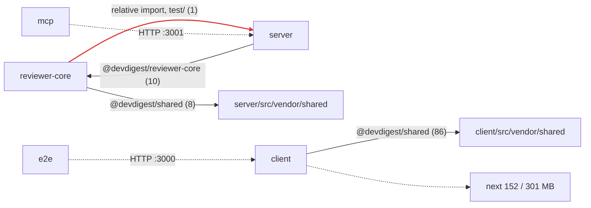

# Report template

The report has exactly five numbered sections, in this order. Prose is Ukrainian;
headings keep the English name in parentheses. Every number comes from the collector's
`--summary` output: copy it, never recompute it. The values below are an example.

---

````markdown
# Звіт про залежності — DevDigest

_Дата: YYYY-MM-DD · джерело: `scripts/collect.mjs --summary` · розміри — на диску, приблизні_

## 1. Охоплення (Scope)

| Пакет | Менеджер | node_modules | Частка | prod / dev / peer | Файлів проскановано |
|---|---|---|---|---|---|
| client | pnpm | 629.4 MB | 43.9% | 11 / 12 / 0 | 418 |
| server | pnpm | 275.4 MB | 19.2% | 25 / 8 / 0 | 204 |
| **Разом** | | **1433 MB** | | | |

Не встановлені: _немає_ (або: `<pkg>` — розміри не визначені).
Це не monorepo: внутрішні зв'язки йдуть через tsconfig-аліаси, а не `workspace:*`.

## 2. Граф залежностей (Dependency graph)



Легенда: суцільна — імпорт через аліас, червона — порушення межі пакета,
пунктир з підписом `HTTP` — runtime-зв'язок, пунктир до вузла з розміром —
найважча зовнішня залежність (власний / з транзитивними).

## 3. Розміри (Sizes)

Найважчі залежності (`summary.topByTransitiveSize`):

| # | Залежність | Пакет | Категорія | Тип | Власний | З транзитивними (пакетів) | Імпорти src / test / config |
|---|---|---|---|---|---|---|---|
| 1 | next | client | framework | prod | 152.3 MB | 300.7 MB (17) | 25 / 5 / 0 |

Коментар у 1–3 реченнях: що домінує і чи це очікувано.

## 4. Знахідки та пріоритети (Findings & Priorities)

### P0 — виправити до наступного merge
1. **<коротка назва>** — `<пакет>`, `<файл>`. Доказ: `<поле JSON = значення>`.
   Чому це проблема: … Рекомендація: …

### P1 — у поточній ітерації
### P2 — коли торкаєтесь файлу
### Info

_Рівень без знахідок: напишіть «немає» — не пропускайте його._

## 5. Підсумок і поради (Summary)

1. **[P0]** дія → файл → очікуваний результат · команда для користувача.
2. **[P1]** …

Що перевірити вручну: знахідки з позначкою «verify».
Нічого не змінено — усі дії лише рекомендовані.
````

---

## Rules for filling it

- Section 1 lists every package in `summary.packages`, including uninstalled ones.
- Section 2 is one `mermaid` block of type `flowchart LR`:
  - **Violation edges first**, so they are `linkStyle 0..n-1` and the red style
    never lands on the wrong edge; then aliases (solid), then `runtime-http` edges
    (dotted, labelled `HTTP :<port>`), then at most ~6 external dependencies.
  - Same-package aliases (`crossPackage: false`, e.g. `@/*`) are not drawn.
  - Quote every label; keep labels short.
- Section 3 copies the top 10 rows and shows both sizes.
- Section 4 uses the four tiers from `severity.md`; each finding names the package,
  the dependency or file, and the JSON evidence.
- Section 5 has 3–5 actions in priority order, each with a tier tag.
- No sections beyond these five.
