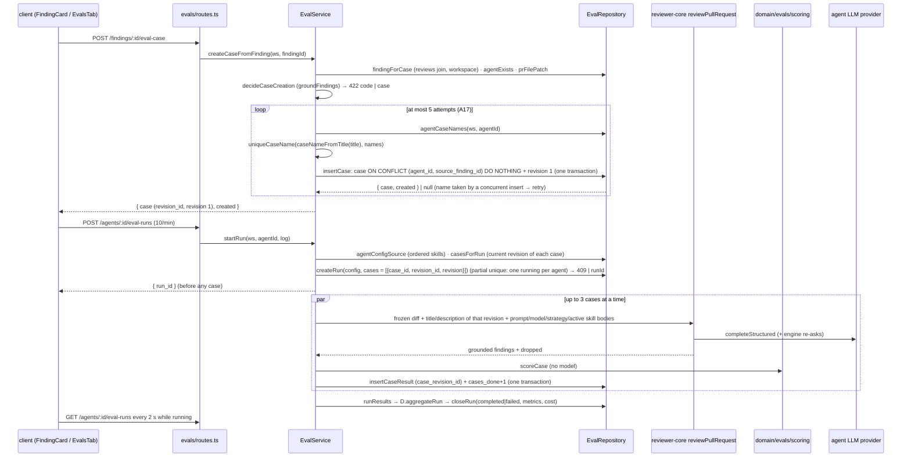

# Eval Pipeline (cases from findings, background runs, code-only scoring, agent Evals tab) — Implementation Plan

Date: 2026-10-11 (revised 2026-10-12) · Branch: feature/l06-eval-pipeline · Status: draft

## Goal
A reviewer turns an accepted or dismissed finding into a frozen eval case with one click. An agent author runs the agent over all of its cases with `POST /agents/:id/eval-runs`. The run records the full agent configuration and the revision of every case it covered, scores recall, precision and citation accuracy with fixed rules and no model call, and shows the case list, live progress and run history on a new Evals tab in the agent editor. `pnpm verify:l06` at the repository root proves all of this without a real model, and the package specs describe the shipped behaviour.

## Context
- Request: plan every AC (AC1–AC27) of SPEC-04-eval-pipeline (`specs/04-eval-pipeline-2026-10-11.md`, `Status: approved`, `## Open questions: none`; packages server + client; committed in cd46298). Coordinator addition (from the parallel SPEC-05 draft): the per-run configuration record keeps the ORDER of the linked skills (an ordered list with id and version), so that a later Promote can relink them in order. SPEC-05 features themselves are out of scope.
- Revision 2026-10-12 (user answers): A2 (errored row shows the reason), A10 (reason on the card plus the global toast) and A11 (`verify:l06` needs Docker and runs the whole server it-suite) are kept as written. R1, R3, R4 and R5 are not accepted and stay recommendations only. R2 is accepted: after implementation the package specs in `server/specs/` and `client/specs/` must be updated → T017 (last wave).
- Revision 2026-10-12, new storage requirement from SPEC-06 (`specs/06-case-editor-2026-10-12.md`, `Status: draft`, every OQ answered by the user on 2026-10-12): the user chose case revisions. SPEC-06 AC11: "WHEN a save changes a case's diff, PR meta, expectation type, file, lines or expected output, the system shall store it as a new revision of that case, keeping every earlier revision that a run covered, while a change of name alone creates no revision." AC12: "The system shall record in every eval run the revision of each case it covered, and count a case covered at different revisions by the two runs of a comparison or alert as one removed and one added …". AC13: "IF the latest completed run of the owner covered an earlier revision of a case, THEN the system shall show that case's row as 'edited since last run' …". NFR History: "Case revisions are append-only while a run refers to them; the per-case result of a past run never changes after an edit (AC11, AC12)." NFR Contract reach: "The case shape today has no expectation type, no expectation location, no origin (manual or from a finding) and no revision; those facts change in both `vendor/shared` copies together, whose eval sections are identical today." This plan therefore stores case content in an append-only revision table and makes every eval run record the revision of each case, so SPEC-06 can add editing without migrating past runs. Editing, "edited since last run", compare and alert stay SPEC-06 / SPEC-05 work.
- Revision 2026-10-12 (cross-spec review, user accepted R2 of the SPEC-06 plan `docs/plans/2026-10-12-case-editor.md`): case names are unique per set. AC5 now reads: "… and name the case after the finding title in lowercase kebab-case cut to 60 characters, ending in `-2`, `-3`, … within those 60 characters when that name is already taken in the agent's set, so that no two cases of one set share a name." Finding-made cases and their names are first created here, so the suffix rule and the DB guarantee live in this plan: the pure `uniqueCaseName` (T004), the full unique index `eval_cases_owner_name_uq (workspace_id, owner_kind, owner_id, name)` in migration 0017 (T002), the name-clash mapping in the repository (T006) and a bounded retry with the next suffix in the service (T009), proven against Postgres in T012. SPEC-06 AC8 (a save that takes another case's name is refused) relies on this index. The spec text that changed the same day (Non-goals now split the deferred work into SPEC-05 and SPEC-06, skill-owned cases belong to SPEC-06, a new provenance row for the suffix rule) was not quoted by this plan; no quote needed updating.
- INSIGHTS entries that apply (quoted in the tasks they constrain):
  - server/INSIGHTS.md: 2026-09-19 `findings` has no `workspace_id` (tenancy through the `reviews` join); 2026-09-19 cost `null` = unknown, `0` = free; 2026-09-26 an unmocked client in an it-test makes real calls (override every LLM client in `appWith`); 2026-09-29 a `running` row inserted before `buildApp()` is reaped; 2026-09-19 `waitForPrRuns` returns on timeout, so assert terminal status; 2026-09-30 no cross-module import, type-only included; 2026-09-22 a container facade for a service that takes `Container` makes a cycle; 2026-09-22 helpers↔repository row-type cycle in a new module; 2026-09-22 drop+add in one `db:generate` triggers an interactive rename prompt (now applied: two passes); 2026-09-21 the first `db.transaction()` (`setSkills`) is the shape to copy; 2026-09-21 half the modules skip the routes → service → repository anatomy; 2026-09-22 testcontainers flakiness (`TESTCONTAINERS_RYUK_DISABLED=true`); 2026-10-04 `maxRetries` is not "one HTTP request".
  - client/INSIGHTS.md: 2026-09-19 `formatUsd` (em dash for unknown); 2026-09-21 `Modal` is not portaled; 2026-09-26 `fireEvent` only (no user-event); 2026-09-21 `@messages/…` alias; 2026-09-21 `vi.mock` with alias paths; 2026-09-26 diff-viewer tests need `shell` + `prReview`; 2026-10-03 dot reporter; 2026-10-03 editor `body` scroll chain keeps `minHeight: 0`; 2026-09-19 `SeverityBadge compact` is colour-only.
  - INSIGHTS.md (root): 2026-09-19 diff only the contract files you touched; 2026-09-26 and 2026-10-03 `typecheck` never covers `test/` (scratch tsconfig, `rootDir: ".."` for server); 2026-09-21 `zod/v4` imports compile; 2026-09-21 server typecheck needs `reviewer-core/node_modules`; 2026-10-03 an unquoted vitest glob in a shell script shrinks the suite; 2026-09-21 pnpm 12 rejects `-s`; 2026-10-11 a relative path in a package `CLAUDE.md` "Read when" row is read from the repo root (T017).
  - reviewer-core/INSIGHTS.md: 2026-10-04 OpenRouter ignores the per-request `timeoutMs` (so the per-case bound is a server-side `withTimeout`).
- Spec invariants that apply: `server/specs/review-flow.md` invariant 1 (grounding is mandatory), 2 (null-vs-zero cost), 5 (orphans reaped at boot, one API instance per DB), 6 (one content-free `prompt.assembled` per prompt sent); `reviewer-core/specs/review-contract.md` › Grounding (whole-file kinds), › Structured output (re-asks up to `DEFAULT_REVIEW_MAX_RETRIES`), › Purity rules; `reviewer-core/CLAUDE.md` (optional slots omit-when-empty, `INJECTION_GUARD` is the only injection defence); SPEC-06 NFR History and Contract reach (above); SPEC-06 AC8 (a name equal to another case's name in the owner's set is refused — relies on the unique index here); `client/specs/pages.md` URL-param rules (unrecognised value degrades, T013/T017).
- Closest existing features followed: the brief and intent modules (`server/src/modules/{brief,intent}/` with narrow `Deps`, a container facade built from deps, `test/brief.it.test.ts` with `ThrowingLLMProvider` overrides); the review executor for engine inputs and skill blocks (`server/src/modules/reviews/run-executor.ts`); the agent editor Context tab (`client/src/app/(shell)/agents/[id]/_components/AgentEditor/_components/ContextTab/`); `client/src/lib/hooks/reviews.ts` for mutation and invalidation shape; `server/specs/intent.md` / `server/specs/blast-radius.md` for the package-spec shape (T017).

## Requirements review
- **Already there:** `eval_cases` / `eval_runs` tables (empty, unread by any code); the `eval` and `agents.editor.tabs.evals` message keys; `groundFindings` (reviewer-core), which decides AC7's "lines intersect a hunk unless whole-file kind" exactly as a run grounds its findings; `reviewPullRequest` returns both the grounded findings and `dropped`, so citation accuracy needs no engine change; `pr_files.patch` per file; `withTimeout` in `platform/resilience.ts`; route-level `rateLimit` config; `InvalidModelOutputError` and engine re-asks; `formatUsd`; `useConfirm`.
- **Missing in code (planned):**
  - No notion of a run over many cases, no agent version, no config snapshot, no expectation type, no provenance, no case-per-finding uniqueness → schema change (T002) and contracts (T001).
  - No case revision (SPEC-06 AC11–AC12, NFR History): case content sits on `eval_cases` and a run could only point at the case, so a later edit would rewrite what past runs covered → new append-only `eval_case_revisions` table holding the content; each case from a finding gets revision 1 in the same transaction as the case; the run stores its covered `(case_id, revision_id, revision)` list, and each per-case result stores `case_revision_id` (T001, T002, T006, T009). The four legacy content columns of `eval_cases` are dropped in a second `db:generate` pass (T002).
  - `eval_runs.case_id` cascades on case delete, which would drop earlier per-case results (AC9). It becomes nullable with `ON DELETE SET NULL`, the new `case_revision_id` likewise, and each run's metrics and pass count are stored on the run row at close (T002, T009). The run's case list is jsonb and is never nulled, so a past run still names the deleted case and revision.
  - `eval_cases.owner_id` has no FK, so deleting an agent would leave its cases (AC10) → new `eval_cases.agent_id` FK with cascade (cases → revisions cascade too), and the run table's `agent_id` FK with cascade (T002).
  - Two parallel starts (EC9) could both pass a "no running run" read → partial unique index on the run table (`agent_id` WHERE `status = 'running'`); the insert conflict is the refusal (T002, T006).
  - Double-click / two tabs on "Turn into eval case" (EC2) → unique index on `(agent_id, source_finding_id)` plus `ON CONFLICT DO NOTHING` (T002, T006).
  - Two findings whose titles give the same kebab-case name would yield two cases with one name in a set (AC5, accepted 2026-10-12) → pure suffix rule `uniqueCaseName` (T004), a full unique index `eval_cases_owner_name_uq (workspace_id, owner_kind, owner_id, name)` as the guarantee (T002), the repository mapping a violation of that index to "name taken" (T006), and the service re-reading the set's names and retrying with the next suffix (T009). The table is empty when the index is created, so no dedupe step is needed.
  - The finding card cannot know a case exists (AC6) → optional `eval_case_id` on `FindingRecord`, filled by `GET /pulls/:id/reviews` (T001, T005).
  - Modules may not import `adapters/git/diff-parser.ts` (`no-concrete-adapters-in-modules`) → the parser is injected as `EvalDeps.parseDiff` from the container (T012).
  - Eval runs left `running` by a dead process would block new runs forever (EC20) → `reapStaleRuns` on boot in `app.ts`, which closes them by the AC17 rule instead of marking them failed blindly (T009, T012).
  - No root `package.json` → new root `package.json` with `verify:l06` delegating to `scripts/verify-l06.sh` (T015). `server/package.json` is skip-worktree (TESTING.md) and is not touched.
  - No package spec describes evals, and `client/specs/pages.md` does not list `?tab=evals` → T017 (accepted R2), after all code waves.
- **Unclear, settled as Assumptions below:** what "got M" counts; how an errored case is shown (A2, confirmed by the user 2026-10-12); the agent version that produced a finding; the run's duration when closed on boot; the eval task line; the per-case timeout; how the card shows a refusal reason (A10, confirmed); Docker for `verify:l06` (A11, confirmed); the ordered skill snapshot (coordinator addition); the minimal revision shape for SPEC-06 (A15); how many times a name clash is retried (A17).
- **Contradictory:** none. The onion skill (§6) prefers a service-owned `UnitOfWork`; the codebase's only transaction (`AgentsRepository.setSkills`) is repository-owned and holds a single use-case write. The two multi-statement writes here (case + its first revision; case result + progress counter) follow that existing shape (T006); no external call happens inside either. SPEC-06 is `draft`, but no OQ is open; only its storage requirement is planned here, not its features.
- **Spec coverage (every AC → tasks):** AC1 T004·T008·T009·T011·T012·T015 · AC2 T004·T009·T012·T015 · AC3 T004·T008·T009·T012 · AC4 T002·T004·T006·T009·T012 · AC5 T002·T004·T006·T009·T012 · AC6 T001·T002·T005·T006·T008·T012·T015 · AC7 T004·T008·T009·T012 · AC8 T006·T010·T013 · AC9 T002·T006·T014 · AC10 T002·T012 · AC11 T009·T010·T012·T014 · AC12 T002·T006·T009·T010·T012·T014 · AC13 T009·T014 · AC14 T001·T002·T004·T006·T009·T014 · AC15 T006·T007·T010·T014 · AC16 T003·T009·T014 · AC17 T003·T009·T012·T014 · AC18 T003·T015 · AC19 T003·T010 · AC20 T003·T010 · AC21 T003·T010 · AC22 T003 · AC23 T010 · AC24 T010 · AC25 T012 · AC26 T015 · AC27 T015. SPEC-06 storage requirement (AC11–AC12 shape, NFR History, Contract reach) → T001·T002·T006·T009·T012·T014. Accepted R2 (package specs) → T017. Accepted R2 of the SPEC-06 plan (unique names, the AC5 suffix) → T002·T004·T006·T009·T012·T017.

## Assumptions
- A1 — "expected N finding(s), got M" (AC8): N is 1 for `must_find` and 0 for `must_not_flag`; M is the number of GROUNDED findings of that case that match the expectation (`findings_matching`). A `must_not_flag` case with M = 0 passes.
- A2 — An errored case (AC16) shows "errored" with its stored reason (at most 200 characters, the error message only, never prompt or diff text) instead of "expected N, got M", because no M exists. Confirmed by the user 2026-10-12.
- A3 — The "agent version that produced the finding" (AC5) is read from the source run's trace (`run_traces.trace.config.version`, through `reviews.run_id`). It is `null` when there is no run or trace (seeded or older reviews); the case is still created.
- A4 — The frozen diff (AC4) is stored as a self-contained unified diff: `diff --git a/
 b/
`, `--- a/
`, `+++ b/
`, then the stored `pr_files.patch`, the same shape `diffFromPrFiles` builds. The 100,000-character cap (AC7) applies to the stored patch. The description is cut to 4,000 characters; a missing body is stored as `""`. The frozen input lives on the case's revision 1.
- A5 — A case is created only when `pr_files` has a row whose `path` equals the finding's `file` exactly and whose `patch` is non-null. Anything else is "no stored diff for the file" (`eval_case_no_diff`).
- A6 — The eval task line is a module-local copy of the review task rules ("report only defensible findings citing file and line …, never withhold a security or correctness finding …") built from the frozen PR title only. No PR number or author is sent, because AC13 limits input to the frozen fields. Drift between the two task lines is accepted (R3 not accepted).
- A7 — Each case is bounded by `withTimeout(EVAL_CASE_TIMEOUT_MS = 180_000)` around its engine call. A timeout makes the case errored (AC16); a model call already in flight is not cancelled (`server/specs/review-flow.md` invariant 4).
- A8 — A run closed on boot (AC17) gets `finished_at` = the time of its last stored case result, or `started_at` when there is none, and `duration_ms` = `finished_at − started_at`. Downtime is not counted.
- A9 — The run snapshot (AC14 plus the coordinator addition) lists EVERY linked skill in `agent_skills.order` ascending, as `{ id, name, description, version, order, link_enabled, skill_enabled, body }`. `body` is stored only when both flags are on (those are the skills the run sends, AC13), and `null` otherwise. Array order is the link order, and `order` repeats it explicitly.
- A10 — A refused creation (AC7, AC3) answers 422 with a closed `EvalErrorCode`. The card shows the i18n reason for that code inline. The existing global mutation toast also shows the server message (two messages; client error-UX taxonomy, unchanged). An already existing case answers 200 with `created: false` (AC6, EC2), not an error. Confirmed by the user 2026-10-12.
- A11 — `verify:l06` needs Docker and runs the whole server integration suite. The script fails with a clear message when `docker info` fails. It sets `EVAL_IT_REQUIRED=1`, which makes the eval-pipeline test fail instead of self-skipping, so AC26's "exits 0 only when … passes" holds. Confirmed by the user 2026-10-12.
- A12 — The prompt record for an eval case uses component `reviewer` with `correlation: { run_id: <eval run id>, agent: <agent name> }`. No prompt-log change is needed (R4 not accepted).
- A13 — Metric deltas (AC23) are `round(latest × 100) − round(previous × 100)` points over completed runs only. A delta is not shown when either value is "—". Failed runs appear in the history (AC24) but never serve as "latest" or "previous" for the cards.
- A14 — The tab polls `GET /agents/:id/eval-runs` every 2 s while any listed run is `running` (AC15), and refetches the case list on the same interval while running, so the per-case results appear once the run closes.
- A15 — Revision shape (SPEC-06 requirement): revision numbers start at 1 per case; a case from a finding has exactly one revision in SPEC-04 (its content is never edited), and no SPEC-04 code updates or deletes a revision row. A case's "current" revision is its highest `revision`. A run starts over the current revision of each case and records it; the case list's `latest_result` is still keyed by case (with one revision per case it is always the current one), and carries `case_revision_id` so SPEC-06 AC13 can detect "edited since last run" without a contract change. Notes and name stay on the case (SPEC-06 AC11: a name change makes no revision).
- A16 — The package spec update (T017) is a new `server/specs/evals.md` in the shape of the sibling specs (endpoints table, numbered invariants `EV1…`, data model), linked from `server/specs/README.md` and from a `server/CLAUDE.md` › *Read when* row; `server/specs/review-flow.md` only gains the `eval_case_id` note on `GET /pulls/:id/reviews`; `client/specs/pages.md` gains `evals` in the agent editor `?tab=` row. The root `specs/` (SPEC-04/05/06) is not edited.
- A17 — Name choice under concurrency (AC5): the service reads the names the agent's set holds, takes `uniqueCaseName(caseNameFromTitle(title), names)` and inserts. When a concurrent insert took the same name first, the insert fails on `eval_cases_owner_name_uq`, its transaction rolls back (nothing written), and the service re-reads the names and tries again, at most `MAX_CASE_NAME_ATTEMPTS = 5` times in total; after that the request fails as a server error (500, no case written). The idempotency rule wins over the name rule: a repeat for a finding that already has a case returns that case (`created: false`) whatever name was computed. The suffix counts from `-2`; a base name that already ends in digits (e.g. `retry-2`) is treated as any other base.

## Recommendations
- R1 — Add one e2e flow (agent editor → Evals tab shows its empty state and the disabled "Run all evals" with "no eval cases") — why: TESTING.md keeps a few flows over the main journeys, and this tab is new · cost: one `e2e/specs/*.flow.json`, no model. Not accepted by the user (2026-10-12).
- R2 — After shipping, write `server/specs/evals.md` (scoring rules, run lifecycle, reaping, case revisions) and add `?tab=evals` to `client/specs/pages.md` › agent editor — why: lasting behaviour belongs in package specs · cost: a doc-writer task. Accepted by the user (2026-10-12) → T017.
- R3 — Move the shared review task rule text to `server/src/domain/reviews/task-line.ts` and use it from both `reviews/helpers.ts` and `evals/helpers.ts` — why: eval scores stay comparable with real reviews only while both prompts say the same thing · cost: touches the reviews module (one more file in T005). Not accepted by the user (2026-10-12).
- R4 — Add `eval_run_id` / `case_id` to the `prompt.assembled` correlation — why: makes one eval case's prompt traceable in logs · cost: `platform/prompt-log.ts` + its test. Not accepted by the user (2026-10-12).
- R5 — A cancel action for an in-progress eval run — why: today only finishing or a restart frees the agent for a new run · cost: a route, a cancellation flag checked before each case, UI; not in the spec. Not accepted by the user (2026-10-12).

## Scope
- In: every AC (AC1–AC27): schema change via two `db:generate` passes; contracts in both `eval-ci.ts` copies and both `review-api.ts` copies; pure scoring in `server/src/domain/evals/`; a new `evals` server module (routes → service → repository, container facade, boot reaper); `eval_case_id` on findings returned by `GET /pulls/:id/reviews`; "Turn into eval case" on the shared finding card (findings panel and Files changed); the agent editor Evals tab (metrics, case list with delete, Run all evals with progress, run history); the root `pnpm verify:l06` with a scripted-model integration test; docs (server README API map, server architecture data layer and reaping, client cache-key table). From SPEC-06: case content stored as append-only revisions, and every eval run recording the revision of each case it covered (run case list + per-case result). From accepted R2: package specs `server/specs/evals.md` (new), `server/specs/README.md`, `server/specs/review-flow.md`, `client/specs/pages.md`, plus the `server/CLAUDE.md` *Read when* row (T017). From the SPEC-06 plan's R2 (accepted 2026-10-12): unique case names per set — the `-2`, `-3`, … suffix rule (AC5) and the unique index `eval_cases_owner_name_uq` with a retry on a concurrent clash.
- Out (SPEC-05, SPEC-06 or not asked): the Eval Dashboard page, compare and Promote, trend chart, alert banner, per-agent dashboard, "Run all agents", the case editor and every SPEC-06 feature (editing a case, creating a revision on edit, "edited since last run", the added/removed counting in compare and alert, single-case run, Run on save, skills Evals tab, skill-owned cases, the editor's name-taken refusal), replaying a past version, moving cases between agents, seeding demo cases, LLM judge, `evals/` package changes, PreToolUse hook, mutation testing, edits to the root `specs/` files, R1, R3–R5. Choices made so they do not block SPEC-05 / SPEC-06: the full ordered config snapshot per run, the per-run case + revision list, per-case result rows that survive case deletion (with case name, expectation snapshot and revision id), `GET /eval-runs/:id` returning per-case results, and a name index keyed by `(owner_kind, owner_id)` that also covers SPEC-06's skill-owned cases.

## Design

Naming: the spec's "eval run" (one run over all cases of a set) is the new table `eval_suite_runs`. The existing `eval_runs` table becomes that run's per-case results (one row per case). The API calls the suite run an "eval run" (`POST /agents/:id/eval-runs`, `GET /eval-runs/:id`). `EvalRunRecord.eval_run_id` references `eval_suite_runs.id`. A case's content (frozen diff, file list, PR meta, expectation type, expectation) lives in `eval_case_revisions`; `eval_cases` keeps the identity (owner, name, notes, source finding, provenance).

Case revisions (SPEC-06 AC11–AC12, NFR History) — why this shape: normalising the content into its own append-only table (postgresql-table-design §Core Rules, normalise first) means a SPEC-06 edit is one INSERT of revision N+1, and nothing a past run points at is ever rewritten. There is no `current_revision_id` pointer on `eval_cases` (it would make a circular FK); "current" is the highest `revision`, guarded by `UNIQUE (case_id, revision)`. A run records its covered cases twice on purpose: `eval_suite_runs.cases` (jsonb list of `{ case_id, revision_id, revision }`, never nulled, so compare/alert in SPEC-05/06 can diff two runs even after a case is deleted) and `eval_runs.case_revision_id` (FK, SET NULL on case deletion, like `case_id`).

Unique case names (AC5, accepted 2026-10-12) — why this shape: the rule "no two cases of one set share a name" is a data invariant, so the database holds it (postgresql-table-design §Constraints, UNIQUE) and the code only picks a free name. The pure `uniqueCaseName` decides the suffix; the service reads the set's names, picks, inserts, and on a clash re-reads and retries (A17). The retry is in the service, not in one transaction, because a failed statement aborts the Postgres transaction it runs in: each attempt is its own `insertCase` transaction. The index key is `(workspace_id, owner_kind, owner_id, name)` — the set is identified by owner, so SPEC-06's skill-owned cases are covered by the same index without another migration.

Rings (onion-architecture §2, §4):
- **Contracts (core):** `server/src/vendor/shared/contracts/eval-ci.ts` and `review-api.ts`, each copied byte-identically into `client/src/vendor/shared/contracts/` for the edited sections (T001).
- **Domain (pure):** `server/src/domain/evals/scoring.ts` (T003): path normalisation, inclusive range overlap, per-case score, pooled run aggregate, sum of known costs. It lives in `src/domain` so `domain-is-pure` proves by `arch:check` that scoring cannot reach a model (AC18). `server/src/modules/evals/{constants,helpers,types}.ts` (T001, T004): case naming and the unique-name suffix, frozen-diff building, the creation decision (through `groundFindings`), run-config building in skill order, skill blocks, the eval task line, a concurrency mapper.
- **Application:** `server/src/modules/evals/service.ts` (T009): `EvalService` with narrow `EvalDeps` (repo, `llm`, `parseDiff`, tokenizer, prompt-log mode, clock). It never takes `Container`. Background execution is fire-and-forget after the run row exists. It owns the name-clash retry (A17).
- **Infrastructure:** `server/src/modules/evals/repository.ts` (T006): every read is workspace-scoped; findings are reached through the `reviews` join; one transaction for a case plus its revision 1, one for a case result plus the progress counter; the unique-violation mappings for the one-running-run index and the case-name index; no method updates or deletes a revision.
- **Presentation:** `server/src/modules/evals/routes.ts` (T012): zod params, `getContext`, one service call, 10/min on the start route.
- **Composition root:** `platform/container.ts` (`evals` getter injecting `parseUnifiedDiff`), `modules/index.ts`, `app.ts` (boot reaper) (T012).
- **Reviews module:** `eval_case_id` on its finding DTOs (T005). The reviews repository reads `eval_cases` by `source_finding_id`; no module import.
- **Client:** data hooks `client/src/lib/hooks/evals.ts` + `keys.ts` (T007); the action inside the shared `client/src/components/finding-card/` (T008), wired by its two consumers (T011); the `EvalsTab` feature folder under the agent editor (T010); tab registration (T013). The client reads the new revision fields only through the contract; no UI shows them in SPEC-04.
- **Package specs (after code):** `server/specs/evals.md` and the `client/specs/pages.md` row are written from the merged code in the last wave (T017).

### Contracts
Both `server/src/vendor/shared/contracts/eval-ci.ts` and `client/src/vendor/shared/contracts/eval-ci.ts` (read 2026-10-12: the eval section is byte-identical today; the files keep their pre-existing differences outside it, and the import line gains `ReviewStrategy`, `Severity`, `FindingCategory`, and `Provider` on the client). All Zod 3:
- `EvalExpectationType = enum['must_find','must_not_flag']`
- `EvalExpectation = { file: string.min(1); start_line: int > 0; end_line: int > 0 }`
- `EvalCaseInputMeta = { pr_title: string; pr_description: string.max(4000) }`
- `EvalDecision = enum['accepted','dismissed']`
- `EvalCaseProvenance = { finding_id; review_id; pr_id; pr_number: int; repo_id; repo_full_name; decision: EvalDecision; decided_at: string; agent_version: int | null; severity: Severity; category: FindingCategory; title: string }`
- `AgentEvalCase = { id; agent_id; name; revision_id: string; revision: int > 0; expectation_type: EvalExpectationType; expectation: EvalExpectation; input_file: string; input_meta: EvalCaseInputMeta; provenance: EvalCaseProvenance; created_at: string }` — `revision_id` / `revision` and the content fields come from the case's current (highest) revision.
- `EvalCaseResultStatus = enum['passed','failed','errored']`
- `EvalCaseLatestResult = { eval_run_id; case_revision_id: string | null; status: EvalCaseResultStatus; expected: int; got: int | null; error: string | null }`
- `AgentEvalCaseListItem = AgentEvalCase & { latest_result: EvalCaseLatestResult | null }` (null = "never run")
- `EvalRunSkill = { id; name; description; version: int; order: int; link_enabled: boolean; skill_enabled: boolean; body: string | null }`
- `EvalRunConfig = { agent_version: int; provider: Provider; model: string; system_prompt: string; strategy: ReviewStrategy; skills: EvalRunSkill[] }` (skills in link order, A9)
- `EvalRunCaseRef = { case_id: string; revision_id: string; revision: int > 0 }` (new; one entry per case the run covered)
- `EvalRunStatus = enum['running','completed','failed']`
- `AgentEvalRunSummary = { id; agent_id; status: EvalRunStatus; started_at; finished_at: string | null; duration_ms: int | null; agent_version: int; cases_total: int; cases_done: int; cases_scored: int; cases_passed: int; recall: number[0..1] | null; precision: … | null; citation_accuracy: … | null; cost_usd: number | null; error: string | null }`
- `EvalRunRecord` (existing, extended): `case_id` becomes `string | null`; adds `eval_run_id; case_revision_id: string | null; status: EvalCaseResultStatus; error: string | null; expectation_type; expectation: EvalExpectation; findings_returned / findings_grounded / findings_matching: int | null`. `case_name` stays.
- `AgentEvalRunDetail = AgentEvalRunSummary & { config: EvalRunConfig; cases: EvalRunCaseRef[]; results: EvalRunRecord[] }` (replaces the earlier draft's `case_ids: string[]`)
- `StartEvalRunResponse = { run_id: string }` · `CreateEvalCaseResponse = { case: AgentEvalCase; created: boolean }`
- `EvalErrorCode = enum['eval_case_undecided','eval_case_no_agent','eval_case_agent_missing','eval_case_no_diff','eval_case_diff_too_large','eval_case_lines_outside_diff','no_eval_cases','eval_run_in_progress']`
- `review-api.ts` (both copies, byte-identical today): `FindingRecord` gains `eval_case_id: z.string().nullish()`.

`knowledge.ts` (`EvalRun`, `EvalCase`), `EvalCaseInput` and `productionize.ts` are unchanged (no code maps them to the DB columns). `EvalDashboard` keeps referencing the extended `EvalRunRecord`. mcp does not declare `FindingRecord` (checked). The unique-name rule adds no contract field and no error code (a lost race past the retry bound is a 500, A17).

API: `POST /findings/:id/eval-case` → 201 or 200 `CreateEvalCaseResponse` · `GET /agents/:id/eval-cases` → `AgentEvalCaseListItem[]` · `DELETE /eval-cases/:id` → `{ ok: true }` · `POST /agents/:id/eval-runs` → 202 `StartEvalRunResponse` · `GET /agents/:id/eval-runs` → `AgentEvalRunSummary[]` (newest first) · `GET /eval-runs/:id` → `AgentEvalRunDetail`. Refusals are 422 (AC3, AC7, `no_eval_cases`) and 409 (`eval_run_in_progress`); outside the workspace the answer is 404 (AC25).

### Database
Two `pnpm run db:generate` passes, per the server INSIGHTS rename-prompt rule (first ADD everything, then DROP the old columns alone).

Pass 1 → migration `0017_*` (additions and one FK change only; the legacy `eval_cases` content columns are still in place):
- `eval_cases` adds `agent_id uuid` (FK `agents.id` ON DELETE CASCADE, nullable: future skill-owned cases), `source_finding_id uuid` (no FK: the case outlives the finding, EC6), `provenance jsonb` (`$type<EvalCaseProvenance>`), `created_at timestamptz NOT NULL DEFAULT now()`. `owner_kind='agent'`, `owner_id=agent_id`, `name`, `notes` stay. Indexes: `eval_cases_ws_agent_idx (workspace_id, agent_id)`; `eval_cases_agent_finding_uq UNIQUE (agent_id, source_finding_id)` (NULLs distinct on purpose: manual cases have no source); `eval_cases_owner_name_uq UNIQUE (workspace_id, owner_kind, owner_id, name)` (AC5, SPEC-06 AC8). The name index is FULL, not partial: all four columns are `NOT NULL` and the rule holds for every row of every set (agent today, skill in SPEC-06), so there is no subset to exclude, and only a full unique index can serve as an `ON CONFLICT` arbiter should a later plan need one (postgresql-table-design §Upsert-Friendly Design). It goes into pass 1 because it is an addition on existing columns; the table is empty, so creating it needs no dedupe.
- New `eval_case_revisions` (append-only): `id uuid pk`, `workspace_id` FK cascade NOT NULL, `case_id uuid NOT NULL` FK `eval_cases` ON DELETE CASCADE, `revision int NOT NULL`, `input_diff text NOT NULL`, `input_files jsonb NOT NULL` (`$type<string[]>`, `[path]`), `input_meta jsonb NOT NULL` (`$type<EvalCaseInputMeta>`), `expectation_type text NOT NULL` (enum hint `must_find|must_not_flag`), `expectation jsonb NOT NULL` (`$type<EvalExpectation>`), `created_at timestamptz NOT NULL DEFAULT now()`. Indexes: `eval_case_revisions_case_rev_uq UNIQUE (case_id, revision)` (also serves the `case_id` FK), `eval_case_revisions_ws_idx (workspace_id)`.
- New `eval_suite_runs`: `id uuid pk`, `workspace_id` FK cascade NOT NULL, `agent_id` FK `agents` cascade NOT NULL, `status text NOT NULL DEFAULT 'running'`, `started_at timestamptz NOT NULL DEFAULT now()`, `finished_at timestamptz`, `duration_ms int`, `agent_version int NOT NULL`, `config jsonb NOT NULL` (`$type<EvalRunConfig>`), `cases jsonb NOT NULL` (`$type<EvalRunCaseRef[]>`), `cases_total int NOT NULL`, `cases_done/cases_scored/cases_passed int NOT NULL DEFAULT 0`, `recall/precision/citation_accuracy double precision`, `cost_usd double precision` (null = unknown), `error text`. Indexes: `eval_suite_runs_agent_started_idx (agent_id, started_at)`, partial `eval_suite_runs_one_running_uq UNIQUE (agent_id) WHERE status = 'running'`, `eval_suite_runs_ws_idx (workspace_id)`.
- `eval_runs` (per-case results) adds `workspace_id` FK cascade NOT NULL, `suite_run_id` FK `eval_suite_runs` cascade NOT NULL, `case_revision_id uuid` (FK `eval_case_revisions` ON DELETE SET NULL, nullable), `case_name text NOT NULL`, `status text NOT NULL`, `error text`, `expectation_type text NOT NULL`, `expectation jsonb NOT NULL`, `findings_returned/findings_grounded/findings_matching int`. `case_id` becomes nullable with `ON DELETE SET NULL` (AC9). Indexes: `eval_runs_suite_idx (suite_run_id)`, `eval_runs_case_idx (case_id)`, `eval_runs_case_revision_idx (case_revision_id)`.

Pass 2 → migration `0018_*` (drops only, nothing else in the pass): `eval_cases` drops `input_diff`, `input_files`, `input_meta`, `expected_output` (their content now lives in `eval_case_revisions`).

- The NOT NULL additions without defaults, the unique name index and the drops are safe because no code has ever written these tables (`grep -rln -e evalCases -e evalRuns -e eval_cases server/src client/src` → schema and migrations only, re-checked 2026-10-12).
- AC10 by FK cascade: agent → cases → revisions; agent → suite runs → per-case rows. AC9: case delete → revisions gone, results keep `case_id` / `case_revision_id` null, the run's `cases` jsonb unchanged. AC5: a deleted case frees its name for the next case of the set.

## Global constraints
- Zod 3 only (`import { z } from 'zod'`; never `zod/v4`, `zod/mini`) · no do-not-touch path · migrations only from `pnpm run db:generate` (two passes) · tests per TESTING.md (one happy path + the edge that matters; LLM, GitHub and git mocked; no real model call anywhere) · no cross-module import in `server/src/modules/**`, type-only included (`pnpm run arch:check`) · every eval read and write scoped by `workspace_id`; findings only through `reviews.workspace_id` · case revisions are append-only: no code updates or deletes an `eval_case_revisions` row (only the FK cascade removes them) · case names are unique per set (`eval_cases_owner_name_uq`); code picks a free name with `uniqueCaseName` and never relies on the index alone · cost is `null` when unknown, never `0`; the UI renders it with `formatUsd` · no diff, finding text, prompt or skill body in any log line or error message · scoring never receives an LLM provider · every label comes from the `eval` or `prReview` namespace · model and PR text rendered as plain React text only · `server/package.json` is not edited · package specs are edited only by T017, and the root `specs/` not at all.

## Tasks

### Wave 0 — foundation (sequential)

#### T001 — Eval contracts (both copies, with case revisions), `eval_case_id` on findings, eval module internal types
- Area: backend
- Agent: implementer
- Depends on: —
- Files (exclusive):
  - `server/src/vendor/shared/contracts/eval-ci.ts` (modified)
  - `client/src/vendor/shared/contracts/eval-ci.ts` (modified)
  - `server/src/vendor/shared/contracts/review-api.ts` (modified)
  - `client/src/vendor/shared/contracts/review-api.ts` (modified)
  - `server/src/modules/evals/types.ts` (new)
  - `server/test/contracts.test.ts` (modified)
- Skills: zod → schema-use-enums, schema-use-primitives-correctly, object-optional-vs-nullable, type-use-z-infer, type-export-schemas-and-types, schema-use-unknown-not-any; onion-architecture → §2, §4; typescript-expert → Code Review Checklist
- Rules (applied by the agent instead of loading the skills; 5–15 lines):
  - Closed vocabularies (`EvalExpectationType`, `EvalDecision`, `EvalCaseResultStatus`, `EvalRunStatus`, `EvalErrorCode`) are `z.enum([...])`, never free strings — zod §schema-use-enums
  - Fields whose key is always present but may be empty are `.nullable()` (`agent_version`, `finished_at`, `duration_ms`, metrics, `cost_usd`, `error`, `latest_result`, `body`, `case_revision_id`); only `FindingRecord.eval_case_id` is `.nullish()`, because accept/dismiss responses omit it — zod §object-optional-vs-nullable
  - `revision` fields are `z.number().int().positive()`; `revision_id` / `case_id` in `EvalRunCaseRef` are required strings (a run never covers a case without a revision) — zod §schema-use-primitives-correctly
  - Every schema is exported with `export type X = z.infer<typeof X>`; no hand-written duplicate of a schema's shape — zod §type-export-schemas-and-types, §type-use-z-infer
  - `actual_output` stays `z.unknown()`, never `z.any()` — zod §schema-use-unknown-not-any
  - The canonical copy is `server/src/vendor/shared`; the eval section of `eval-ci.ts` and the whole `review-api.ts` are made byte-identical in the client copy in the same task — onion-architecture §4 (schema the client also uses)
  - `modules/evals/types.ts` holds plain TS interfaces importing only `@devdigest/shared`, so helpers, repository and service import it without a cycle — onion-architecture §2
  - No `any`; exported interfaces declare every field type — typescript-expert §Code Review Checklist (Type Safety)
- Interface (only when another task calls what this task exports, or this task calls another's export):
  - Every schema and type listed in Design › Contracts (including `EvalRunCaseRef`), from `@devdigest/shared` — exported here
  - `interface FindingForCase { finding: { id: string; file: string; startLine: number; endLine: number; kind: string; severity: string; category: string; title: string; acceptedAt: Date | null; dismissedAt: Date | null }; review: { id: string; agentId: string | null; runId: string | null }; pull: { id: string; number: number; title: string; body: string | null }; repo: { id: string; fullName: string }; agentVersion: number | null }` — exported here
  - `interface NewEvalCase { workspaceId: string; agentId: string; sourceFindingId: string; name: string; expectationType: EvalExpectationType; expectation: EvalExpectation; inputDiff: string; inputFile: string; inputMeta: EvalCaseInputMeta; provenance: EvalCaseProvenance }` — exported here (the repository writes the identity fields to `eval_cases` and the content fields to revision 1)
  - `interface CaseForRun { id: string; revisionId: string; revision: number; name: string; expectationType: EvalExpectationType; expectation: EvalExpectation; inputDiff: string; inputMeta: EvalCaseInputMeta }` — exported here
  - `interface AgentConfigSource { agent: { id: string; name: string; version: number; provider: Provider; model: string; systemPrompt: string; strategy: ReviewStrategy }; skills: { id: string; name: string; description: string; body: string; version: number; order: number; linkEnabled: boolean; skillEnabled: boolean }[] }` — exported here
  - `interface NewEvalRun { workspaceId: string; agentId: string; agentVersion: number; config: EvalRunConfig; cases: EvalRunCaseRef[] }` — exported here
  - `interface CaseResultInsert { workspaceId: string; evalRunId: string; caseId: string; caseRevisionId: string; caseName: string; expectationType: EvalExpectationType; expectation: EvalExpectation; status: EvalCaseResultStatus; error: string | null; findingsReturned: number | null; findingsGrounded: number | null; findingsMatching: number | null; recall: number | null; precision: number | null; citationAccuracy: number | null; durationMs: number; costUsd: number | null; actualOutput: unknown }` — exported here
  - `interface RunClose { status: 'completed' | 'failed'; finishedAt: Date; durationMs: number | null; casesScored: number; casesPassed: number; recall: number | null; precision: number | null; citationAccuracy: number | null; costUsd: number | null; error: string | null }` — exported here
  - `interface CaseCreationInput { finding: FindingForCase['finding']; reviewAgentId: string | null; agentExists: boolean; patch: string | null; diff: UnifiedDiff | null }` — exported here
  - `type CaseCreationDecision = { ok: true; expectationType: EvalExpectationType; decidedAt: Date } | { ok: false; code: EvalErrorCode }` — exported here
  - `interface EvalLogger { info(obj: unknown, msg?: string): void; warn(obj: unknown, msg?: string): void; error(obj: unknown, msg?: string): void }` — exported here
- Steps:
  1. Test first in `server/test/contracts.test.ts`: a full `AgentEvalRunDetail` fixture (two skills in order 0 and 1, the second with `body: null`; `cases` with two `EvalRunCaseRef` entries; one `errored` result with `case_id: null` and `case_revision_id: null`) parses; an `AgentEvalCase` with `revision: 1` and a `revision_id` parses; `EvalExpectation` with `start_line: 0`, an `EvalRunCaseRef` with `revision: 0` and an unknown `EvalErrorCode` are rejected; `FindingRecord` parses with and without `eval_case_id`; the existing `EvalRun` case still passes. Run it red.
  2. Edit the server `eval-ci.ts` (eval section) and `review-api.ts` per Design › Contracts.
  3. Copy the eval section and `review-api.ts` byte-for-byte to the client copies; adjust only the client import line.
  4. Write `server/src/modules/evals/types.ts`.
- Acceptance criteria:
  - The contracts carry what AC6 (`eval_case_id`), AC8 (latest result), AC14 (ordered config snapshot, covered cases with their revisions, agent version), AC15 (`cases_done` / `cases_total`), AC16 (errored + reason), AC17 (status, duration, passed, cost) and AC23/AC24 need.
  - SPEC-06 storage requirement: a case exposes `revision_id` and `revision`; a run detail exposes `cases: EvalRunCaseRef[]`; every per-case result and latest result exposes `case_revision_id` — in both copies.
  - `diff -q server/src/vendor/shared/contracts/review-api.ts client/src/vendor/shared/contracts/review-api.ts` prints nothing; `diff` of the two `eval-ci.ts` files shows differences only outside the eval section and on the import line.
- Verify (one line per touched package; add task-specific checks below it):
  - `scripts/verify-task.sh server server/src/vendor/shared/contracts/eval-ci.ts server/src/vendor/shared/contracts/review-api.ts server/src/modules/evals/types.ts server/test/contracts.test.ts`
  - `scripts/verify-task.sh client client/src/vendor/shared/contracts/eval-ci.ts client/src/vendor/shared/contracts/review-api.ts`
  - `diff -q server/src/vendor/shared/contracts/review-api.ts client/src/vendor/shared/contracts/review-api.ts`
  - `diff server/src/vendor/shared/contracts/eval-ci.ts client/src/vendor/shared/contracts/eval-ci.ts`
- Constraints (quoted, not just referenced — the agent does not read the whole INSIGHTS file):
  - "`diff -r` over the two `vendor/shared` copies is NOT a drift gate." — Rule: after changing a contract, diff ONLY the files you touched … and expect that check to be silent. — `INSIGHTS.md` (2026-09-19)
  - "The installed zod 3.25 exports `zod/v4` …" — Rule: treat any `zod/v4`, `zod/mini` or `@zod/*` import as a violation. — `INSIGHTS.md` (2026-09-21)
  - Spec NFR Contract reach: "The eval contracts are identical in both copies today and must stay identical after the change … Today's per-case run record has no notion of a run over many cases, no agent version, no configuration record and no expectation type; those facts are added in both copies."
  - SPEC-06 NFR Contract reach: "The case shape today has no expectation type, no expectation location, no origin (manual or from a finding) and no revision; those facts change in both `vendor/shared` copies together, whose eval sections are identical today." — `specs/06-case-editor-2026-10-12.md`
  - SPEC-06 AC12: "The system shall record in every eval run the revision of each case it covered …" — `specs/06-case-editor-2026-10-12.md`
  - Coordinator addition: the run configuration record keeps the linked skills as an ORDERED list with id and version (A9).

#### T002 — Schema change for cases, case revisions, suite runs and per-case results + two generated migrations
- Area: backend
- Agent: implementer
- Depends on: T001
- Files (exclusive):
  - `server/src/db/schema/eval.ts` (modified)
  - `server/src/db/schema.ts` (modified)
  - `server/src/db/migrations/0017_*.sql` (generated by `pnpm run db:generate`, pass 1)
  - `server/src/db/migrations/0018_*.sql` (generated by `pnpm run db:generate`, pass 2)
  - `server/src/db/migrations/meta/_journal.json` (generated by `pnpm run db:generate`)
  - `server/src/db/migrations/meta/0017_snapshot.json` (generated by `pnpm run db:generate`)
  - `server/src/db/migrations/meta/0018_snapshot.json` (generated by `pnpm run db:generate`)
- Skills: postgresql-table-design → Core Rules, Constraints, Indexing, PostgreSQL "Gotchas", Upsert-Friendly Design, Safe Schema Evolution; drizzle-orm-patterns → references/schema-definition.md (Indexes and Constraints), references/migrations.md (Migration Best Practices); onion-architecture → §2
- Rules (applied by the agent instead of loading the skills; 5–15 lines):
  - Every new domain table (`eval_case_revisions`, `eval_suite_runs`) carries `workspace_id uuid NOT NULL` referencing `workspaces.id` ON DELETE CASCADE, and `eval_runs` gains one too — postgresql-table-design §Core Rules (NOT NULL where required) + server CLAUDE.md
  - Case content is normalised into `eval_case_revisions` (diff, files, meta, expectation type, expectation); `eval_cases` keeps identity only (owner, name, notes, agent, source finding, provenance) — postgresql-table-design §Core Rules (normalise first)
  - Every FK column gets an explicit index (`eval_cases.agent_id` via `(workspace_id, agent_id)`, `eval_case_revisions.case_id` via `UNIQUE (case_id, revision)`, `eval_suite_runs.agent_id`, `eval_runs.suite_run_id`, `eval_runs.case_id`, `eval_runs.case_revision_id`) — postgresql-table-design §PostgreSQL "Gotchas" (FK indexes are manual)
  - FK actions are explicit: agent → cases and suite runs CASCADE, case → revisions CASCADE, suite run → results CASCADE, case → results SET NULL, revision → results SET NULL — postgresql-table-design §Constraints
  - One running run per agent is a partial unique index `uniqueIndex('eval_suite_runs_one_running_uq').on(t.agentId).where(sql\`status = 'running'\`)` — postgresql-table-design §Indexing (Partial)
  - `(agent_id, source_finding_id)` is UNIQUE with NULLs distinct (manual cases have no source); state this in a comment — postgresql-table-design §Constraints (UNIQUE + NULLs)
  - Case names are unique per set by a FULL unique index `uniqueIndex('eval_cases_owner_name_uq').on(t.workspaceId, t.ownerKind, t.ownerId, t.name)` with no `.where(...)` — every column is NOT NULL and the rule covers every row; a comment names AC5 and SPEC-06 AC8 — postgresql-table-design §Constraints (UNIQUE), §Upsert-Friendly Design (partial indexes cannot be a conflict target)
  - Timestamps are `timestamp(..., { withTimezone: true })`, metrics and cost `doublePrecision`, cost nullable — postgresql-table-design §Data Types
  - jsonb columns are typed with `.$type<…>()` from `@devdigest/shared` (`EvalRunConfig`, `EvalRunCaseRef[]`, `EvalExpectation`, `EvalCaseProvenance`, `EvalCaseInputMeta`, `string[]`) — drizzle-orm-patterns §Best Practices (type safety)
  - FK references use arrow functions (`() => agents.id`, `() => evalCaseRevisions.id`) — drizzle-orm-patterns §Constraints and Warnings
  - Two passes, never one: pass 1 adds every new table, column, index (the name index included) and the FK change with the legacy `eval_cases` content columns still declared → `pnpm run db:generate`; pass 2 removes only `inputDiff`, `inputFiles`, `inputMeta`, `expectedOutput` from `evalCases` → `pnpm run db:generate`. Never hand-edit a generated file; if drizzle-kit asks a rename question, stop and report — drizzle-orm-patterns §Migration Best Practices; postgresql-table-design §Safe Schema Evolution
  - Export `evalCaseRevisions` and `evalSuiteRuns` from `server/src/db/schema.ts` next to `evalCases` / `evalRuns` — onion-architecture §2 (infrastructure ring owns db/**)
- Interface (only when another task calls what this task exports, or this task calls another's export):
  - Drizzle tables `t.evalCases` (+ `agentId`, `sourceFindingId`, `provenance`, `createdAt`; − `inputDiff`, `inputFiles`, `inputMeta`, `expectedOutput`; index `eval_cases_owner_name_uq`), `t.evalCaseRevisions` (`id`, `workspaceId`, `caseId`, `revision`, `inputDiff`, `inputFiles`, `inputMeta`, `expectationType`, `expectation`, `createdAt`), `t.evalSuiteRuns` (incl. `cases`), `t.evalRuns` (+ `workspaceId`, `suiteRunId`, `caseRevisionId`, `caseName`, `status`, `error`, `expectationType`, `expectation`, `findingsReturned`, `findingsGrounded`, `findingsMatching`; `caseId` nullable) — exported here
  - Index name `eval_cases_owner_name_uq` — exported here (T006 matches a `23505` on it by this exact name)
- Steps:
  1. Pass 1: edit `eval.ts` per Design › Database pass 1 (import `agents` from `./agents`, `sql` from `drizzle-orm`), export the new tables through `schema.ts`; `cd server && pnpm run db:generate` → one `0017_*.sql`; read it: CREATE TABLE `eval_case_revisions` and `eval_suite_runs`, ADD COLUMNs, the FK change on `eval_runs.case_id` to SET NULL, DROP NOT NULL on `case_id`, the partial unique index with its WHERE clause, the full unique index `eval_cases_owner_name_uq` WITHOUT a WHERE clause, no DROP COLUMN.
  2. Pass 2: remove the four legacy content columns from `evalCases`; `cd server && pnpm run db:generate` → one `0018_*.sql` containing exactly four `DROP COLUMN` statements on `eval_cases` and nothing else.
  3. Prove both migrations apply on a fresh Postgres by running an existing it-test (startPg migrates).
- Acceptance criteria:
  - AC6 / EC2: a second insert of the same `(agent_id, source_finding_id)` conflicts.
  - AC5: a second case with the same `(workspace_id, owner_kind, owner_id, name)` conflicts on `eval_cases_owner_name_uq`; the same name under another owner does not.
  - AC9: deleting a case removes its revisions and keeps its `eval_runs` rows with `case_id` and `case_revision_id` null.
  - AC10: deleting an agent removes its cases, their revisions, its suite runs and their per-case rows.
  - AC12 / EC9: a second `running` row for the same agent violates `eval_suite_runs_one_running_uq`.
  - AC14 / SPEC-06 AC12: `eval_suite_runs.cases` stores the covered case and revision list; a second revision with the same `(case_id, revision)` conflicts.
- Verify (one line per touched package; add task-specific checks below it):
  - `scripts/verify-task.sh server server/src/db/schema/eval.ts server/src/db/schema.ts`
  - `grep -c "eval_suite_runs_one_running_uq" server/src/db/migrations/0017_*.sql` (≥ 1) · `grep -c "eval_case_revisions" server/src/db/migrations/0017_*.sql` (≥ 1) · `grep -ci "drop column" server/src/db/migrations/0017_*.sql` (0)
  - `grep -n "eval_cases_owner_name_uq" server/src/db/migrations/0017_*.sql` (one `CREATE UNIQUE INDEX` line with `workspace_id`, `owner_kind`, `owner_id`, `name` and no `WHERE`)
  - `grep -ci "drop column" server/src/db/migrations/0018_*.sql` (4) · `grep -ciE "create table|add column|create (unique )?index" server/src/db/migrations/0018_*.sql` (0)
  - `cd server && TESTCONTAINERS_RYUK_DISABLED=true pnpm exec vitest run test/agents-versions.it.test.ts --reporter=dot --silent`
- Constraints (quoted, not just referenced — the agent does not read the whole INSIGHTS file):
  - "A single `pnpm db:generate` that both DROPS a column and ADDS several new ones on the same table triggers an interactive 'is this a rename?' prompt drizzle-kit cannot resolve in a non-interactive shell." — Rule: split the change into two `db:generate` passes — first ADD every new column while leaving the old one in place (unambiguous, no prompt), run `pnpm db:generate`, THEN remove the old column alone in a second pass … Never try to answer the prompt. — `server/INSIGHTS.md` (2026-09-22)
  - "A Drizzle `text(col, {enum:[...]})` hint is NOT a DB constraint" — Rule: … confirm the CREATE TABLE has no CHECK constraint … — `server/INSIGHTS.md` (2026-09-22). Status and expectation-type values are therefore guarded by the contract enums and the code that writes them.
  - "Grepping `pgTable('name'` silently UNDERCOUNTS the schema." — Rule: … read the barrel `src/db/schema.ts` and each file's exports. — `server/INSIGHTS.md` (2026-09-20)
  - "`pnpm exec vitest run .it.test` is flaky in a sandboxed shell" — Rule: set `TESTCONTAINERS_RYUK_DISABLED=true` … and just retry on `CONNECT_TIMEOUT`. — `server/INSIGHTS.md` (2026-09-22)
  - SPEC-06 NFR History: "Case revisions are append-only while a run refers to them; the per-case result of a past run never changes after an edit (AC11, AC12)." — `specs/06-case-editor-2026-10-12.md`
  - Spec AC5 (updated 2026-10-12): "… ending in `-2`, `-3`, … within those 60 characters when that name is already taken in the agent's set, so that no two cases of one set share a name."
  - SPEC-06 AC8: "IF the name is … equals another case's name in the owner's set, THEN the system shall refuse to save and name the reason." — `specs/06-case-editor-2026-10-12.md` (relies on this index)

### Wave 1 — parallel

#### T003 [P] — Pure scoring: matching, per-case score, pooled run aggregate
- Area: backend
- Agent: implementer
- Depends on: T001
- Files (exclusive):
  - `server/src/domain/evals/scoring.ts` (new)
  - `server/test/eval-scoring.test.ts` (new)
- Skills: onion-architecture → §2, §3, §5 Domain, §8, §9; typescript-expert → Code Review Checklist
- Rules (applied by the agent instead of loading the skills; 5–15 lines):
  - `src/domain/**` imports only `src/domain/**`, `@devdigest/shared` and zod: no module, platform, container, adapter, I/O or LLM type (`domain-is-pure`) — this is the AC18 "no model request" guarantee — onion-architecture §9
  - Path match: `normalizePath(p) = p.trim().replace(/^\.\//, '')` on BOTH the finding file and the expectation file, then strict equality — onion-architecture §5 Domain (rules explicit, pure)
  - Range overlap is inclusive and order-tolerant: `max(min(a), min(b)) <= min(max(a), max(b))` — onion-architecture §5 Domain
  - Per case: `must_find` passes iff ≥ 1 grounded finding matches; `must_not_flag` passes iff 0 grounded findings match (EC12, EC13) — onion-architecture §5 Domain
  - Pooled over SCORED cases only (status ≠ `errored`): recall = matched `must_find` / scored `must_find`; precision = (grounded − noise) / grounded, where noise = matching grounded findings of `must_not_flag` cases; citation = grounded / returned; each `null` when its denominator is 0 — never an average of per-case values — onion-architecture §5 Domain
  - Run status: `completed` iff ≥ 1 case scored, else `failed`; errored cases count as not passed — onion-architecture §5 Domain
  - Cost = sum of the non-null per-case costs, `null` when none is known (never `0` for "unknown") — onion-architecture §5 Domain (null-vs-zero stays explicit)
  - Tests need no container, DB or network — onion-architecture §8
  - Explicit return types on every export; no `any` — typescript-expert §Code Review Checklist
- Interface (only when another task calls what this task exports, or this task calls another's export):
  - `normalizePath(path: string): string` — exported here
  - `findingMatches(finding: Pick<Finding, 'file' | 'start_line' | 'end_line'>, expectation: EvalExpectation): boolean` — exported here
  - `interface CaseScore { status: 'passed' | 'failed'; findingsReturned: number; findingsGrounded: number; findingsMatching: number; recall: number | null; precision: number | null; citationAccuracy: number | null }` — exported here
  - `scoreCase(type: EvalExpectationType, expectation: EvalExpectation, grounded: Pick<Finding, 'file' | 'start_line' | 'end_line'>[], returnedCount: number): CaseScore` — exported here
  - `interface RunAggregate { status: 'completed' | 'failed'; casesScored: number; casesPassed: number; recall: number | null; precision: number | null; citationAccuracy: number | null; costUsd: number | null }` — exported here
  - `aggregateRun(results: Pick<EvalRunRecord, 'status' | 'expectation_type' | 'findings_returned' | 'findings_grounded' | 'findings_matching' | 'cost_usd'>[]): RunAggregate` — exported here
- Steps:
  1. Test first: `./src/a.ts` vs ` src/a.ts ` matches; 10–12 vs 12–20 overlaps (ends included); 10–12 vs 13–20 does not; a `must_not_flag` case with a finding elsewhere in the same file passes and adds no noise (EC13); a mixed run (2 `must_find` with 1 matched, 1 `must_not_flag` with 1 noisy finding of 3 grounded, 4 returned, 1 errored case with cost null) gives recall 0.5, precision 2/3, citation 3/4, passed 1, status completed, cost = sum of known; only-`must_not_flag` → recall null (EC14); no findings anywhere → precision and citation null (EC15); all errored → failed, metrics null, cost null (EC16). Run red.
  2. Implement `scoring.ts`.
- Acceptance criteria:
  - AC18, AC19, AC20, AC21, AC22 hold as pure functions; AC16 (errored excluded, not passed) and AC17 (completed vs failed, cost sum or none) are decided here.
- Verify (one line per touched package; add task-specific checks below it):
  - `scripts/verify-task.sh server server/src/domain/evals/scoring.ts server/test/eval-scoring.test.ts`
- Constraints (quoted, not just referenced — the agent does not read the whole INSIGHTS file):
  - "A run's cost is `null` for 'unknown', `0` for 'free' — never conflate them." — Rule: the failure path writes `costUsd: null`, and every cost column/field stays nullable so the UI can render an em dash. — `server/INSIGHTS.md` (2026-09-19)
  - Spec NFR Metric aggregation: "Recall, precision and citation accuracy are pooled counts over all scored cases of a run, not an average of per-case values; errored cases are excluded from them and count as not passed."
  - "`typecheck` in `server/` … never type-checks `test/`" — Rule: type-check tests separately with a scratch tsconfig (`"rootDir": ".."` for server). — `INSIGHTS.md` (2026-09-26, 2026-10-03)

#### T004 [P] — Evals module constants and pure helpers (naming with unique suffix, frozen input, creation decision, run config, concurrency)
- Area: backend
- Agent: implementer
- Depends on: T001
- Files (exclusive):
  - `server/src/modules/evals/constants.ts` (new)
  - `server/src/modules/evals/helpers.ts` (new)
  - `server/test/evals-helpers.test.ts` (new)
- Skills: onion-architecture → §2, §3, §4, §5 Domain, §8; security → A05, Agentic AI Security; typescript-expert → Code Review Checklist
- Rules (applied by the agent instead of loading the skills; 5–15 lines):
  - `helpers.ts` is pure: it imports `./constants.js`, `./types.js`, `@devdigest/shared` and `@devdigest/reviewer-core` only; never `./repository.js` (cycle), the container, adapters or I/O — onion-architecture §2, §5 Domain
  - The AC7 hunk check calls `groundFindings([finding], diff)` from `@devdigest/reviewer-core`, so creation and runs share one grounding rule (whole-file kinds included, EC5); do not re-implement hunk parsing — onion-architecture §3 (pure code shared through reviewer-core)
  - `decideCaseCreation` checks in this order: undecided (AC3) → review without agent (EC4) → agent missing → no patch → patch > `MAX_FROZEN_DIFF_CHARS` (EC24) → lines outside every hunk (EC3); accepted → `must_find`, dismissed → `must_not_flag`, `decidedAt` = the set timestamp — onion-architecture §5 Domain
  - Caps live in `constants.ts`: `MAX_FROZEN_DIFF_CHARS = 100_000`, `MAX_PR_DESCRIPTION_CHARS = 4_000`, `MAX_CASE_NAME_CHARS = 60`, `MAX_CASE_NAME_ATTEMPTS = 5`, `EVAL_CASE_CONCURRENCY = 3`, `EVAL_CASE_TIMEOUT_MS = 180_000`, `MAX_ERROR_REASON_CHARS = 200`, `EVAL_RUN_START_RATE_LIMIT = { max: 10, timeWindow: '1 minute' }` — onion-architecture §4 (constant next to its consumer)
  - `caseNameFromTitle`: lowercase, every run of non-`[a-z0-9]` → `-`, trim `-`, cut to 60, trim a trailing `-`; empty result → `finding` — the title is model output and becomes a plain identifier only — security §Agentic AI Security (model output validated before storing)
  - `uniqueCaseName(base, taken)`: `base` when not in `taken`; else the first `n = 2, 3, …` for which `${stem}-${n}` is not in `taken`, where `stem = base.slice(0, 60 − (\`-${n}\`).length)` with trailing `-` trimmed, so the result is always ≤ 60 characters, never ends in `--`, and stays in `[a-z0-9-]` (AC5) — onion-architecture §5 Domain
  - `buildRunConfig` keeps ALL linked skills sorted by `order` ascending with `order` written into each item; `body` only when `linkEnabled && skillEnabled`, else `null`; `skillBlocks` emits `### Skill: <name>\n<description>\n\n<body>` for non-null bodies in that order — onion-architecture §5 Domain
  - `evalTaskLine(title)` embeds the title only as the engine's untrusted `task` slot text; it adds no keyword scanning of PR text (INJECTION_GUARD is the only defence) — security §A05
  - `errorReason(err)` returns the error's `message` cut to 200 characters, never a stack or payload — security §A09
  - Tests are pure (no container, DB, network) — onion-architecture §8
  - Explicit return types; the concurrency mapper is generic without `any` — typescript-expert §Code Review Checklist
- Interface (only when another task calls what this task exports, or this task calls another's export):
  - `caseNameFromTitle(title: string): string` — exported here
  - `uniqueCaseName(base: string, taken: ReadonlySet<string>): string` — exported here
  - `MAX_CASE_NAME_ATTEMPTS: 5` (from `constants.ts`) — exported here
  - `frozenDiff(path: string, patch: string): string` — exported here
  - `capDescription(body: string | null): string` — exported here
  - `decideCaseCreation(input: CaseCreationInput): CaseCreationDecision` — exported here
  - `buildRunConfig(source: AgentConfigSource): EvalRunConfig` — exported here
  - `skillBlocks(skills: EvalRunConfig['skills']): string[]` — exported here
  - `evalTaskLine(prTitle: string): string` — exported here
  - `expectedCount(type: EvalExpectationType): 0 | 1` — exported here
  - `errorReason(err: unknown): string` — exported here
  - `mapWithConcurrency<T, R>(items: readonly T[], limit: number, fn: (item: T, index: number) => Promise<R>): Promise<R[]>` — exported here
- Steps:
  1. Test first: name of `"SQL Injection in /users!"` → `sql-injection-in-users`, a 100-char title → ≤ 60 chars without a trailing `-`; `uniqueCaseName("sql-injection-in-users", {})` → unchanged, with the base taken → `sql-injection-in-users-2`, with the base and `-2` taken → `-3`; a 60-character base that is taken → a 60-character result ending in `-2` with no `--`; `frozenDiff` + reviewer-core grounding on a parsed diff (tests may import `parseUnifiedDiff` from `src/adapters`) for each refusal code and for a `secret_leak` finding outside every hunk (allowed, EC5); `buildRunConfig` with skills in orders 2, 0, 1 and one disabled → ordered 0, 1, 2, disabled body null, `skillBlocks` only for active; `mapWithConcurrency` never runs more than 3 at once and keeps result order. Run red.
  2. Implement `constants.ts` and `helpers.ts`.
- Acceptance criteria:
  - AC1/AC2 (type from decision), AC3 (undecided refused), AC4 (frozen diff shape, description cut), AC5 (name, and the `-2`, `-3`, … suffix within 60 characters), AC7 (every refusal reason), AC14 (ordered snapshot incl. versions) are decided by these pure functions.
- Verify (one line per touched package; add task-specific checks below it):
  - `scripts/verify-task.sh server server/src/modules/evals/constants.ts server/src/modules/evals/helpers.ts server/test/evals-helpers.test.ts`
- Constraints (quoted, not just referenced — the agent does not read the whole INSIGHTS file):
  - "Copying `agents/helpers.ts`'s `import type {XRow} from './repository.js'` shape into a NEW module trips `arch:check`'s `no-circular` rule." — Rule: in a new module, declare the row shape `helpers.ts` needs as a local structural interface … — `server/INSIGHTS.md` (2026-09-22)
  - `reviewer-core/CLAUDE.md`: "`INJECTION_GUARD` in `src/prompt.ts` is the single trusted defense against prompt injection. Do **not** add keyword or denylist scanning of untrusted text."
  - Spec EC5: "A `secret_leak` finding whose lines fall outside every hunk of its file — allowed, because whole-file kinds are grounded by file alone."
  - Spec AC5 (updated 2026-10-12): "… name the case after the finding title in lowercase kebab-case cut to 60 characters, ending in `-2`, `-3`, … within those 60 characters when that name is already taken in the agent's set, so that no two cases of one set share a name."

#### T005 [P] — `eval_case_id` on findings returned by `GET /pulls/:id/reviews`
- Area: backend
- Agent: implementer
- Depends on: T001, T002
- Files (exclusive):
  - `server/src/modules/reviews/repository/review.repo.ts` (modified)
  - `server/src/modules/reviews/repository.ts` (modified)
  - `server/src/modules/reviews/helpers.ts` (modified)
  - `server/src/modules/reviews/service.ts` (modified)
  - `server/test/reviews-helpers.test.ts` (modified)
- Skills: onion-architecture → §5 (Infrastructure, Application), §11; drizzle-orm-patterns → references/queries-joins-aggregations.md (Query Operators); typescript-expert → Code Review Checklist
- Rules (applied by the agent instead of loading the skills; 5–15 lines):
  - New repo function `evalCaseIdsForFindings(db, workspaceId, findingIds)` runs ONE `select { sourceFindingId, id } from eval_cases where workspace_id = $ws and source_finding_id in (...)`; it returns an empty map without a query for an empty list — drizzle-orm-patterns §Query Operators (`inArray`); onion-architecture §11 (no query per row)
  - The facade method in `repository.ts` declares the same parameter and return types as the repo function — onion-architecture §5 Infrastructure
  - `findingRowToDto(row, evalCaseId?)` and `reviewToDto(review, findings, agentName?, evalCaseIds?)` stay pure; `eval_case_id` is `null` when the map has no entry; existing callers compile unchanged — onion-architecture §5 Domain
  - `ReviewService.reviewsForPull` collects every finding id once, calls the new method once with the caller's `workspaceId`, and passes the map down — onion-architecture §5 Application
  - No import from `modules/evals/**` (`no-cross-module-imports`); the table is read through `db/schema` only — onion-architecture §3
  - `ReviewDtoFinding` gains `eval_case_id?: string | null`; no `any` — typescript-expert §Code Review Checklist
- Interface (only when another task calls what this task exports, or this task calls another's export):
  - `evalCaseIdsForFindings(workspaceId: string, findingIds: string[]): Promise<Map<string, string>>` on `ReviewRepository` — exported here
  - `FindingRecord.eval_case_id?: string | null` (from T001)
- Steps:
  1. Test first in `reviews-helpers.test.ts`: `reviewToDto` with a map containing one finding id sets that finding's `eval_case_id` and leaves the other `null`; without a map every `eval_case_id` is `null`. Run red.
  2. Implement the repo function, the facade, the helper parameters and the service call.
- Acceptance criteria:
  - AC6: after a case exists for a finding, `GET /pulls/:id/reviews` returns that finding with `eval_case_id` set (proved end to end in T012/T015).
- Verify (one line per touched package; add task-specific checks below it):
  - `scripts/verify-task.sh server server/src/modules/reviews/repository/review.repo.ts server/src/modules/reviews/repository.ts server/src/modules/reviews/helpers.ts server/src/modules/reviews/service.ts server/test/reviews-helpers.test.ts`
- Constraints (quoted, not just referenced — the agent does not read the whole INSIGHTS file):
  - "`completeAgentRun`'s value type is declared TWICE." — Rule: when extending any repository facade method, patch BOTH declarations. — `server/INSIGHTS.md` (2026-09-19)
  - "`findings` is the ONE domain table with no `workspace_id`." — Rule: NEVER filter findings by PR id alone — join reviews and assert the workspace there … — `server/INSIGHTS.md` (2026-09-19). Here the PR was already loaded workspace-scoped by `reviewsForPull`, and `eval_cases` is filtered by `workspace_id` itself.

#### T006 [P] — Evals repository (workspace-scoped reads, case + revision insert with name-clash mapping, run lifecycle writes)
- Area: backend
- Agent: implementer
- Depends on: T001, T002
- Files (exclusive):
  - `server/src/modules/evals/repository.ts` (new)
- Skills: drizzle-orm-patterns → references/queries-joins-aggregations.md (Joins, Aggregations), references/transactions.md (Basic Transaction, Transaction Error Handling); onion-architecture → §5 Infrastructure, §6, §11; postgresql-table-design → Upsert-Friendly Design; security → A01
- Rules (applied by the agent instead of loading the skills; 5–15 lines):
  - Every method that reads or writes domain rows takes `workspaceId` and filters on it; a finding is loaded with `innerJoin(t.reviews, eq(t.reviews.id, t.findings.reviewId))` + `innerJoin(t.pullRequests, …)` + `innerJoin(t.repos, …)` and `eq(t.reviews.workspaceId, workspaceId)` — security §A01 (no IDOR); onion-architecture §5 Infrastructure
  - The repository returns contract types (`AgentEvalCase`, `AgentEvalCaseListItem`, `AgentEvalRunSummary`, `AgentEvalRunDetail`, `EvalRunRecord`) or `types.ts` interfaces, never raw rows; dates leave as ISO strings — onion-architecture §5 Infrastructure
  - It imports nothing from services, routes or the container — onion-architecture §5 Infrastructure (`infrastructure-does-not-call-inwards-code`)
  - `insertCase` runs in ONE `this.db.transaction(async (tx) => …)`: insert the case (`owner_kind: 'agent'`, `owner_id = agent_id`, the given `name`) with `.onConflictDoNothing({ target: [t.evalCases.agentId, t.evalCases.sourceFindingId] }).returning()`; a new row → insert its revision 1 (a module-local `const FIRST_CASE_REVISION = 1` in `repository.ts`) with the content fields; no row → select the existing case with its current revision and return `created: false`; every statement on `tx` — postgresql-table-design §Upsert-Friendly Design; drizzle-orm-patterns §Basic Transaction
  - `insertCase` catches, OUTSIDE the transaction callback, a Postgres unique violation (`code === '23505'`) whose constraint is `eval_cases_owner_name_uq` and returns `null` (the transaction rolled back, nothing written); every other error, including other `23505`s, is rethrown; it never retries itself (the service does, A17) — drizzle-orm-patterns §Transaction Error Handling
  - `agentCaseNames` returns the `name` of every case with `workspace_id = $ws`, `owner_kind = 'agent'`, `owner_id = $agent` in ONE query — onion-architecture §11
  - No method updates or deletes an `eval_case_revisions` row (append-only, SPEC-06 History); `deleteCase` deletes the case only and lets the FK cascade remove its revisions — onion-architecture §5 Infrastructure
  - `listCases`, `casesForRun` and `insertCase` read each case's CURRENT revision (highest `revision`) in one query (e.g. `selectDistinctOn([t.evalCaseRevisions.caseId])` ordered by `revision` desc, or a `max(revision)` subquery), never a query per case — onion-architecture §11 (no N+1); drizzle-orm-patterns §Joins
  - `createRun` inserts the `running` row with `cases` = the given `EvalRunCaseRef[]`; a Postgres unique violation (`code === '23505'` on `eval_suite_runs_one_running_uq`) returns `null`, every other error is rethrown — drizzle-orm-patterns §Transaction Error Handling
  - `insertCaseResult` inserts the `eval_runs` row (with `case_revision_id`) and runs `cases_done = cases_done + 1` (SQL increment, never read-modify-write) in ONE transaction with every statement on `tx`; nothing but these two statements inside — onion-architecture §6; drizzle-orm-patterns §Basic Transaction
  - `listCases` finds the agent's latest `completed` suite run with one query, then its results keyed by `case_id` (one query, `inArray`); `latest_result.case_revision_id` comes from that result row; a case absent from that run gets `latest_result: null` — onion-architecture §11 (no N+1)
  - `agentConfigSource` reads the agent (workspace-scoped) and ALL `agent_skills` joined to `skills`, ordered by `agent_skills.order` ascending, with both enabled flags and the skill `version` — drizzle-orm-patterns §Joins
  - `agentVersion` in `findingForCase` comes from `run_traces.trace->'config'->>'version'` through `reviews.run_id` (left join), parsed to an int, `null` when absent (A3) — drizzle-orm-patterns §Joins
  - `listRuns` orders by `started_at DESC`; `getRun` returns `cases` from the stored jsonb unchanged; `runningRuns()` and `lastResultAt(runId)` are unscoped boot-time reads used only by the reaper — onion-architecture §5 Infrastructure
- Interface (only when another task calls what this task exports, or this task calls another's export):
  - `class EvalRepository { constructor(db: Db) }` — exported here
  - `findingForCase(workspaceId: string, findingId: string): Promise<FindingForCase | undefined>` — exported here
  - `agentExists(workspaceId: string, agentId: string): Promise<boolean>` — exported here
  - `prFilePatch(prId: string, path: string): Promise<string | null>` (null = no row or no patch) — exported here
  - `agentCaseNames(workspaceId: string, agentId: string): Promise<string[]>` — exported here
  - `insertCase(values: NewEvalCase): Promise<{ case: AgentEvalCase; created: boolean } | null>` (null = `values.name` was taken in the set by a concurrent insert; nothing written) — exported here
  - `listCases(workspaceId: string, agentId: string): Promise<AgentEvalCaseListItem[]>` — exported here
  - `deleteCase(workspaceId: string, caseId: string): Promise<boolean>` — exported here
  - `casesForRun(workspaceId: string, agentId: string): Promise<CaseForRun[]>` — exported here
  - `agentConfigSource(workspaceId: string, agentId: string): Promise<AgentConfigSource | undefined>` — exported here
  - `createRun(values: NewEvalRun): Promise<string | null>` — exported here
  - `insertCaseResult(values: CaseResultInsert): Promise<void>` — exported here
  - `runResults(runId: string): Promise<EvalRunRecord[]>` — exported here
  - `closeRun(runId: string, values: RunClose): Promise<void>` — exported here
  - `listRuns(workspaceId: string, agentId: string): Promise<AgentEvalRunSummary[]>` — exported here
  - `getRun(workspaceId: string, runId: string): Promise<AgentEvalRunDetail | undefined>` — exported here
  - `runningRuns(): Promise<{ id: string; startedAt: Date }[]>` — exported here
  - `lastResultAt(runId: string): Promise<Date | null>` — exported here
  - Index name `eval_cases_owner_name_uq` (from T002)
- Steps:
  1. Implement the class with the methods above (behaviour is proved against real Postgres by T012, T014 and T015; this task has no own test file, per TESTING.md "one real integration per data-backed workflow").
  2. `pnpm run arch:check` stays green.
- Acceptance criteria:
  - AC4/AC5 (case stored with frozen input on revision 1 and provenance on the case; a name already in the set answers `null` without writing), AC6 (idempotent insert, the same revision returned), AC8 (latest completed run result per case), AC9 (delete scoped, results kept), AC12 (in-progress refusal via index), AC14 (snapshot and covered case + revision list stored), AC15 (`cases_done` increments) are supported with the exact signatures above.
  - SPEC-06 storage requirement: every case the repository returns carries its current `revision_id` / `revision`; every result row carries `case_revision_id`; no revision is ever updated.
- Verify (one line per touched package; add task-specific checks below it):
  - `scripts/verify-task.sh server server/src/modules/evals/repository.ts`
- Constraints (quoted, not just referenced — the agent does not read the whole INSIGHTS file):
  - "`findings` is the ONE domain table with no `workspace_id`." — Rule: NEVER filter findings by PR id alone — join reviews and assert the workspace there … — `server/INSIGHTS.md` (2026-09-19)
  - "The codebase's first `db.transaction()` now exists: `AgentsRepository.setSkills`." — Rule: when converting a delete-then-reinsert to a transaction, copy this shape … every statement inside using `tx`, never `this.db`. — `server/INSIGHTS.md` (2026-09-22)
  - "Drizzle types `sum()` as `string | null`" — Rule: put every SQL aggregate over a nullable numeric column through `parseAggregateCost` … — `server/INSIGHTS.md` (2026-09-19). Cost is summed in the domain (T003), not in SQL; do not add a SQL `sum()` here.
  - SPEC-06 NFR History: "Case revisions are append-only while a run refers to them; the per-case result of a past run never changes after an edit (AC11, AC12)." — `specs/06-case-editor-2026-10-12.md`
  - Spec AC5 (updated 2026-10-12): "… so that no two cases of one set share a name."

#### T007 [P] — Client eval hooks and cache keys
- Area: frontend
- Agent: implementer
- Depends on: T001
- Files (exclusive):
  - `client/src/lib/hooks/evals.ts` (new)
  - `client/src/lib/hooks/keys.ts` (modified)
  - `client/src/lib/hooks/index.ts` (modified)
  - `client/src/lib/hooks/evals.test.tsx` (new)
- Skills: frontend-ui-architecture → §3, §4, §6; react-best-practices → Hooks, Data Fetching; react-testing-library → Async Testing, Mocking Strategies; `client/docs/ui-architecture.md` (cache keys, error-UX taxonomy); zod → Zod 3 caveat
- Rules (applied by the agent instead of loading the skills; 5–15 lines):
  - All requests go through `api` from `src/lib/api.ts`; no `fetch` — frontend-ui-architecture §4 (tier 2 via the one API client)
  - New keys only through the factory: `agentEvalCases: (agentId) => ["agent-eval-cases", agentId]`, `agentEvalRuns: (agentId) => ["agent-eval-runs", agentId]`; never a literal `queryKey` — client/docs/ui-architecture.md §Cache keys
  - `useAgentEvalRuns` sets `refetchInterval: (q) => (q.state.data?.some((r) => r.status === "running") ? 2000 : false)` (AC15 ≤ 5 s) — react-best-practices §Data Fetching
  - `useCreateEvalCase` invalidates `keys.reviews(data.case.provenance.pr_id)` and `keys.agentEvalCases(data.case.agent_id)` on success; `useStartEvalRun` invalidates `keys.agentEvalRuns(agentId)`; `useDeleteEvalCase` invalidates `keys.agentEvalCases(agentId)` — client/docs/ui-architecture.md §Cache keys
  - Server state stays in the query cache; `useFindingEvalCaseAction` derives `pending` / `errorCode` per finding from the one mutation's `variables` and `error` (`ApiError.code`), never mirrors them into `useState` — react-best-practices §Derive, Don't Store
  - Mutations keep the global toast (no `onError` override) — client/docs/ui-architecture.md §Error-UX taxonomy
  - Body-less POSTs call `api.post(path)` without a body, so `apiFetch` sends no JSON content-type — frontend-ui-architecture §4 (calls go through the one API client)
  - Hooks are named for their purpose and call hooks; the barrel adds `export * from "./evals"` like its siblings — frontend-ui-architecture §3 (lib vs utils vs helpers), §6
  - The hook test mocks `@/lib/api` with an alias path and wraps a fresh `QueryClientProvider`; it uses `waitFor` / `findBy`, no fixed delays — react-testing-library §Mocking Strategies, §Async Testing
- Interface (only when another task calls what this task exports, or this task calls another's export):
  - `useAgentEvalCases(agentId: string | null | undefined, opts?: { refetchIntervalMs?: number | false }): UseQueryResult<AgentEvalCaseListItem[], Error>` — exported here
  - `useAgentEvalRuns(agentId: string | null | undefined): UseQueryResult<AgentEvalRunSummary[], Error>` — exported here
  - `useStartEvalRun(agentId: string): UseMutationResult<StartEvalRunResponse, Error, void>` — exported here
  - `useDeleteEvalCase(agentId: string): UseMutationResult<{ ok: true }, Error, string>` — exported here
  - `useCreateEvalCase(): UseMutationResult<CreateEvalCaseResponse, Error, { findingId: string }>` — exported here
  - `interface FindingEvalCaseControl { onCreate: () => void; pending: boolean; errorCode: string | null }` — exported here
  - `useFindingEvalCaseAction(): (findingId: string) => FindingEvalCaseControl` — exported here
- Steps:
  1. Test first (`evals.test.tsx`, `renderHook`): `useFindingEvalCaseAction` → calling `onCreate()` for finding `f1` posts `/findings/f1/eval-case`; while pending only `f1` reports `pending: true`; a rejected `ApiError` with code `eval_case_no_diff` gives `errorCode: "eval_case_no_diff"` for `f1` and `null` for `f2`; `useAgentEvalRuns` with a `running` run in the data has polling on. Run red.
  2. Implement keys, hooks and the barrel export.
- Acceptance criteria:
  - AC15: progress polls every 2 s while a run is running and stops when none is.
  - AC6/AC1/AC2: after creation the PR's reviews query is invalidated, so the card shows "Eval case exists".
- Verify (one line per touched package; add task-specific checks below it):
  - `scripts/verify-task.sh client client/src/lib/hooks/evals.ts client/src/lib/hooks/keys.ts client/src/lib/hooks/index.ts client/src/lib/hooks/evals.test.tsx`
- Constraints (quoted, not just referenced — the agent does not read the whole INSIGHTS file):
  - "Moving a component folder breaks `vi.mock("../../…/lib/hooks/x")` in its test …" — Rule: mock module paths with the alias (`vi.mock("@/lib/hooks/reviews", …)`) … — `client/INSIGHTS.md` (2026-09-21)
  - "A green client vitest run is mostly noise with the default reporter." — Rule: … run `pnpm exec vitest run <files> --reporter=dot --silent` … — `client/INSIGHTS.md` (2026-10-03)
  - `client/CLAUDE.md` › Non-obvious behavior: "`apiFetch` only sets `content-type: application/json` when a body is actually present. A body-less POST that declares it trips Fastify's 'Body cannot be empty …'."

#### T008 [P] — "Turn into eval case" action on the shared finding card
- Area: frontend
- Agent: implementer
- Depends on: T001
- Files (exclusive):
  - `client/src/components/finding-card/FindingCard.tsx` (modified)
  - `client/src/components/finding-card/EvalCaseAction.tsx` (new)
  - `client/src/components/finding-card/FindingCard.test.tsx` (modified)
  - `client/messages/en/prReview.json` (modified)
- Skills: frontend-ui-architecture → §3, §5, §6, §8; react-best-practices → Component Design, Conditional Rendering, Accessibility; react-testing-library → Query Priority, Anti-Patterns; security → Framework Security Quirks (React)
- Rules (applied by the agent instead of loading the skills; 5–15 lines):
  - `EvalCaseAction` is a sub-component only `FindingCard` renders, so it lives in the card's folder, not exported from `index.ts` — frontend-ui-architecture §5
  - `FindingCard` stays hook-free apart from translations: it takes an optional `evalCase` control prop and renders nothing new when the prop is absent (trace drawer and other consumers unchanged) — frontend-ui-architecture §6 (shared never imports a feature); react-best-practices §Component Design
  - States, in this order: `f.eval_case_id` set → text "Eval case exists" (no button, AC6); neither `accepted_at` nor `dismissed_at` → the button `disabled` with the visible hint "Accept or dismiss this finding first" linked through `aria-describedby` (AC3); otherwise an enabled button after Dismiss that calls `evalCase.onCreate()` and is disabled while `pending` — react-best-practices §Conditional Rendering, §Accessibility
  - `errorCode` from `EvalErrorCode` maps to `prReview.finding.evalCase.errors.<code>`; any other code maps to `errors.generic`; shown in a `role="alert"` line under the actions (the global toast still shows too, A10) — react-best-practices §Accessibility
  - All strings come from `prReview` (`finding.evalCase.action`, `.exists`, `.undecidedHint`, `.creating`, `.errors.*`); finding text stays plain React text — security §Framework Security Quirks (React escaping)
  - Use `Button` from `@devdigest/ui` (an icon name from `icons.tsx`) and inline style objects in `styles.ts`; no new UI library — frontend-ui-architecture §8
  - Tests use `fireEvent` (no user-event), `getByRole` / `getByText`, and load `@messages/en/prReview.json` — react-testing-library §Query Priority, §Anti-Patterns
- Interface (only when another task calls what this task exports, or this task calls another's export):
  - `FindingCard` prop `evalCase?: { onCreate: () => void; pending: boolean; errorCode: string | null }` — exported here (structurally identical to `FindingEvalCaseControl` from T007)
- Steps:
  1. Test first (`FindingCard.test.tsx`, expanded card): accepted finding → clicking "Turn into eval case" calls `onCreate` once; undecided finding → the button is disabled and the hint is visible; `eval_case_id` set → "Eval case exists" and no button; `errorCode: "eval_case_diff_too_large"` → the mapped reason in an alert; no `evalCase` prop → no eval action at all. Run red.
  2. Add the message keys, `EvalCaseAction.tsx`, and the prop on `FindingCard`.
- Acceptance criteria:
  - AC1/AC2: the action is on accepted and dismissed findings, after Dismiss; AC3: disabled with the hint on undecided ones; AC6: "Eval case exists" in place of the action; AC7: the refusal reason is named.
- Verify (one line per touched package; add task-specific checks below it):
  - `scripts/verify-task.sh client client/src/components/finding-card/FindingCard.tsx client/src/components/finding-card/EvalCaseAction.tsx client/src/components/finding-card/FindingCard.test.tsx`
- Constraints (quoted, not just referenced — the agent does not read the whole INSIGHTS file):
  - "`@testing-library/user-event` is NOT installed; component tests use `fireEvent`." — Rule: use `fireEvent` from `@testing-library/react` … — `client/INSIGHTS.md` (2026-09-26)
  - "`messages/*.json` sits outside `src/`, so `@/` cannot import it; use `@messages/…`." — Rule: import message bundles as `@messages/en/<ns>.json` … — `client/INSIGHTS.md` (2026-09-21)
  - "Mixing the `border` shorthand with a `borderColor` override is a runtime error in dev." — Rule: any style whose variant changes ONE border facet is all-longhand … — `client/INSIGHTS.md` (2026-09-19)
  - Spec NFR i18n: "Every label comes from the existing `eval` message namespace … or the PR review namespace for the finding-card action, in English, never hard-coded."

### Wave 2 — parallel

#### T009 [P] — `EvalService`: case creation with unique names, background runs over frozen revisions, close and boot reaping
- Area: backend
- Agent: implementer
- Depends on: T003, T004, T006
- Files (exclusive):
  - `server/src/modules/evals/service.ts` (new)
  - `server/test/evals-service.test.ts` (new)
- Skills: onion-architecture → §5 Application, §6, §7, §8, §11; security → A01, A09, Agentic AI Security; typescript-expert → Code Review Checklist (Error Handling Patterns)
- Rules (applied by the agent instead of loading the skills; 5–15 lines):
  - `EvalService` takes `EvalDeps` (repo Pick, `llm`, `parseDiff`, tokenizer, `promptLogMode`, optional `now`); it never imports `Container`, drizzle, `db/*` or `adapters/**` and never `new`s an adapter — onion-architecture §5 Application
  - Each use case is read → pure decision (helpers / domain scoring) → write; not-found and refusals throw `NotFoundError` or `new AppError(code, message, 422 | 409)` with an `EvalErrorCode`, never a reply — onion-architecture §7
  - Workspace checks come first: unknown finding, agent, case or run in the caller's workspace → `NotFoundError` before any parse, insert or model call (AC25) — security §A01
  - `createCaseFromFinding` names the case in a loop of at most `MAX_CASE_NAME_ATTEMPTS`: `agentCaseNames(ws, agentId)` → `uniqueCaseName(caseNameFromTitle(title), new Set(names))` → `insertCase({ …, name })`; a `null` answer (name taken by a concurrent insert) starts the next attempt with re-read names; a non-null answer is returned as is (`created: false` included); after the last attempt it throws a plain `Error('eval case name still taken after 5 attempts')` (500, A17). No model call or external call happens in the loop — onion-architecture §5 Application, §6
  - `startRun` order: agent config (404) → cases (`no_eval_cases` 422) → `buildRunConfig` → `createRun({ …, cases: cases.map((c) => ({ case_id: c.id, revision_id: c.revisionId, revision: c.revision })) })` (`null` → `eval_run_in_progress` 409) → return `{ run_id }`, then `void this.execute(...)` with a `.catch` that logs and closes the run as failed; the response never waits for a case (AC11) — onion-architecture §5 Application
  - The run executes over the `CaseForRun` list read at start (each with its `revisionId`); every `insertCaseResult` passes `caseRevisionId: c.revisionId`, so the result names the exact revision that was sent (SPEC-06 AC12, EC14) — onion-architecture §5 Application
  - Per case (`mapWithConcurrency(cases, EVAL_CASE_CONCURRENCY)`): resolve `llm(config.provider)` inside the case's try; `reviewPullRequest({ systemPrompt, model, diff: parseDiff(inputDiff), llm, strategy, skills: skillBlocks(config.skills), prDescription: meta.pr_description || undefined, task: evalTaskLine(meta.pr_title), sessionId })` — no callers, repoMap, specs, intent or memory (AC13) — wrapped in `withTimeout(…, EVAL_CASE_TIMEOUT_MS)`; any throw → an `errored` result with `errorReason(err)`, `costUsd: null` (AC16) — security §Agentic AI Security (untrusted input only through the engine's guarded slots)
  - Scoring calls `scoreCase(type, expectation, outcome.review.findings, outcome.review.findings.length + outcome.dropped.length)`; the LLM provider is never passed to scoring — onion-architecture §5 Domain
  - Close: `aggregateRun(await repo.runResults(id))` → `closeRun` with `finishedAt = now()`, `durationMs`, metrics, `costUsd`, `error` (`"no case was scored"` when failed) (AC17); `reapStaleRuns` applies the same close to each `runningRuns()` row with `finishedAt = lastResultAt ?? startedAt` (A8) and returns the count — onion-architecture §5 Application
  - Prompt records: when `promptLogMode !== 'off'`, pass `promptMeasure` and `onPromptAssembled` → `logPromptAssembled(logger, { component: 'reviewer', provider, model, correlation: { run_id: evalRunId, agent: agentName }, … })`; other logs carry ids, counts and statuses only — never diff, finding text, prompt, case name or skill body — security §A09
  - No external call happens inside a repository transaction; the case result write comes after the engine returns — onion-architecture §6
  - Unit tests use a fake `EvalDeps` (in-memory repo, a `MockLLMProvider` with a structured `Review` fixture) and await the background run through the fake repo's `closeRun` promise — onion-architecture §8
  - Discriminate errors by class (`instanceof NotFoundError`), never by message — typescript-expert §Code Review Checklist (Error Handling Patterns)
- Interface (only when another task calls what this task exports, or this task calls another's export):
  - `interface EvalDeps { repo: Pick<EvalRepository, 'findingForCase' | 'agentExists' | 'prFilePatch' | 'agentCaseNames' | 'insertCase' | 'listCases' | 'deleteCase' | 'casesForRun' | 'agentConfigSource' | 'createRun' | 'insertCaseResult' | 'runResults' | 'closeRun' | 'listRuns' | 'getRun' | 'runningRuns' | 'lastResultAt'>; llm: (provider: Provider) => Promise<LLMProvider>; parseDiff: (raw: string) => UnifiedDiff; tokenizer: { count(text: string): number }; promptLogMode: PromptLogMode; now?: () => Date }` — exported here
  - `class EvalService { constructor(deps: EvalDeps) }` — exported here
  - `createCaseFromFinding(workspaceId: string, findingId: string): Promise<CreateEvalCaseResponse>` — exported here
  - `listCases(workspaceId: string, agentId: string): Promise<AgentEvalCaseListItem[]>` — exported here
  - `deleteCase(workspaceId: string, caseId: string): Promise<void>` — exported here
  - `startRun(workspaceId: string, agentId: string, logger: EvalLogger): Promise<StartEvalRunResponse>` — exported here
  - `listRuns(workspaceId: string, agentId: string): Promise<AgentEvalRunSummary[]>` — exported here
  - `getRun(workspaceId: string, runId: string): Promise<AgentEvalRunDetail>` — exported here
  - `reapStaleRuns(): Promise<number>` — exported here
  - `agentCaseNames(workspaceId: string, agentId: string): Promise<string[]>` and `insertCase(values: NewEvalCase): Promise<{ case: AgentEvalCase; created: boolean } | null>` (from T006)
  - `uniqueCaseName(base: string, taken: ReadonlySet<string>): string` and `MAX_CASE_NAME_ATTEMPTS: 5` (from T004)
  - Uses `scoreCase`, `aggregateRun` (from T003); `decideCaseCreation`, `buildRunConfig`, `skillBlocks`, `evalTaskLine`, `frozenDiff`, `capDescription`, `caseNameFromTitle`, `errorReason`, `mapWithConcurrency` (from T004); `EvalRepository` methods (from T006); `CaseForRun`, `NewEvalRun`, `CaseResultInsert` (from T001)
- Steps:
  1. Tests first (`evals-service.test.ts`, no DB): create from an accepted finding → `must_find`, name, frozen diff, provenance; a second finding with the same title in the same agent's set → named `<base>-2`; the fake `insertCase` answering `null` once → a second attempt with re-read names succeeds; answering `null` five times → the call throws and nothing is created; undecided → 422 `eval_case_undecided`, nothing inserted; `startRun` with 0 cases → 422 `no_eval_cases`; `createRun` returning null → 409; a run of 4 cases where the mock throws for one → that case `errored`, the others scored, run `completed`, `llm` resolved per case, the engine got neither `callers`, `repoMap`, `specs` nor `intent`, `createRun` received one `{ case_id, revision_id, revision }` per case, and every `insertCaseResult` (errored one included) carried that case's `caseRevisionId`; a run where `llm()` throws `ConfigError` → every case errored, run `failed`, cost null (EC16); `reapStaleRuns` with one scored result → completed, with none → failed. Run red.
  2. Implement the service.
- Acceptance criteria:
  - AC1–AC5, AC7 (creation; AC5 names unique in the set with the `-2`, `-3`, … suffix and a concurrent clash resolved by retry), AC11 (answer before cases), AC12 (refusals), AC13 (engine inputs), AC14 (snapshot from `buildRunConfig` and the case + revision list recorded at start; later edits do not reach a running run, EC10), AC16, AC17 (close and reap) hold at the service level.
  - SPEC-06 AC12 shape: the run's case list and every per-case result name the revision that was run.
- Verify (one line per touched package; add task-specific checks below it):
  - `scripts/verify-task.sh server server/src/modules/evals/service.ts server/test/evals-service.test.ts`
- Constraints (quoted, not just referenced — the agent does not read the whole INSIGHTS file):
  - "A NEW module that needs another module's SERVICE … trips `arch:check`'s `no-circular`" — Rule: don't add a container facade for another module's service … retype its parameter … to a minimal structural interface. — `server/INSIGHTS.md` (2026-09-22). `EvalService` takes `EvalDeps`, never `Container`.
  - "A run's cost is `null` for 'unknown', `0` for 'free'" — Rule: the failure path writes `costUsd: null` … — `server/INSIGHTS.md` (2026-09-19)
  - "`maxRetries: 0` on `completeStructured` is NOT 'one HTTP request'." — Rule: … count answered attempts, not HTTP requests … — `server/INSIGHTS.md` (2026-10-04). The engine's default re-asks stay on (AC16 "after the engine's own re-asks").
  - "`OpenRouterProvider` ignores the per-request `timeoutMs`" — Rule: NEVER promise a per-call time bound for an OpenRouter-backed feature … — `reviewer-core/INSIGHTS.md` (2026-10-04). The case bound is the server-side `withTimeout` (A7).
  - `server/specs/review-flow.md` invariant 6: "Every prompt sent produces one content-free `prompt.assembled` record, on stdout only … never a secret, diff line or spec/skill body."
  - SPEC-06 EC14: "A case is edited while a run that covers it is in progress — the run keeps the revision recorded at its start." — `specs/06-case-editor-2026-10-12.md`
  - Spec AC5 (updated 2026-10-12): "… ending in `-2`, `-3`, … within those 60 characters when that name is already taken in the agent's set, so that no two cases of one set share a name."

#### T010 [P] — Agent editor Evals tab (metrics, cases, Run all evals with progress, run history)
- Area: frontend
- Agent: implementer
- Depends on: T007
- Files (exclusive):
  - `client/src/app/(shell)/agents/[id]/_components/AgentEditor/_components/EvalsTab/EvalsTab.tsx` (new)
  - `client/src/app/(shell)/agents/[id]/_components/AgentEditor/_components/EvalsTab/MetricCards.tsx` (new)
  - `client/src/app/(shell)/agents/[id]/_components/AgentEditor/_components/EvalsTab/CaseList.tsx` (new)
  - `client/src/app/(shell)/agents/[id]/_components/AgentEditor/_components/EvalsTab/RunHistory.tsx` (new)
  - `client/src/app/(shell)/agents/[id]/_components/AgentEditor/_components/EvalsTab/helpers.ts` (new)
  - `client/src/app/(shell)/agents/[id]/_components/AgentEditor/_components/EvalsTab/styles.ts` (new)
  - `client/src/app/(shell)/agents/[id]/_components/AgentEditor/_components/EvalsTab/index.ts` (new)
  - `client/src/app/(shell)/agents/[id]/_components/AgentEditor/_components/EvalsTab/helpers.test.ts` (new)
  - `client/src/app/(shell)/agents/[id]/_components/AgentEditor/_components/EvalsTab/EvalsTab.test.tsx` (new)
  - `client/messages/en/eval.json` (modified)
- Skills: frontend-ui-architecture → §3, §4, §5, §8; react-best-practices → Component Design, Derive Don't Store, Conditional Rendering, Accessibility, Key Prop Patterns; next-best-practices → Directives; react-testing-library → Query Priority, Async Testing, Mocking Strategies, Anti-Patterns
- Rules (applied by the agent instead of loading the skills; 5–15 lines):
  - Tier 1 in `helpers.ts`, pure and React-free: `toPercent(v)` (whole %, `null` → `null`), `formatPercent(v)` (`"—"` via `NO_DATA`), `deltaPoints(latest, previous)` (A13), `latestCompleted(runs)` / `previousCompleted(runs)`, `runAllBlocker(cases, runs): "noCases" | "inProgress" | null`, `progressOf(run)` — frontend-ui-architecture §4
  - `EvalsTab` (container) calls the T007 hooks and passes data down; `MetricCards`, `CaseList`, `RunHistory` render props only; each file stays under ~200 lines — react-best-practices §Component Design; frontend-ui-architecture §5
  - Nothing derived is stored in `useState` (latest run, deltas, blocker, progress are computed during render) — react-best-practices §Derive, Don't Store
  - "Run all evals" is disabled with the visible reason ("no eval cases" / "eval run already in progress") when `runAllBlocker` is non-null (AC12); while a run is running, show "k / N cases" from `cases_done` / `cases_total` in an `aria-live="polite"` element (AC15) — react-best-practices §Accessibility
  - Case rows (AC8): name, `must_find` / `must_not_flag`, `file:start–end`, and the latest result as icon + text (passed / failed / errored + reason / never run) — never colour alone; "expected N finding(s), got M" via ICU plural; an errored row shows its reason instead (A2) — react-best-practices §Accessibility; spec NFR Accessibility
  - Delete asks through `useConfirm()` and then calls `useDeleteEvalCase` (AC9) — react-best-practices §Component Design
  - Metric cards (AC23) show the latest completed run's whole percentages, the signed delta in points versus the previous completed run, and "x / y" passed; run history (AC24) rows are newest first, with start time, `v{agent_version}`, three metrics, "x / y" (`cases_passed` / `cases_total`), cost via `formatUsd`, status — react-best-practices §Conditional Rendering (no `count && …` with 0)
  - List keys are ids (`case.id`, `run.id`), never indexes — react-best-practices §Key Prop Patterns
  - `"use client"` only on `EvalsTab.tsx` (the interactive entry); sub-components inherit it — next-best-practices §Directives
  - Inline style objects in `styles.ts`; strings only from `eval` (`evalsTab.*`, `dashboard.metrics.*`) — frontend-ui-architecture §8; client CLAUDE.md
  - Tests mock `@/lib/hooks/evals` by alias, render with `NextIntlClientProvider` + the real `@messages/en/eval.json`, use `fireEvent` and role/text queries — react-testing-library §Mocking Strategies, §Query Priority
- Interface (only when another task calls what this task exports, or this task calls another's export):
  - `EvalsTab({ agentId }: { agentId: string }): JSX.Element` from `.../AgentEditor/_components/EvalsTab` (`index.ts`) — exported here
  - `useAgentEvalCases(agentId: string | null | undefined, opts?: { refetchIntervalMs?: number | false }): UseQueryResult<AgentEvalCaseListItem[], Error>` (from T007)
  - `useAgentEvalRuns(agentId: string | null | undefined): UseQueryResult<AgentEvalRunSummary[], Error>` (from T007)
  - `useStartEvalRun(agentId: string): UseMutationResult<StartEvalRunResponse, Error, void>` (from T007)
  - `useDeleteEvalCase(agentId: string): UseMutationResult<{ ok: true }, Error, string>` (from T007)
- Steps:
  1. Tests first: `helpers.test.ts` — `deltaPoints(0.82, 0.78)` → `4`, with a `null` side → `null`; `latestCompleted` skips failed and running runs; `runAllBlocker` for 0 cases and for a running run. `EvalsTab.test.tsx` — two completed runs → recall card "82%" with "+4"; a running run → "3 / 8 cases" and Run all disabled with "eval run already in progress"; a case with `latest_result: null` → "never run"; an errored case shows its reason; an unknown cost → "—"; delete → confirm → mutation called with the case id. Fixtures include the new `revision_id` / `revision` / `case_revision_id` fields so they match the T001 types. Run red.
  2. Add the `evalsTab` keys to `eval.json` (keep every existing key), then the helpers, components and styles.
- Acceptance criteria:
  - AC8, AC11 (button calls the start hook), AC12 (disabled with reason), AC15, AC19–AC21 ("—" for no value), AC23, AC24 are visible on the tab; AC9 delete with confirmation.
- Verify (one line per touched package; add task-specific checks below it):
  - `scripts/verify-task.sh client "client/src/app/(shell)/agents/[id]/_components/AgentEditor/_components/EvalsTab/EvalsTab.tsx" "client/src/app/(shell)/agents/[id]/_components/AgentEditor/_components/EvalsTab/MetricCards.tsx" "client/src/app/(shell)/agents/[id]/_components/AgentEditor/_components/EvalsTab/CaseList.tsx" "client/src/app/(shell)/agents/[id]/_components/AgentEditor/_components/EvalsTab/RunHistory.tsx" "client/src/app/(shell)/agents/[id]/_components/AgentEditor/_components/EvalsTab/helpers.ts" "client/src/app/(shell)/agents/[id]/_components/AgentEditor/_components/EvalsTab/helpers.test.ts" "client/src/app/(shell)/agents/[id]/_components/AgentEditor/_components/EvalsTab/EvalsTab.test.tsx"`
- Constraints (quoted, not just referenced — the agent does not read the whole INSIGHTS file):
  - "A missing number renders as an em dash, never as `$0.00`." — Rule: route every USD value through `formatUsd` … — `client/INSIGHTS.md` (2026-09-19)
  - "`@devdigest/ui` `Modal` is not portaled: clicks inside it bubble to the parent that renders it." — Rule: render `{dialog}` from `useConfirm()` wherever convenient, but any other `Modal` placed under a clickable ancestor must stop click propagation itself. — `client/INSIGHTS.md` (2026-09-21)
  - "In the agent editor and skill detail, the scroll container is the editor `body` only while the flex chain above it keeps `minHeight: 0`." — Rule: never … wrap a tab in another `overflow` box … — `client/INSIGHTS.md` (2026-10-03)
  - "`@devdigest/ui`'s `Skeleton` has no `lines` prop" — Rule: … render `Array.from({length: n})` of `<Skeleton>` yourself … — `client/INSIGHTS.md` (2026-09-22)
  - Spec NFR Accessibility: "A case's passed / failed / errored / never-run state is conveyed by icon and text, never colour alone."

#### T011 [P] — Wire the eval-case action into the findings panel and Files changed
- Area: frontend
- Agent: implementer
- Depends on: T007, T008
- Files (exclusive):
  - `client/src/app/(shell)/repos/[repoId]/pulls/[number]/_components/FindingsTab/_components/ReviewRunAccordion/_components/FindingsPanel/FindingsPanel.tsx` (modified)
  - `client/src/app/(shell)/repos/[repoId]/pulls/[number]/_components/FindingsTab/_components/ReviewRunAccordion/_components/FindingsPanel/FindingsPanel.test.tsx` (modified)
  - `client/src/app/(shell)/repos/[repoId]/pulls/[number]/_components/DiffTab/DiffTab.tsx` (modified)
  - `client/src/app/(shell)/repos/[repoId]/pulls/[number]/_components/DiffTab/DiffTab.test.tsx` (modified)
  - `client/src/components/diff-viewer/findings.ts` (modified)
  - `client/src/components/diff-viewer/InlineFindings/InlineFindings.tsx` (modified)
  - `client/src/components/diff-viewer/OffPatchFindings/OffPatchFindings.tsx` (modified)
- Skills: frontend-ui-architecture → §4, §6, §8; react-best-practices → Component Design, Hooks; react-testing-library → Mocking Strategies, Anti-Patterns
- Rules (applied by the agent instead of loading the skills; 5–15 lines):
  - The hook is called once per consumer (`FindingsPanel`, `DiffTab`), never inside `FindingCard` or the diff-viewer components — frontend-ui-architecture §4 (orchestration in the feature, view stays props-only)
  - `DiffFindingApi` gains optional `evalCaseFor?: (findingId: string) => { onCreate: () => void; pending: boolean; errorCode: string | null }`; `InlineFindings` / `OffPatchFindings` pass `evalCase={api.evalCaseFor?.(f.id)}`; shared `diff-viewer` never imports `@/lib/hooks/evals` — frontend-ui-architecture §6 (shared never imports a feature)
  - `FindingsPanel` passes `evalCase={evalCaseFor(f.id)}` to every card; keyboard shortcuts and accept/dismiss behaviour stay unchanged — react-best-practices §Component Design
  - No new state: per-finding pending/error come from the hook — react-best-practices §Hooks
  - Existing tests that render these components add `vi.mock("@/lib/hooks/evals", …)` with an alias path, returning a stub `useFindingEvalCaseAction`; one assertion per consumer proves the button reaches the card (a click calls the stub's `onCreate`) — react-testing-library §Mocking Strategies
  - Diff-viewer renders keep both `shell` and `prReview` bundles; `fireEvent` only — react-testing-library §Anti-Patterns
- Interface (only when another task calls what this task exports, or this task calls another's export):
  - `useFindingEvalCaseAction(): (findingId: string) => FindingEvalCaseControl` (from T007)
  - `FindingCard` prop `evalCase?: { onCreate: () => void; pending: boolean; errorCode: string | null }` (from T008)
  - `DiffFindingApi.evalCaseFor?: (findingId: string) => { onCreate: () => void; pending: boolean; errorCode: string | null }` — exported here
- Steps:
  1. Tests first: in `FindingsPanel.test.tsx` an accepted finding's card shows "Turn into eval case" and the click reaches the mocked control for that finding id; in `DiffTab.test.tsx` the inline card of an accepted finding shows the same action (EC25). Run red.
  2. Wire both consumers and the diff-viewer pass-through.
- Acceptance criteria:
  - AC1 / EC25: the same action is on the card in the findings panel and inline in Files changed; AC6 follows from `eval_case_id` on the card.
- Verify (one line per touched package; add task-specific checks below it):
  - `scripts/verify-task.sh client "client/src/app/(shell)/repos/[repoId]/pulls/[number]/_components/FindingsTab/_components/ReviewRunAccordion/_components/FindingsPanel/FindingsPanel.tsx" "client/src/app/(shell)/repos/[repoId]/pulls/[number]/_components/FindingsTab/_components/ReviewRunAccordion/_components/FindingsPanel/FindingsPanel.test.tsx" "client/src/app/(shell)/repos/[repoId]/pulls/[number]/_components/DiffTab/DiffTab.tsx" "client/src/app/(shell)/repos/[repoId]/pulls/[number]/_components/DiffTab/DiffTab.test.tsx" client/src/components/diff-viewer/findings.ts client/src/components/diff-viewer/InlineFindings/InlineFindings.tsx client/src/components/diff-viewer/OffPatchFindings/OffPatchFindings.tsx`
  - `cd client && pnpm exec vitest run src/components/diff-viewer --reporter=dot --silent` (FileCard tests stay green)
- Constraints (quoted, not just referenced — the agent does not read the whole INSIGHTS file):
  - "Moving a component folder breaks `vi.mock(\"../../…/lib/hooks/x\")` in its test … same error text means 'a mock path went stale'." — Rule: mock module paths with the alias … — `client/INSIGHTS.md` (2026-09-21)
  - "A test that renders diff-viewer must give `NextIntlClientProvider` BOTH `shell` and `prReview`." — Rule: when rendering `DiffViewer`/`FileCard`/`CodeLine`, load both bundles … — `client/INSIGHTS.md` (2026-09-26)
  - "In `FindingsTab`, `runs` are REVIEWS and `prRuns` are runs." — Rule: do not "fix" `<RunHistory runs={prRuns} reviews={runs} />`. — `client/INSIGHTS.md` (2026-09-19)

### Wave 3 — parallel

#### T012 [P] — Evals routes, container facade, module registration, boot reaper + routes integration test
- Area: backend
- Agent: implementer
- Depends on: T005, T009
- Files (exclusive):
  - `server/src/modules/evals/routes.ts` (new)
  - `server/src/modules/index.ts` (modified)
  - `server/src/platform/container.ts` (modified)
  - `server/src/app.ts` (modified)
  - `server/test/evals.it.test.ts` (new)
- Skills: fastify-best-practices → rules/routes.md (Route Parameters, Reply Methods, Route-Level Configuration), rules/schemas.md (Request Validation Parts), rules/error-handling.md (Custom Error Classes), rules/plugins.md; onion-architecture → §5 Presentation, §5 Composition root, §8; security → A01, A06; TESTING.md
- Rules (applied by the agent instead of loading the skills; 5–15 lines):
  - Each handler: zod `params` (`IdParams`) and `response` schema → `getContext(container, req)` → ONE service call → return; no `container.db`, no drizzle, no business branching, no `Schema.parse(req.body)` — onion-architecture §5 Presentation; fastify-best-practices §Request Validation Parts
  - Routes: `POST /findings/:id/eval-case` (status 201 when `created`, else 200), `GET /agents/:id/eval-cases`, `DELETE /eval-cases/:id` → `{ ok: true }`, `POST /agents/:id/eval-runs` → `reply.status(202)` with `{ run_id }`, `GET /agents/:id/eval-runs`, `GET /eval-runs/:id` — fastify-best-practices §Reply Methods
  - The start route carries `config: { rateLimit: EVAL_RUN_START_RATE_LIMIT }` (10/min) — fastify-best-practices §Route-Level Configuration; security §A06
  - Errors leave only as `AppError` subclasses thrown by the service; the route never calls `reply.code` for them — fastify-best-practices §Custom Error Classes
  - The plugin is registered with one import + one entry in `modules/index.ts`; the background logger passed to `startRun` is `app.log` (it outlives the request) — fastify-best-practices §plugins.md (encapsulation)
  - `container.evals` is a memoised getter building `new EvalService({ repo: new EvalRepository(this.db), llm: (p) => this.llm(p), parseDiff: parseUnifiedDiff, tokenizer: this.tokenizer, promptLogMode: this.config.promptLog })`; the parser import from `../adapters/git/diff-parser.js` lives ONLY in the container — onion-architecture §5 Composition root
  - `app.ts` calls `await container.evals.reapStaleRuns()` right after the review reaper, in its own try/catch that logs a count or a warning and never fails boot — onion-architecture §5 Composition root
  - The it-test overrides every LLM provider (`openai` scripted, `anthropic` / `openrouter` throwing), `git`, `github`, `repoIntel`, `repoDocs`; a second workspace's rows are inserted directly — onion-architecture §8; TESTING.md (hermetic)
- Interface (only when another task calls what this task exports, or this task calls another's export):
  - `Container.evals: Pick<EvalService, 'createCaseFromFinding' | 'listCases' | 'deleteCase' | 'startRun' | 'listRuns' | 'getRun' | 'reapStaleRuns'>` — exported here
  - `EvalService` methods and `EvalDeps` (from T009); `EvalRepository` constructor (from T006); `evalCaseIdsForFindings` (from T005)
- Steps:
  1. Test first (`evals.it.test.ts`, testcontainers): create an agent, a PR with patches and a review by that agent with findings. Accept one, dismiss one, leave one undecided → `must_find` (201) and `must_not_flag` cases, each with `revision: 1` and a `revision_id`; a repeat POST → 200 `created: false` with the same `revision_id`; exactly one `eval_case_revisions` row per case; `GET /pulls/:id/reviews` shows `eval_case_id` (AC1, AC2, AC5, AC6); two accepted findings of that review whose titles give the same kebab name → cases named `<base>` and `<base>-2` (AC5); a direct insert of a third row with `<base>` into the same set fails on `eval_cases_owner_name_uq`, and the same name under another agent succeeds; undecided → 422 `eval_case_undecided` (AC3). The seeded agentless review → `eval_case_no_agent`; a 100,001-char patch → `eval_case_diff_too_large`; lines outside every hunk → `eval_case_lines_outside_diff`; a `secret_leak` outside hunks → created (AC7, EC5). Delete the PR row → the case still lists and keeps its frozen input (AC4, EC6). Ids from a second workspace (finding, agent, case, run) → 404 on every route and 0 LLM calls (AC25). Delete the agent → its cases, their revisions and its runs are gone (AC10). Run red.
  2. Implement routes, registration, the container getter and the reaper call.
- Acceptance criteria:
  - AC1–AC7, AC10 and AC25 pass against real Postgres; AC11/AC12/AC17 routes and the reaper are wired (behaviour proved in T014).
  - AC5: case names are unique per set in the database; a title clash gets the `-2` suffix end to end.
  - Each case created from a finding has exactly one revision (revision 1), and the idempotent repeat returns it unchanged.
- Verify (one line per touched package; add task-specific checks below it):
  - `scripts/verify-task.sh server --it server/src/modules/evals/routes.ts server/src/modules/index.ts server/src/platform/container.ts server/src/app.ts server/test/evals.it.test.ts`
- Constraints (quoted, not just referenced — the agent does not read the whole INSIGHTS file):
  - "A new enrichment step in `executeRuns` silently makes REAL network and LLM calls in `reviews.it.test.ts`" — Rule: … extend `appWith` in the same change with an override for every client it can reach (`llm.<provider>`, `github`, `webFetch`, or `intent` itself) … — `server/INSIGHTS.md` (2026-09-26)
  - "A `status: 'running'` run inserted before `buildApp()` comes back as `failed`." — Rule: in a `*.it.test.ts`, insert any `running` run AFTER `buildApp()` has resolved … — `server/INSIGHTS.md` (2026-09-29). This now applies to `eval_suite_runs` too.
  - "A TYPE-ONLY import of another module's `types.ts` also fails `no-cross-module-imports`" — Rule: NEVER plan a cross-module import, type-only included; check with `pnpm run arch:check`. — `server/INSIGHTS.md` (2026-09-30)
  - `server/specs/review-flow.md` invariant 5: "Orphans are reaped at boot, not lazily … the assumption is one API instance per database."
  - "The seeded review was invisible to anything that joins reviews to runs." — Rule: … never conclude a seed edit works because the dev DB still looks right. — `server/INSIGHTS.md` (2026-09-19). The seeded review has no agent (EC4); this test relies on that.

#### T013 [P] — Register the Evals tab in the agent editor
- Area: frontend
- Agent: implementer
- Depends on: T010
- Files (exclusive):
  - `client/src/app/(shell)/agents/[id]/_components/AgentEditor/constants.ts` (modified)
  - `client/src/app/(shell)/agents/[id]/_components/AgentEditor/AgentEditor.tsx` (modified)
  - `client/src/app/(shell)/agents/[id]/_components/AgentEditorView/AgentEditorView.tsx` (modified)
  - `client/src/app/(shell)/agents/[id]/_components/AgentEditor/AgentEditor.test.tsx` (modified)
- Skills: frontend-ui-architecture → §5, §6, §8; react-best-practices → Conditional Rendering; next-best-practices → Directives; react-testing-library → Query Priority, Mocking Strategies
- Rules (applied by the agent instead of loading the skills; 5–15 lines):
  - `TABS` gains `{ key: "evals", labelKey: "editor.tabs.evals", icon: <a valid IconName> }` directly AFTER Context, and the comment saying Evals stays out is updated (AC8) — frontend-ui-architecture §8
  - `AgentEditor` renders `<EvalsTab key={agent.id} agentId={agent.id} />` for `tab === "evals"`, keeping the existing branches; no nested ternary deeper than today's — react-best-practices §Conditional Rendering
  - `AgentEditorView`'s `VALID_TABS` gains `"evals"`; unknown values still fall back to `config` — frontend-ui-architecture §6 (routes compose features)
  - `EvalsTab` is imported through its folder `index.ts`, not its internals — frontend-ui-architecture §6
  - No new `"use client"` (the files already carry it where needed) — next-best-practices §Directives
  - The smoke test mocks `@/lib/hooks/evals` by alias and loads both `agents` and `eval` message bundles — react-testing-library §Mocking Strategies
- Interface (only when another task calls what this task exports, or this task calls another's export):
  - `EvalsTab({ agentId }: { agentId: string }): JSX.Element` (from T010)
- Steps:
  1. Test first: the tab bar shows "Evals" after "Context"; `tab="evals"` renders the Evals tab heading (hooks mocked to empty lists). Run red.
  2. Edit constants, editor, view.
- Acceptance criteria:
  - AC8: the agent editor has an Evals tab after Context, reachable as `?tab=evals`.
- Verify (one line per touched package; add task-specific checks below it):
  - `scripts/verify-task.sh client "client/src/app/(shell)/agents/[id]/_components/AgentEditor/constants.ts" "client/src/app/(shell)/agents/[id]/_components/AgentEditor/AgentEditor.tsx" "client/src/app/(shell)/agents/[id]/_components/AgentEditorView/AgentEditorView.tsx" "client/src/app/(shell)/agents/[id]/_components/AgentEditor/AgentEditor.test.tsx"`
- Constraints (quoted, not just referenced — the agent does not read the whole INSIGHTS file):
  - "`@devdigest/ui`'s exported `IconName` has 'Edit', not 'Pencil'" — Rule: when an icon name guessed from the lucide/prototype name fails to typecheck, check `icons.tsx` for a rename … — `client/INSIGHTS.md` (2026-09-22)
  - Spec provenance: "Agent editor tabs are Config, Skills, Context; Evals is deliberately left out until its lesson" — this lesson.

### Wave 4 — integration and docs

#### T014 [P] — Run lifecycle integration test (background start, progress, snapshot and revisions, errors, close, reaping, case deletion)
- Area: backend
- Agent: implementer
- Depends on: T012
- Files (exclusive):
  - `server/test/eval-runs.it.test.ts` (new)
- Skills: onion-architecture → §8; drizzle-orm-patterns → references/queries-joins-aggregations.md (Insert); TESTING.md; security → A09
- Rules (applied by the agent instead of loading the skills; 5–15 lines):
  - The test is DB-backed, so its name ends in `.it.test.ts`; it self-skips without Docker like its siblings — onion-architecture §8 (infrastructure tested against real Postgres)
  - Every LLM client is overridden: a scripted `openai` provider (counts calls, records each request's messages, can block on a deferred promise or throw per case), `anthropic` / `openrouter` throwing; `git`, `github`, `repoIntel`, `repoDocs` mocked — onion-architecture §8
  - Wait for completion by polling `GET /eval-runs/:id` until `status !== 'running'` with a timeout, then ASSERT the status is terminal before any metric assertion — onion-architecture §8
  - Rows for reaping scenarios (`eval_suite_runs` with `status 'running'` and a `cases` list, optional `eval_runs` results) are inserted directly AFTER a first `buildApp()`, then a SECOND `buildApp()` is built to trigger the reaper — drizzle-orm-patterns §Insert
  - Directly inserted `eval_cases` rows of one agent get distinct `name` values (the set's names are unique, `eval_cases_owner_name_uq`) — drizzle-orm-patterns §Insert
  - Assert recorded prompts carry the frozen diff and no repo-intel, project-context, intent or memory section (search the recorded user message for section headings), and no request reaches GitHub or git — security §A09 / spec AC13
  - Keep to the typological set: one scenario per AC, no exhaustive matrices — TESTING.md §Philosophy (typological, not exhaustive)
- Interface (only when another task calls what this task exports, or this task calls another's export):
  - HTTP API from T012: `POST /agents/:id/eval-runs` → 202 `StartEvalRunResponse`; `GET /eval-runs/:id` → `AgentEvalRunDetail`; `GET /agents/:id/eval-runs` → `AgentEvalRunSummary[]`; `GET /agents/:id/eval-cases` → `AgentEvalCaseListItem[]`; `DELETE /eval-cases/:id`
- Steps:
  1. Write the scenarios: (a) AC11 — with the provider blocked, POST answers 202 with `run_id` while `GET /eval-runs/:id` is `running` and `cases_done` is 0; unblock; `cases_done` reaches `cases_total` (AC15). (b) AC12 — a second POST while running → 409 `eval_run_in_progress`; an agent with 0 cases → 422 `no_eval_cases`. (c) AC14 / EC10 / EC11 — edit the prompt and link a skill during a blocked run → the run's `config` keeps the old prompt and the old ordered skill list; a later run records the new skill with its version and order while `agent_version` may be equal; the run's `cases` lists every case with the `revision_id` / `revision` the case list reports, and each result's `case_revision_id` equals its case's `revision_id` (SPEC-06 AC12 shape). (d) AC16 / EC16 — one case's request throws → that result is `errored` with a reason, the run completes with that case excluded; all throw → `failed`, metrics null, cost null. (e) AC17 / EC20 — the reaper closes a running run with one scored result as `completed` (duration and passed set) and one with none as `failed`; a new start then succeeds. (f) AC9 / EC18 — delete a case after a run → the run's metrics and `cases_passed` / `cases_total` are unchanged, its result row has `case_id: null` and `case_revision_id: null`, the run's `cases` still lists the deleted case and its revision, and the case no longer appears in later runs. (g) AC8 — the case list shows each case's latest completed result (with its `case_revision_id`) and "never run" for a case added after it (EC19). (h) AC13 — prompt contents as in Rules.
  2. Run it and fix only test code; a product bug found here is reported back, not patched in this task.
- Acceptance criteria:
  - AC8, AC9, AC11, AC12, AC13, AC14, AC15, AC16, AC17 pass end to end with no real model call.
  - Every run records the revision of each case it covered, and that record survives case deletion (SPEC-06 AC12, NFR History).
- Verify (one line per touched package; add task-specific checks below it):
  - `scripts/verify-task.sh server --it server/test/eval-runs.it.test.ts`
- Constraints (quoted, not just referenced — the agent does not read the whole INSIGHTS file):
  - "`waitForPrRuns` returns on TIMEOUT, it does not throw." — Rule: after `waitForPrRuns`, ASSERT the statuses are terminal before asserting on anything the executor writes … — `server/INSIGHTS.md` (2026-09-19). The same applies to the eval-run poll.
  - "A `status: 'running'` run inserted before `buildApp()` comes back as `failed`." — Rule: in a `*.it.test.ts`, insert any `running` run AFTER `buildApp()` has resolved … — `server/INSIGHTS.md` (2026-09-29)
  - "Test fire-and-forget review behaviour by INSERTING runs, not by running one." — Rule: split these — creation-time facts in the run-the-review test, derived behaviour in a direct-insert `.it.test.ts`. — `server/INSIGHTS.md` (2026-09-19)
  - "`pnpm exec vitest run .it.test` is flaky in a sandboxed shell" — Rule: set `TESTCONTAINERS_RYUK_DISABLED=true` … just retry on `CONNECT_TIMEOUT` / `Failed to connect to Reaper` … — `server/INSIGHTS.md` (2026-09-22)
  - SPEC-06 NFR History: "Case revisions are append-only while a run refers to them; the per-case result of a past run never changes after an edit (AC11, AC12)." — `specs/06-case-editor-2026-10-12.md`

#### T015 [P] — Eval-pipeline integration test (≥ 8 one-click cases, two prompts) and root `pnpm verify:l06`
- Area: backend
- Agent: implementer
- Depends on: T012
- Files (exclusive):
  - `server/test/eval-pipeline.it.test.ts` (new)
  - `package.json` (new)
  - `scripts/verify-l06.sh` (new)
- Skills: onion-architecture → §8; TESTING.md; typescript-expert → Code Review Checklist; security → Secret Detection
- Rules (applied by the agent instead of loading the skills; 5–15 lines):
  - The test drives only HTTP routes: create agent (`system_prompt` A) → seed a PR with ≥ 8 patched files and one review by that agent with ≥ 8 findings (direct inserts allowed for PR, files, review, findings) → accept ≥ 5 and dismiss ≥ 3 via `POST /findings/:id/accept|dismiss` → `POST /findings/:id/eval-case` for each (≥ 8 cases, both types) — onion-architecture §8 (presentation tested through `app.inject()`)
  - The scripted provider decides findings from the SYSTEM message only: prompt A cites each case file's expected range (and nothing on `must_not_flag` lines); prompt B cites the `must_not_flag` ranges and a line outside the diff — so recall or precision differ and citation drops — onion-architecture §8 (deterministic double)
  - Run the set, `PUT /agents/:id` to prompt B, run again; poll each run to a terminal status and assert it is `completed`; assert `recall` or `precision` differ, the two `config.system_prompt` values differ, both runs' `cases` list the same case and revision ids (no edit happened), and the provider call count equals exactly one call per case per run (16 for 8 cases) — scoring made no model request (AC18, AC27) — onion-architecture §8
  - `const d = hasDocker || process.env.EVAL_IT_REQUIRED === '1' ? describe : describe.skip`, so `verify:l06` fails rather than skips without Docker (A11) — TESTING.md §Conventions (it-tests self-skip only when Docker is optional)
  - Root `package.json`: `{ "name": "devdigest", "private": true, "scripts": { "verify:l06": "bash scripts/verify-l06.sh" } }` — no dependencies, no `packageManager`, no workspace file — typescript-expert §Code Review Checklist (Module System: no accidental monorepo)
  - `scripts/verify-l06.sh`: `set -euo pipefail` and `set -f`; fail early with a message when `docker info` fails or a package has no `node_modules`; run reviewer-core `npm run typecheck` + `npm test`; server `pnpm run typecheck` + `./node_modules/.bin/vitest run --exclude '**/*.it.test.ts'` + `EVAL_IT_REQUIRED=1 ./node_modules/.bin/vitest run .it.test`; client `pnpm run typecheck` + `./node_modules/.bin/vitest run`; exit non-zero on the first failure; print one PASS line per step — security §Secret Detection (no keys or env values echoed)
- Interface (only when another task calls what this task exports, or this task calls another's export):
  - HTTP API from T012 (same routes as T014) plus `POST /findings/:id/accept|dismiss`, `PUT /agents/:id`, `GET /pulls/:id/reviews` (`eval_case_id`, from T005)
- Steps:
  1. Write `eval-pipeline.it.test.ts` and run it red until the flow passes.
  2. Add `package.json` and `scripts/verify-l06.sh`; run `pnpm verify:l06` from the repository root.
  3. Confirm a nested package still resolves its own workspace: `cd server && pnpm run typecheck`, `cd client && pnpm run typecheck`.
- Acceptance criteria:
  - AC27: ≥ 8 cases through the one-click flow covering `must_find` and `must_not_flag`, two runs with two prompts, recall or precision differ, no model request from scoring, no real model call.
  - AC26: `pnpm verify:l06` from the root exits 0 only when typecheck and tests of server, client and reviewer-core pass and the eval-pipeline test passes; it exits non-zero without Docker.
  - AC1, AC6, AC18 are exercised end to end.
- Verify (one line per touched package; add task-specific checks below it):
  - `scripts/verify-task.sh server --it server/test/eval-pipeline.it.test.ts`
  - `pnpm verify:l06` (from the repository root; needs Docker)
  - `bash -n scripts/verify-l06.sh`
- Constraints (quoted, not just referenced — the agent does not read the whole INSIGHTS file):
  - "An unquoted vitest glob in a shell script silently shrinks the server suite." — Rule: in `scripts/*.sh` that pass globs or file lists through a variable, `set -f` … or quote the glob; check the `Tests N passed` count against a direct run … — `INSIGHTS.md` (2026-10-03)
  - "The installed pnpm (12.4.2) rejects `-s`." — Rule: invoke package scripts as `pnpm run <script>` … — `INSIGHTS.md` (2026-09-21)
  - "`server` typecheck fails inside `../reviewer-core` when reviewer-core has no `node_modules`." — Rule: … run `npm install` in `reviewer-core/` as well. — `INSIGHTS.md` (2026-09-21). The script checks `reviewer-core/node_modules` first.
  - TESTING.md: "`server/package.json` is `skip-worktree` … CI therefore invokes the split with `pnpm exec vitest run …`" — do not add scripts to `server/package.json`.
  - Spec NFR Testing: "Server tests make no real model call …; the integration test uses a scripted model (AC27)."

#### T016 [P] — Docs: API map, data layer, case revisions and reaping, client cache keys
- Area: backend
- Agent: doc-writer
- Depends on: T012, T013
- Files (exclusive):
  - `server/README.md` (modified)
  - `server/docs/architecture.md` (modified)
  - `client/docs/ui-architecture.md` (modified)
- Skills: —
- Steps:
  1. `server/README.md` › API map: an `evals` node with the six routes (start 10/min, background, no model in scoring).
  2. `server/docs/architecture.md` › Data layer: `eval.ts` row lists `eval_case_revisions` (append-only case content; a run records each case's revision), `eval_suite_runs`, and that case names are unique per set (`eval_cases_owner_name_uq`); › Background work: eval runs left `running` are closed on boot by the completed/failed rule.
  3. `client/docs/ui-architecture.md` › Cache keys: rows for `["agent-eval-cases", agentId]` and `["agent-eval-runs", agentId]` (polls every 2 s while running; `useCreateEvalCase` also invalidates `["reviews", prId]`).
- Acceptance criteria:
  - The three docs name the new routes, tables (including the revision table and the name index), reaper rule and cache keys; no file under `specs/` or `<pkg>/specs/` is touched here (package specs are T017's).
- Verify (one line per touched package; add task-specific checks below it):
  - `grep -n "eval-runs" server/README.md` · `grep -n "eval_suite_runs" server/docs/architecture.md` · `grep -n "eval_case_revisions" server/docs/architecture.md` · `grep -n "agent-eval-runs" client/docs/ui-architecture.md`

#### T017 [P] — Package specs: `server/specs/evals.md`, review-flow reviews payload, `client/specs/pages.md` `?tab=evals` (accepted R2)
- Area: backend
- Agent: doc-writer
- Depends on: T012, T013
- Files (exclusive):
  - `server/specs/evals.md` (new)
  - `server/specs/README.md` (modified)
  - `server/specs/review-flow.md` (modified)
  - `server/CLAUDE.md` (modified)
  - `client/specs/pages.md` (modified)
- Skills: —
- Steps:
  1. Write `server/specs/evals.md` FROM THE MERGED CODE (routes, service, repository, `domain/evals/scoring.ts`, schema), in the shape of `server/specs/intent.md` / `blast-radius.md`: an endpoints table (the six routes with 201/200/202/404/409/422 and the 10/min start limit); numbered invariants `EV1…` covering — a case is created only from an accepted or dismissed finding of an agent review with a stored patch ≤ 100,000 chars and lines inside a hunk (whole-file kinds by file); one case per agent and finding; case names are unique per set (`eval_cases_owner_name_uq`), a taken name gets `-2`, `-3`, … within 60 characters, and a concurrent clash is retried with the next suffix (AC5); case content lives in append-only revisions and every run records the case + revision list and each result's revision; a run sends only the frozen diff, PR title and description through the engine's untrusted slots; scoring is code-only, pooled over scored cases, errored cases excluded and not passed; cost `null` = unknown; one running run per agent; boot reaping closes a run by the completed/failed rule; deleting a case keeps past results and run metrics; every route is workspace-scoped (404 outside); the data model (`eval_cases`, `eval_case_revisions`, `eval_suite_runs`, `eval_runs` as per-case results); links to `specs/04-eval-pipeline-2026-10-11.md` and `specs/06-case-editor-2026-10-12.md` (revisions).
  2. `server/specs/README.md`: add an `evals.md` entry in the style of the existing list.
  3. `server/specs/review-flow.md` › Endpoints: the `GET /pulls/:id/reviews` row notes that each finding carries `eval_case_id` (`null` when no case exists) and points to `evals.md`.
  4. `server/CLAUDE.md` › *Read when*: add "Read `specs/evals.md` before touching the evals module, the eval tables or eval scoring" next to the other spec rows.
  5. `client/specs/pages.md` URL-param table: the agent editor `?tab=` row lists `evals` (after `context`, unrecognised values fall back to `config`).
- Acceptance criteria:
  - `server/specs/evals.md` exists, states every behaviour in step 1 as a numbered invariant, and each statement matches the merged code (the doc-writer reads the code, not this plan; a mismatch is reported, not "fixed" in code).
  - The spec is linked from `server/specs/README.md` and `server/CLAUDE.md`; `review-flow.md` names `eval_case_id`; `client/specs/pages.md` lists `evals` for the agent editor; no root `specs/` file is touched.
- Verify (one line per touched package; add task-specific checks below it):
  - `grep -c "EV1" server/specs/evals.md` (≥ 1) · `grep -n "evals.md" server/specs/README.md server/CLAUDE.md` · `grep -n "eval_case_id" server/specs/review-flow.md` · `grep -n "evals" client/specs/pages.md` · `grep -n "eval_cases_owner_name_uq" server/specs/evals.md`
  - `git diff --name-only -- specs/` prints nothing

## Ownership check
| File | Task |
|---|---|
| `server/src/vendor/shared/contracts/eval-ci.ts` | T001 |
| `client/src/vendor/shared/contracts/eval-ci.ts` | T001 |
| `server/src/vendor/shared/contracts/review-api.ts` | T001 |
| `client/src/vendor/shared/contracts/review-api.ts` | T001 |
| `server/src/modules/evals/types.ts` | T001 |
| `server/test/contracts.test.ts` | T001 |
| `server/src/db/schema/eval.ts` | T002 |
| `server/src/db/schema.ts` | T002 |
| `server/src/db/migrations/0017_*.sql` | T002 |
| `server/src/db/migrations/0018_*.sql` | T002 |
| `server/src/db/migrations/meta/_journal.json` | T002 |
| `server/src/db/migrations/meta/0017_snapshot.json` | T002 |
| `server/src/db/migrations/meta/0018_snapshot.json` | T002 |
| `server/src/domain/evals/scoring.ts` | T003 |
| `server/test/eval-scoring.test.ts` | T003 |
| `server/src/modules/evals/constants.ts` | T004 |
| `server/src/modules/evals/helpers.ts` | T004 |
| `server/test/evals-helpers.test.ts` | T004 |
| `server/src/modules/reviews/repository/review.repo.ts` | T005 |
| `server/src/modules/reviews/repository.ts` | T005 |
| `server/src/modules/reviews/helpers.ts` | T005 |
| `server/src/modules/reviews/service.ts` | T005 |
| `server/test/reviews-helpers.test.ts` | T005 |
| `server/src/modules/evals/repository.ts` | T006 |
| `client/src/lib/hooks/evals.ts` | T007 |
| `client/src/lib/hooks/keys.ts` | T007 |
| `client/src/lib/hooks/index.ts` | T007 |
| `client/src/lib/hooks/evals.test.tsx` | T007 |
| `client/src/components/finding-card/FindingCard.tsx` | T008 |
| `client/src/components/finding-card/EvalCaseAction.tsx` | T008 |
| `client/src/components/finding-card/FindingCard.test.tsx` | T008 |
| `client/messages/en/prReview.json` | T008 |
| `server/src/modules/evals/service.ts` | T009 |
| `server/test/evals-service.test.ts` | T009 |
| `client/src/app/(shell)/agents/[id]/_components/AgentEditor/_components/EvalsTab/EvalsTab.tsx` | T010 |
| `client/src/app/(shell)/agents/[id]/_components/AgentEditor/_components/EvalsTab/MetricCards.tsx` | T010 |
| `client/src/app/(shell)/agents/[id]/_components/AgentEditor/_components/EvalsTab/CaseList.tsx` | T010 |
| `client/src/app/(shell)/agents/[id]/_components/AgentEditor/_components/EvalsTab/RunHistory.tsx` | T010 |
| `client/src/app/(shell)/agents/[id]/_components/AgentEditor/_components/EvalsTab/helpers.ts` | T010 |
| `client/src/app/(shell)/agents/[id]/_components/AgentEditor/_components/EvalsTab/styles.ts` | T010 |
| `client/src/app/(shell)/agents/[id]/_components/AgentEditor/_components/EvalsTab/index.ts` | T010 |
| `client/src/app/(shell)/agents/[id]/_components/AgentEditor/_components/EvalsTab/helpers.test.ts` | T010 |
| `client/src/app/(shell)/agents/[id]/_components/AgentEditor/_components/EvalsTab/EvalsTab.test.tsx` | T010 |
| `client/messages/en/eval.json` | T010 |
| `client/src/app/(shell)/repos/[repoId]/pulls/[number]/_components/FindingsTab/_components/ReviewRunAccordion/_components/FindingsPanel/FindingsPanel.tsx` | T011 |
| `client/src/app/(shell)/repos/[repoId]/pulls/[number]/_components/FindingsTab/_components/ReviewRunAccordion/_components/FindingsPanel/FindingsPanel.test.tsx` | T011 |
| `client/src/app/(shell)/repos/[repoId]/pulls/[number]/_components/DiffTab/DiffTab.tsx` | T011 |
| `client/src/app/(shell)/repos/[repoId]/pulls/[number]/_components/DiffTab/DiffTab.test.tsx` | T011 |
| `client/src/components/diff-viewer/findings.ts` | T011 |
| `client/src/components/diff-viewer/InlineFindings/InlineFindings.tsx` | T011 |
| `client/src/components/diff-viewer/OffPatchFindings/OffPatchFindings.tsx` | T011 |
| `server/src/modules/evals/routes.ts` | T012 |
| `server/src/modules/index.ts` | T012 |
| `server/src/platform/container.ts` | T012 |
| `server/src/app.ts` | T012 |
| `server/test/evals.it.test.ts` | T012 |
| `client/src/app/(shell)/agents/[id]/_components/AgentEditor/constants.ts` | T013 |
| `client/src/app/(shell)/agents/[id]/_components/AgentEditor/AgentEditor.tsx` | T013 |
| `client/src/app/(shell)/agents/[id]/_components/AgentEditorView/AgentEditorView.tsx` | T013 |
| `client/src/app/(shell)/agents/[id]/_components/AgentEditor/AgentEditor.test.tsx` | T013 |
| `server/test/eval-runs.it.test.ts` | T014 |
| `server/test/eval-pipeline.it.test.ts` | T015 |
| `package.json` | T015 |
| `scripts/verify-l06.sh` | T015 |
| `server/README.md` | T016 |
| `server/docs/architecture.md` | T016 |
| `client/docs/ui-architecture.md` | T016 |
| `server/specs/evals.md` | T017 |
| `server/specs/README.md` | T017 |
| `server/specs/review-flow.md` | T017 |
| `server/CLAUDE.md` | T017 |
| `client/specs/pages.md` | T017 |

## Risks
- The NOT NULL columns added without defaults, and the four dropped `eval_cases` columns, fail or lose data on a database where someone wrote rows by hand → no code ever wrote these tables; T002 reads both generated SQL files. If a dev DB has rows, the user empties `eval_runs` and `eval_cases` before `pnpm db:migrate` (the new name index would also fail on hand-written duplicate names).
- drizzle-kit 0.30 might drop the partial index `WHERE` clause, emit the FK change oddly, or ask a rename question → the add-first / drop-second split avoids the prompt; T002 greps both generated files and stops on any prompt; T012/T014 prove the one-running rule, SET NULL, the revision cascade and the name index against real Postgres.
- A name clash raised inside the case + revision transaction aborts that transaction → the repository maps it to `null` only after the transaction has rolled back, and every retry is a new `insertCase` transaction (A17); the retry bound keeps a pathological loop from spinning.
- Later plans' integration tests that insert `eval_cases` rows directly (the SPEC-05 plan's dashboard and promote it-tests, the SPEC-06 plan's tests) now hit `eval_cases_owner_name_uq` if they give two cases of one owner the same name → each such fixture must use distinct names per owner; T014 here states it, and a failure surfaces as an immediate `23505` in the fixture, not as a silent wrong result.
- An agent deleted during its own run makes later case writes fail on the FK → `insertCaseResult` / `closeRun` failures are caught and logged in the background executor; nothing is left `running`, because the run row is gone with the agent.
- The covered case list is stored twice (run `cases` jsonb and per-result `case_revision_id`) → intentional: the FK copy is nulled on case deletion, the jsonb copy is the permanent record SPEC-05/06 compare needs; both are written from the same `CaseForRun` list read at start (T009), and T014 asserts they agree.
- A root `package.json` could change how pnpm or Next.js find a workspace root → no lockfile and no workspace file at the root; T015 re-runs both package typechecks; `server/` and `client/` keep their own `pnpm-workspace.yaml`.
- `verify:l06` runs the full server integration suite (minutes, Docker) → accepted by AC26 and confirmed by the user (A11); the script prints which step failed.
- Eval scores against real reviews drift if the review task line changes while the eval copy does not (A6) → R3 (not accepted).
- Boot reaping assumes one API instance per database (`server/specs/review-flow.md` invariant 5) → unchanged assumption, documented in T016 and stated in `server/specs/evals.md` (T017).
- T017 runs in the same wave as the integration tests T014/T015, so a product bug they find could make the spec describe code that is about to change → T017 writes from the merged code; if a fix round changes behaviour, the run-plan fix round re-runs T017's doc step.

## Open questions
- none. A2, A10 and A11 were confirmed by the user on 2026-10-12; the revision storage requirement from SPEC-06 is settled by A15 and Design › Database; R2 is accepted and planned as T017 (A16); the unique-name rule accepted on 2026-10-12 is settled by A17 and Design › Database.
