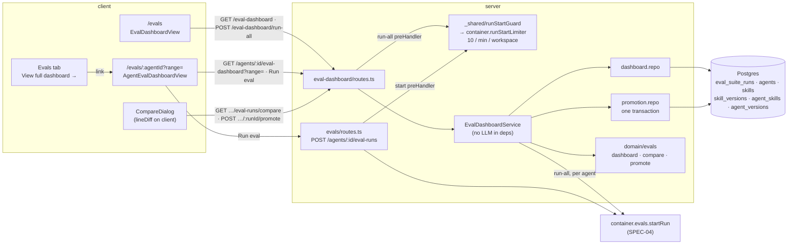

# Eval Dashboard (all-agents overview, per-agent trend and alert, Compare runs, Promote) — Implementation Plan

Date: 2026-10-12 · Branch: feature/l06-eval-pipeline · Status: draft

## Goal
An agent author opens **Skills Lab › Eval Dashboard** and sees every agent's latest eval result with a recall sparkline, the 20 newest eval runs of the workspace, and a "Run all agents" action. Each agent has its own dashboard with metric cards, a trend chart over 7 / 30 / 90 days / All, a deterministic regression banner and the run table. Two completed runs can be compared (metric deltas, case-set difference, system-prompt diff, provider / model / strategy / skill differences). The later run's configuration can be promoted: agent version and restored skill bodies change together in one transaction. No model is called by any of it. Every eval run start in a workspace — a single agent's run or "Run all agents" — counts against one shared limit of 10 starts per minute.

## Context
- Request: plan SPEC-05-eval-dashboard (`specs/05-eval-dashboard-2026-10-11.md`, `Status: approved`, `## Open questions: none`; packages server + client) on top of the SPEC-04 plan `docs/plans/2026-10-11-eval-pipeline.md` (draft, executed before this one). Its Design, Database and Contracts are treated as shipped: `eval_cases` (identity), append-only `eval_case_revisions`, `eval_suite_runs` with the `config` record (`EvalRunConfig`, linked skills ordered, each with id, version, order, both enabled flags, `body` only when active) and the `cases` jsonb list of `EvalRunCaseRef { case_id, revision_id, revision }`, per-case rows in `eval_runs`, migrations 0017/0018, the `evals` module (`EvalService.startRun`, `container.evals`, `evals/routes.ts` with its 10/min route limit `EVAL_RUN_START_RATE_LIMIT`), the client hooks `client/src/lib/hooks/evals.ts` and the agent editor `EvalsTab`. Nothing SPEC-04 owns is re-planned here except the start route's rate limit (user decision below).
- Also read: `specs/06-case-editor-2026-10-12.md` (approved) — its AC12 decides how case sets are compared: "count a case covered at different revisions by the two runs of a comparison or alert as one removed and one added in the 'Case sets differ: N added, M removed' notice (SPEC-05 AC19)"; its NFR Concurrency and rate: "Starting a full run, a skill run or a single-case run counts against the same 10 starts per minute." SPEC-06 features are not planned here.
- User decisions applied (caller, 2026-10-12): errored cases show the reason instead of numbers; unknown cost is an em dash, never $0; refusals show on the component AND via the global toast (the global error handler is unchanged); execution mode will be multi-agent; out-of-scope extras are recommendations only.
- User decision (caller, 2026-10-12, during planning): after implementation the package specs in `server/specs/` and `client/specs/` MUST be updated — accepted, planned as T019 (doc-writer, last wave).
- User decision (caller, 2026-10-12, during planning): R2 accepted — ONE shared counter of 10 eval starts per minute per workspace, shared by `POST /agents/:id/eval-runs` (SPEC-04) and "Run all agents", built as a reusable piece the SPEC-06 plan calls for single-case runs and skill runs — planned as T020.
- INSIGHTS entries that apply (quoted in the tasks they constrain):
  - server/INSIGHTS.md: 2026-09-19 cost `null` = unknown, `0` = free; 2026-09-30 no cross-module import, type-only included; 2026-09-22 a container facade for a service that takes `Container` makes a cycle (here: the only new container getter is the limiter, which takes no `Container`); 2026-09-22 helpers↔repository row-type cycle in a new module; 2026-09-22 first `db.transaction()` (`setSkills`) is the shape to copy; 2026-09-21 multi-table writes go in one transaction; 2026-09-29 a `running` row inserted before `buildApp()` is reaped; 2026-09-26 an unmocked LLM client in an it-test makes real calls; 2026-09-19 test fire-and-forget by inserting runs; 2026-09-19 `count()` is a number, `sum()` is not (no SQL sums here); 2026-09-22 testcontainers flakiness (`TESTCONTAINERS_RYUK_DISABLED=true`); 2026-09-22 Drizzle text enum hint is not a DB constraint; 2026-09-20 `pgTable` grep undercounts the schema.
  - client/INSIGHTS.md: 2026-09-19 `formatUsd` (em dash for unknown); 2026-09-21 `Modal` is not portaled; 2026-09-26 `fireEvent` only; 2026-09-21 `@messages/…` alias; 2026-09-21 `vi.mock` with alias paths; 2026-10-03 dot reporter; 2026-09-22 `nav.ts` is an editable data registry, labels from `shell.nav.<key>`; 2026-09-22 `IconName` renames; 2026-10-01 SVG `<title>` double match in jsdom; 2026-09-19 border shorthand vs longhand; 2026-10-04 `SectionLabel` header actions go in its `right` prop; 2026-09-21 stale `.next/types` after adding routes.
  - INSIGHTS.md (root): 2026-09-19 diff only the contract files you touched; 2026-09-26 / 2026-10-03 `typecheck` never covers `test/` (scratch tsconfig, `rootDir: ".."` for server); 2026-09-21 `zod/v4` imports compile; 2026-09-29 `rg` is not installed (gates use `grep -rnE`).
- Spec invariants that apply: `server/specs/skills.md` S4 ("Any change to name/description/type/body → version+1 + a row in `skill_versions` (body, note), in a single transaction"), S5 ("Restore vN = a normal save with body from vN … History is append-only"), S7 (workspace scope); `server/specs/review-flow.md` invariant 2 (failed / unknown cost is `null`, never `0`) and invariant 5 (one API instance per database — also assumed by the in-memory limiter); `client/specs/pages.md` › Presentation invariants 1 (em dash, `formatUsd`) and › URL state contract ("An unrecognised value reads as 'no filter', never as 'show nothing'"); the SPEC-04 plan A9 (`EvalRunSkill.body` is `null` for a skill that was not active) and A13 (deltas over completed runs, in whole points).
- Closest existing features followed: `server/src/modules/brief/routes.ts` (a plugin that builds its service from narrow deps, incl. another module's use case through `container.*`); `server/src/modules/blast/types.ts` + `routes.ts:21` (local structural port, `const r: Port = container.x`); `server/src/modules/agents/repository.ts` (`update` + `snapshotVersion`, `setSkills` transaction) and `server/src/modules/skills/repository.ts` (`update` bumps version + `skill_versions` row in one transaction) for the Promote write; `server/src/modules/_shared/context.ts` (a shared presentation helper every module calls) for the run-start guard; `client/src/lib/line-diff.ts` + the skills `VersionDiffModal` for diffs; `client/src/app/(shell)/agents/[id]/_components/AgentEditorView/AgentEditorView.tsx` for a client view with `useCrumb`, `useParams`, `useSearchParamState`.

## Requirements review
- **Already there:** the SPEC-04 run record (config with ordered skills + versions, covered case revisions, pooled metrics, `cost_usd` null = unknown); `client/src/lib/line-diff.ts` (LCS line diff, tested) and `formatUsd` / `NO_DATA`; `useConfirm` (its `ConfirmDialog` body is `white-space: pre-line`, so a multi-line confirmation needs no new dialog); `useToast`; `useSearchParamState`; `useCrumb`; `activeKeyFor` in `client/src/components/app-shell/helpers.ts:26` already maps `/eval*` to the `eval` nav key; the label `shell.nav.eval` = "Eval Dashboard"; `eval.json` already holds `page.crumbSkillsLab`, `page.crumbEvalDashboard`, `dashboard.metrics.*`, `dashboard.legend.*`, `dashboard.metricTrend`, `dashboard.recentRuns`; recharts 2.15.4 (has `accessibilityLayer`); `skill_versions` keeps every body per `(skill_id, version)`; `EvalDashboard` / `EvalTrendPoint` are referenced by no code outside `vendor/shared` (`grep -rnE 'EvalDashboard|EvalTrendPoint' server/src client/src reviewer-core/src mcp/src` → only the contracts), so they can be redefined.
- **Missing in code (planned):**
  - The vendored `LineChart` maps `null` to 0 (no gaps, AC11), has no tooltip (AC12) and no keyboard access; the vendored `MetricCard` prints the delta as `toFixed(2)` without a sign or points (AC10); the vendored `Sparkline` divides by `data.length − 1` (NaN for one point). `client/src/vendor/ui/**` is do-not-touch, so the chart and the cards are feature components on recharts / the vendored `Sparkline` (≥ 2 values only) (T011, T013).
  - The run record stores a skill `body` only when the skill was active (SPEC-04 plan A9), so the skill diff (AC21) and the restore (AC23) read bodies from `skill_versions` by `(skill_id, version)`, falling back to the recorded body (T006).
  - Nothing writes an agent version and skill versions in one transaction; the agents and skills repositories each own one table set and may not be imported across modules → a promotion repository writes `skills`, `skill_versions`, `agents`, `agent_skills`, `agent_versions` in ONE `db.transaction` (T006), with the `agent_versions.config_json` shape typed by the `AgentVersionConfig` contract.
  - No "start every agent" use case → `POST /eval-dashboard/run-all` calls SPEC-04's `startRun` once per eligible agent through a local structural port (T009, T015).
  - No shared run-start counter: `@fastify/rate-limit` 11 gives every route config its own `LocalStore` child (`node_modules/@fastify/rate-limit/store/LocalStore.js` `child`) keyed by IP, so the SPEC-04 start route and run-all would each allow 10/min. The spec says a run-all "counts once against the existing limit of 10 run starts per minute", and SPEC-06 adds two more start kinds to the same limit → a workspace-keyed `RunStartLimiter` in `platform/`, held once by the container, checked by a shared `runStartGuard` preHandler in `modules/_shared/` that every run-start route uses (T020; wired into run-all by T015).
  - The dashboard contracts carry no agent version, per-case rows and a free-text alert → redefined in both `eval-ci.ts` copies (T001). The alert becomes structured data; its sentence is built from `eval` messages on the client (spec NFR i18n).
  - No package spec describes the dashboards, the alert rule, Promote or the shared start limit → T019 writes `server/specs/eval-dashboard.md` and updates `client/specs/pages.md` plus both spec indexes (user decision).
- **Contradictory, settled as Assumptions:** AC14 ("in place of the chart and the table") vs EC7 ("the failed runs are still in the table") → A3. Onion §6 prefers a service-owned `UnitOfWork`; the codebase's transactions are repository-owned (`AgentsRepository.setSkills`, `SkillsRepository.update`) — Promote follows that existing shape, with no external call inside (as the SPEC-04 plan did).
- **Unclear, settled as Assumptions below:** the shared limit's key, window and test behaviour (A2); what "equals run B's record" compares (A4); link flags and skill-level flags on Promote (A5); where restored bodies come from (A6); the alert tie-break and "others" with no value (A7); delta display for zero and missing values (A8); the "x/y pass" denominator (A9); refusal codes (A10); what follows a promotion (A11); how "Run all" reports (A12); failed-run rows (A13); URL values (A1).
- **Contract reach:** both `eval-ci.ts` copies change identically (the eval section is byte-identical after the SPEC-04 plan T001). The client copy still lacks `AgentVersion` (`knowledge.ts`), and this plan does not need it: compare and Promote read only run records and `EvalPromotePreview.current_agent_version`, so `knowledge.ts` is untouched in both copies. The 429 refusal is an `AppError` envelope (`code: 'run_start_rate_limited'`), not a contract schema.
- **Database:** no change. Every read and write uses tables that exist after the SPEC-04 migrations; no index is added (R7). The limiter is in memory.
- **Spec coverage (every AC → tasks):** AC1 T010·T014 · AC2 T001·T005·T009·T010·T015 · AC3 T009·T010 · AC4 T005·T009·T010·T015 · AC5 T010·T014·T016 · AC6 T009·T010·T015·T020 · AC7 T009·T010·T015 · AC8 T016·T020 · AC9 T002·T009·T015·T016 · AC10 T009·T013 · AC11 T002·T005·T011 · AC12 T011 · AC13 T005·T016 · AC14 T016 · AC15 T002·T009·T013·T015 · AC16 T002·T013 · AC17 T016 · AC18 T003·T009·T012·T017 · AC19 T002·T012·T013·T017 · AC20 T012 · AC21 T003·T006·T012·T017 · AC22 T004·T006·T009·T012·T017 · AC23 T004·T006·T017 · AC24 T004·T009·T012·T017 · AC25 T005·T006·T009·T015·T017. Lasting behaviour of all of them is written down by T019.

## Assumptions
- A1 — Routes: `/evals` (Eval Dashboard) and `/evals/:agentId` (agent dashboard). The range lives in `?range=` with the values `7d`, `30d` (default), `90d`, `all`; anything else reads as `30d` (AC9, EC20). The switcher keeps `?range=` (AC8).
- A2 — One shared run-start limit (user decision): at most 10 eval run starts per workspace in a fixed 60-second window, counted by `RunStartLimiter` (`server/src/platform/run-start-limiter.ts`), one instance per container. Every run-start route calls the shared `runStartGuard` preHandler (`server/src/modules/_shared/run-start-guard.ts`) BEFORE its handler: a "Run all agents" request costs 1 however many agents it starts; a single-agent start costs 1; a refused request (429) costs nothing and starts nothing. The refusal is `AppError('run_start_rate_limited', 'Too many runs — try again in a minute', 429, { retry_after_ms })`. The SPEC-04 route-level `rateLimit` config is removed from `POST /agents/:id/eval-runs` (no double counting); the global 120/min IP limit stays. Like `app.ts`'s global limit, the default limiter is unlimited when `config.nodeEnv === 'test'`; tests that prove the counter inject `new RunStartLimiter({ max: 2 })` through `ContainerOverrides.runStartLimiter`. Counts live in memory and reset on restart (one API instance per database, `server/specs/review-flow.md` invariant 5). SPEC-06 adds `preHandler: runStartGuard(container)` to its single-case and skill run-start routes and nothing else.
- A3 — AC14 vs EC7: when the selected range holds no completed run, the empty message ("No eval runs in the last N days" / "No eval runs yet") with the "Show all" action replaces the chart; the run table is still shown when the range holds any run (failed or running, EC7, EC12) and hidden only when it has none.
- A4 — "Equals run B's record" (AC24) means: the agent's provider, model, system prompt and strategy equal the record; the agent's current links (skill ids in order, with each link's enabled flag) equal run B's still-existing recorded skills in recorded order with their recorded `link_enabled`; and every still-existing recorded skill's current body equals its recorded version's body. The skills' own `enabled` flags, names and descriptions are not compared.
- A5 — Promote relinks the still-existing recorded skills in recorded order with their recorded `link_enabled`; it never changes a skill's own `enabled` flag, name, description or type (only `body`, as S5 restores), nor the agent's name, description, output schema, CI gate, repo-intel or enabled state (AC22). Promote always saves a new agent version, also when only a skill body differs (EC24).
- A6 — A recorded skill version's body comes from `skill_versions (skill_id, version)`; when that row is missing, from the run's recorded `body`; when neither exists, the link is kept, the body is not restored, and Compare shows "Body not available". A recorded skill whose `skills` row no longer exists in the workspace is "deleted — left out" (EC16).
- A7 — Alert (AC15, AC16): over the two newest completed runs, whatever the range; a metric counts only when it has a value in both runs; drop = `round(prev × 100) − round(latest × 100)`, alert when ≥ 1. The largest drop wins; ties go in the order recall, precision, citation accuracy. Every other metric with a value in both runs is reported as up / down / same by the same whole-percent comparison; a metric without a value in either run is left out of the sentence. The case-set notice (AC19) is added when added + removed > 0.
- A8 — Deltas in points are `round(latest × 100) − round(previous × 100)` (SPEC-04 plan A13). A change of 0 reads "0 pt" without an arrow; no delta is shown when either value is "—" or there is no previous completed run (EC8). Cost change in Compare is the signed `formatUsd` of the difference ("+$0.01", "−$0.01", "$0"), or an em dash and no change when either cost is unknown (AC18, user decision).
- A9 — "x/y pass" and "x / y" are `cases_passed / cases_total` of the run, as on the SPEC-04 Evals tab.
- A10 — Refusals: Compare or Promote on a run that is not `completed` → 422 `eval_run_not_completed`; Promote when nothing would change → 409 `eval_promote_noop` (AC24 race, EC15); Compare with the same run id twice → 422 `validation_error`; a start over the shared limit → 429 `run_start_rate_limited` (A2); anything outside the workspace or of another agent → 404 (AC25). The component shows the server message or the mapped reason inline (`role="alert"`) and the global mutation toast shows too (user decision).
- A11 — After a confirmed promotion the dialog closes, the selection clears, and a success toast reads "Promoted run vB as vN" (AC22). The dashboards, agent, skills and comparison queries are invalidated.
- A12 — "Run all agents" (AC6): the confirmation is computed on the client from the dashboard data; the server re-decides per agent and answers `{ started, skipped }`; the page shows "Started N eval runs" in a `role="status"` line. An agent whose `startRun` fails with an unexpected error is logged (ids only) and appears in neither list.
- A13 — Errored cases (user decision) appear on these pages only through their runs' pooled metrics, which SPEC-04 already computes without them. A `failed` run row shows its status and its stored `error` reason in place of numbers; its metrics read "—" and its cost uses `formatUsd`.
- A14 — While any run shown on a page is `running`, its query refetches every 3 s (NFR Freshness ≤ 5 s).
- A15 — The skill differences in Compare (AC21) are: added, removed, or at a different version. Order changes and link-enabled changes are not listed.
- A16 — The agent dashboard lists every run of the range without paging (AC13); the trend is capped at the 200 newest completed runs with "Showing the newest 200 runs" (NFR Sizes).
- A17 — The new server package spec is a separate file, `server/specs/eval-dashboard.md`, not `server/specs/evals.md`: the SPEC-04 plan may still add `evals.md` for the pipeline itself, and two plans must not own one file. It links to `evals.md` only if that file exists when T019 runs.

## Recommendations
- R1 — Send the version the confirmation named (`expected_agent_version`) with Promote and answer 409 when the agent changed since the dialog opened — why: the confirmation names the version being replaced; an edit in another tab between opening and confirming replaces a version the user never saw · cost: one body field, one check in T009, one it-test scenario.
- R2 — Accepted by the user on 2026-10-12 and moved into Scope as T020 (shared per-workspace run-start limiter); no longer a recommendation.
- R3 — Move the SPEC-04 Evals tab's `toPercent` / `formatPercent` / `deltaPoints` to `client/src/lib/eval-metrics.ts` (created here) once both plans have shipped — why: a second consumer exists, and two copies of the points rule can drift · cost: edits to `EvalsTab/helpers.ts`, its consumers and its test.
- R4 — Extract the diff line rendering shared by the skills `VersionDiffModal` and the new `DiffLines` into `client/src/components/line-diff-view/` — why: two renderings of the same "−/+" convention · cost: touches the skills feature and its styles.
- R5 — Accepted by the user on 2026-10-12 and moved into Scope as T019 (package spec updates); no longer a recommendation.
- R6 — One e2e flow: sidebar → Eval Dashboard → an agent's dashboard empty state ("No eval runs yet" after "All") — why: TESTING.md keeps a few flows over the main journeys, and this is a new top-level screen · cost: one `e2e/specs/*.flow.json`, no model.
- R7 — Add an index `eval_suite_runs (workspace_id, started_at)` only if the 1-second budget is missed when measured at 2,000 runs — why: today's indexes are `(agent_id, started_at)` and `(workspace_id)` · cost: a schema change + `db:generate`.
- R8 — A `g e` keyboard shortcut for the Eval Dashboard — why: every other Skills Lab entry has one · cost: one `nav.ts` entry and a `SHORTCUTS` line; not in the spec.

## Scope
- In: every AC (AC1–AC25) of SPEC-05: contracts in both `eval-ci.ts` copies; pure dashboard / compare / promote rules in `server/src/domain/evals/`; a new `eval-dashboard` server module (two repositories, a service with narrow deps, routes for the workspace dashboard, run-all, the agent dashboard, compare and promote); the shared per-workspace run-start limiter and its guard, used by the SPEC-04 start route and run-all (user decision, reusable by SPEC-06); the sidebar entry; the `/evals` page; the `/evals/:agentId` page with switcher, range, Run eval, alert banner, metric cards, trend chart, run table and the compare dialog with Promote; "View full dashboard →" on the SPEC-04 Evals tab; docs (server API map and architecture, client route map and cache keys); package specs after implementation (`server/specs/eval-dashboard.md`, `server/specs/README.md`, `client/specs/pages.md`, `client/specs/README.md`, user decision).
- Out: the case editor and every SPEC-06 feature (it is planned separately; only its AC12 counting rule is applied in AC19, and its run-start routes will call `runStartGuard`); the Stats and CI tabs, the PreToolUse hook, mutation testing; replaying a configuration without making it current; promoting the earlier run; thresholds that block; any model call for alert, diff or compare; DB changes; a persistent (DB- or Redis-backed) limiter; `server/specs/evals.md` (SPEC-04 pipeline, A17); R1, R3, R4, R6–R8.

## Design

Rings (onion-architecture §2, §4) — why a separate module: the dashboard reads many agents and writes agent and skill configuration, while the SPEC-04 `evals` module owns cases and the run lifecycle. A separate plugin keeps `evals/service.ts` focused and makes the "no model call" guarantee structural: nothing in `eval-dashboard` receives an LLM provider. It reaches `startRun` only through a local port, as `brief` reaches `container.intent`.
- **Contracts (core):** `server/src/vendor/shared/contracts/eval-ci.ts` and `client/src/vendor/shared/contracts/eval-ci.ts`, eval section identical (T001).
- **Domain (pure, `domain-is-pure`):** `server/src/domain/evals/dashboard.ts` (range start, points, case-set difference by revision, regression alert, trend cap) (T002); `compare.ts` (earlier/later order, provider/model/strategy changes, skill changes) (T003); `promote.ts` (promotion plan: links, restores, deleted skills, "is current") (T004). They sit next to SPEC-04's `scoring.ts`.
- **Infrastructure:** `server/src/modules/eval-dashboard/repository/dashboard.repo.ts` (workspace-scoped reads, no N+1) (T005); `repository/promotion.repo.ts` (stored runs scoped by workspace AND agent, skill bodies by version, the one-transaction Promote write) (T006). Both match `arch:check`'s `REPOSITORY` pattern (`repository/`).
- **Domain-side module files:** `server/src/modules/eval-dashboard/types.ts` (structural ports and row interfaces) and `helpers.ts` (row → `AgentEvalRunSummary` mapper over a local row interface, so no helpers↔repository cycle) (T001).
- **Application:** `server/src/modules/eval-dashboard/service.ts` — `EvalDashboardService` with `EvalDashboardDeps` (two repository `Pick`s, an `EvalRunStarter`, a clock). It never takes `Container` (T009).
- **Shared run-start limit (T020) — why here:** the limit is a cross-cutting transport concern shared by three modules' routes (evals now, eval-dashboard now, SPEC-06's skill/case routes later), and modules may not import each other. So the stateful counter is a composition-root singleton (`server/src/platform/run-start-limiter.ts`, class `RunStartLimiter`, exposed as `container.runStartLimiter`, overridable through `ContainerOverrides`), and the one place routes touch it is the shared presentation helper `server/src/modules/_shared/run-start-guard.ts` (`runStartGuard(container)` → a Fastify `preHandler`, next to `getContext`). It is keyed by workspace (from `getContext`), not by IP, because the spec counts starts per workspace.
- **Presentation + wiring:** `server/src/modules/eval-dashboard/routes.ts` builds the service once from `container.db` and `container.evals` (typed as `EvalRunStarter`) and puts `runStartGuard(container)` on run-all; `modules/index.ts` registers the plugin (T015). The SPEC-04 `evals/routes.ts` start route switches from its route-level `rateLimit` to the same guard (T020).
- **Client:** messages (T007); data hooks `client/src/lib/hooks/eval-dashboard.ts` + key factory + shared pure metric formatting `client/src/lib/eval-metrics.ts` (two features use it: the workspace page and the agent page) (T008); the `/evals` feature folder (T010); the agent page's sub-components `TrendChart`, `CompareDialog`, `AlertBanner`, `MetricCards` (T011–T013) composed by `AgentEvalDashboardView` (T016); `nav.ts` + the Evals tab link (T014). A 429 from either start action shows its server message inline and in the global toast, like any refusal.
- **Docs and specs:** docs (T018, Wave 4); package specs (T019, Wave 5, after the Promote it-test has proved the behaviour they record).



### Contracts
Both `server/src/vendor/shared/contracts/eval-ci.ts` and `client/src/vendor/shared/contracts/eval-ci.ts`, in the eval section (identical in both after the SPEC-04 plan T001; the import lines keep their known differences and gain `Provider` / `ReviewStrategy` only if not already imported). All Zod 3. `AgentEvalRunSummary`, `EvalRunConfig`, `EvalRunCaseRef`, `StartEvalRunResponse`, `EvalErrorCode` are the SPEC-04 schemas.
- `EvalErrorCode` gains `'eval_run_not_completed'` and `'eval_promote_noop'`. (`run_start_rate_limited` is a shared, non-eval code carried only in the `AppError` envelope.)
- `EvalDashboardRange = z.enum(['7d','30d','90d','all'])`
- `EvalMetricKey = z.enum(['recall','precision','citation_accuracy'])` · `EvalMetricDirection = z.enum(['up','down','same'])`
- `EvalCaseSetDiff = { added: int ≥ 0; removed: int ≥ 0 }`
- `EvalTrendPoint` (redefined) `= { run_id; started_at; agent_version: int; recall: number | null; precision: number | null; citation_accuracy: number | null; cost_usd: number | null }`
- `EvalRegressionAlert = { metric: EvalMetricKey; drop_points: int > 0; agent_version: int; run_id; previous_run_id; others: { metric: EvalMetricKey; direction: EvalMetricDirection }[]; case_sets: EvalCaseSetDiff }`
- `EvalDashboard` (redefined: the per-agent page) `= { agent: { id; name; provider: Provider; model }; range: EvalDashboardRange; cases_total: int; latest: AgentEvalRunSummary | null; previous: AgentEvalRunSummary | null; running_run: AgentEvalRunSummary | null; alert: EvalRegressionAlert | null; trend: EvalTrendPoint[]; trend_truncated: boolean; runs: AgentEvalRunSummary[] }` — `latest`, `previous`, `alert`, `running_run` ignore the range; `trend` (oldest first, ≤ 200) and `runs` (newest first) apply it.
- `EvalWorkspaceAgentRow = { id; name; provider: Provider; model; enabled: boolean; cases_total: int; running: boolean; latest: AgentEvalRunSummary | null; recall_trend: number[] }` (recall of completed runs of the last 30 days with a value, oldest first)
- `EvalWorkspaceRun = AgentEvalRunSummary.extend({ agent_name: z.string() })`
- `EvalWorkspaceDashboard = { agents: EvalWorkspaceAgentRow[]; recent_runs: EvalWorkspaceRun[] }` (≤ 20, newest first)
- `RunAllEvalsSkipReason = z.enum(['no_eval_cases','eval_run_in_progress'])`
- `RunAllEvalsResponse = { started: { agent_id; run_id }[]; skipped: { agent_id; agent_name; reason: RunAllEvalsSkipReason }[] }`
- `EvalConfigField = z.enum(['provider','model','strategy'])` · `EvalConfigChange = { field: EvalConfigField; from: string; to: string }`
- `EvalSkillChangeKind = z.enum(['added','removed','version_changed'])` · `EvalSkillChange = { skill_id; name; change: EvalSkillChangeKind; from_version: int | null; to_version: int | null; from_body: string | null; to_body: string | null }`
- `EvalComparedRun = AgentEvalRunSummary.extend({ config: EvalRunConfig })`
- `EvalPromoteSkill = { skill_id; name; current_version: int; recorded_version: int }`
- `EvalPromotePreview = { run_id; run_agent_version: int; current_agent_version: int; is_current: boolean; skills_to_restore: EvalPromoteSkill[]; affected_agents: { id; name }[]; deleted_skills: { skill_id; name }[] }`
- `EvalRunComparison = { agent_id; earlier: EvalComparedRun; later: EvalComparedRun; case_sets: EvalCaseSetDiff; config_changes: EvalConfigChange[]; skill_changes: EvalSkillChange[]; promote: EvalPromotePreview }`
- `PromoteEvalRunResponse = { agent_id; agent_version: int; run_agent_version: int; restored_skills: { skill_id; version: int }[] }`

API (module `eval-dashboard`): `GET /eval-dashboard` → `EvalWorkspaceDashboard` · `POST /eval-dashboard/run-all` (no body, shared run-start limit) → 202 `RunAllEvalsResponse` or 429 · `GET /agents/:id/eval-dashboard?range=` → `EvalDashboard` · `GET /agents/:id/eval-runs/compare?a=<uuid>&b=<uuid>` (order-free) → `EvalRunComparison` · `POST /agents/:id/eval-runs/:runId/promote` (no body) → 200 `PromoteEvalRunResponse`. None collides with SPEC-04's `GET|POST /agents/:id/eval-runs` and `GET /eval-runs/:id`. SPEC-04's `POST /agents/:id/eval-runs` keeps its path and responses and gains the same 429.

### i18n keys (added to `client/messages/en/eval.json` by T007; every UI task uses exactly these)
Existing keys reused: `page.crumbSkillsLab`, `page.crumbEvalDashboard`, `dashboard.metrics.{recall,precision,citationAccuracy}`, `dashboard.legend.{recall,precision,citation}`, `dashboard.metricTrend`, `dashboard.recentRuns`. New:
```json
{
  "evalsTab": { "viewDashboard": "View full dashboard →" },
  "runStatus": { "running": "running", "completed": "completed", "failed": "failed" },
  "workspace": {
    "title": "Eval Dashboard",
    "subtitle": "Latest eval result of every agent",
    "empty": "No agents yet. Create an agent to run evals.",
    "lastRun": "Last run v{version} · {startedAt} · {passed}/{total} pass",
    "neverRun": "Never run",
    "noCases": "No eval cases",
    "disabled": "disabled",
    "recentHeading": "Recent eval runs · all agents",
    "recentEmpty": "No eval runs yet.",
    "columns": { "agent": "Agent", "model": "Model", "lastRun": "Last run", "trend": "Recall · 30 days", "startedAt": "Started", "version": "Version", "recall": "Recall", "precision": "Precision", "citation": "Citation", "passed": "Passed", "status": "Status" },
    "runAll": "Run all agents",
    "runAllBlocked": { "noCases": "No agent has eval cases", "allRunning": "Every agent with eval cases already has an eval run in progress" },
    "runAllConfirmTitle": "Run all agents?",
    "runAllConfirmBody": "{agents, plural, one {# agent} other {# agents}} will run {cases, plural, one {# case} other {# cases}} in total.",
    "runAllSkipped": "Skipped: {name} — {reason}",
    "runAllConfirm": "Run",
    "runAllStarted": "{count, plural, =0 {No eval runs started} one {Started # eval run} other {Started # eval runs}}",
    "skipReason": { "no_eval_cases": "no eval cases", "eval_run_in_progress": "eval run already in progress" },
    "rateLimited": "Too many runs — try again in a minute"
  },
  "agentDashboard": {
    "allAgents": "All agents",
    "switcherLabel": "Agent",
    "rangeLabel": "Time range",
    "range": { "7d": "7 days", "30d": "30 days", "90d": "90 days", "all": "All" },
    "runEval": "Run eval",
    "runBlocked": { "noCases": "no eval cases", "inProgress": "eval run already in progress" },
    "progress": "{done} / {total} cases",
    "notFoundTitle": "Agent not found",
    "notFoundBody": "This agent does not exist in your workspace.",
    "backToDashboard": "Back to Eval Dashboard",
    "deltaPoints": "{value} pt",
    "emptyRange": "No eval runs in the last {days} days",
    "emptyAll": "No eval runs yet",
    "showAll": "Show all",
    "trendTruncated": "Showing the newest 200 runs",
    "tooltipVersion": "v{version}",
    "tooltipCost": "Cost {cost}",
    "table": { "select": "Select run v{version}", "startedAt": "Started", "version": "Version", "recall": "Recall", "precision": "Precision", "citation": "Citation", "passed": "Passed", "cost": "Cost", "status": "Status" },
    "compare": "Compare",
    "compareHint": "Select exactly 2 runs"
  },
  "alert": {
    "dropped": "{metric} dipped {points}pts on v{version} — {cause}.",
    "cause": { "precision": "a new false positive slipped in", "recall": "an expected finding was missed", "citation_accuracy": "findings cited lines outside the diff" },
    "metricName": { "recall": "Recall", "precision": "Precision", "citation_accuracy": "Citation" },
    "metricNameLower": { "recall": "recall", "precision": "precision", "citation_accuracy": "citation" },
    "othersBoth": "{a} and {b} both {direction}.",
    "othersEach": "{a} {directionA}, {b} {directionB}.",
    "otherOne": "{a} {direction}.",
    "direction": { "up": "up", "down": "down", "same": "unchanged" },
    "caseSetsDiffer": "Case sets differ: {added} added, {removed} removed"
  },
  "compare": {
    "title": "Compare runs · v{from} → v{to}",
    "oldNew": "{old} → {new}",
    "cost": "Cost",
    "systemPrompt": "System prompt",
    "promptUnchanged": "System prompt unchanged",
    "configHeading": "Configuration",
    "noConfigChanges": "No other configuration changes",
    "configChange": "{field}: {from} → {to}",
    "field": { "provider": "Provider", "model": "Model", "strategy": "Strategy" },
    "skillAdded": "Skill {name} added (v{version})",
    "skillRemoved": "Skill {name} removed (v{version})",
    "skillVersionChanged": "Skill {name}: v{from} → v{to}",
    "bodyUnavailable": "Body not available",
    "loadError": "Could not load the comparison.",
    "close": "Close",
    "promote": "Promote v{version}",
    "promoteCurrent": "This is the current configuration",
    "promoteConfirmTitle": "Promote run v{version}?",
    "promoteReplaces": "Replaces the agent's current version v{version}.",
    "promoteSkill": "Skill {name}: v{current} gets the body of v{recorded}",
    "promoteAffects": "Also changes these agents: {agents}",
    "promoteDeleted": "{name}: deleted — left out",
    "promoteConfirm": "Promote",
    "promoted": "Promoted run v{run} as v{version}",
    "errors": { "eval_promote_noop": "This is already the current configuration.", "eval_run_not_completed": "Only completed runs can be compared or promoted.", "not_found": "This run is no longer available.", "generic": "Promote failed." }
  }
}
```

### Database
None. Reads `agents`, `agent_skills`, `skills`, `skill_versions`, `eval_cases`, `eval_suite_runs` (SPEC-04 migration 0017/0018 shape); Promote writes `skills`, `skill_versions`, `agents`, `agent_skills`, `agent_versions` in one transaction. No `db:generate`, no migration. The run-start counter is in memory.

## Global constraints
- Zod 3 only (`import { z } from 'zod'`; never `zod/v4`, `zod/mini`) · no do-not-touch path (`client/src/vendor/ui/nav.ts` is the one allowed file under `vendor/ui`) · no migration · tests per TESTING.md (one happy path + the edge that matters; no real model call; LLM, GitHub and git mocked in it-tests) · no cross-module import in `server/src/modules/**`, type-only included (`pnpm run arch:check`) · nothing in `eval-dashboard` or `domain/evals/{dashboard,compare,promote}.ts` receives an LLM provider · every read and write scoped by `workspace_id`; compare / promote runs additionally by `agent_id` · every eval run-start route uses `runStartGuard(container)` and no route-level `rateLimit` of its own · history is append-only: Promote inserts agent and skill versions, never updates or deletes one · cost `null` means unknown and renders `—` through `formatUsd` · recorded prompts and skill bodies render as plain React text, never HTML or markdown · every label from the `eval` namespace (nav label from `shell.nav.eval`) · no prompt, skill body or diff text in a log line or error message · `server/package.json` is not edited · package specs change only in T019 (last wave), never in a code task.

## Tasks

### Wave 0 — foundation (sequential)

#### T001 — Dashboard / compare / promote contracts (both copies), eval-dashboard module types and run mapper
- Area: backend
- Agent: implementer
- Depends on: —
- Files (exclusive):
  - `server/src/vendor/shared/contracts/eval-ci.ts` (modified)
  - `client/src/vendor/shared/contracts/eval-ci.ts` (modified)
  - `server/test/contracts.test.ts` (modified)
  - `server/src/modules/eval-dashboard/types.ts` (new)
  - `server/src/modules/eval-dashboard/helpers.ts` (new)
  - `server/test/eval-dashboard-helpers.test.ts` (new)
- Skills: zod → schema-use-enums, schema-use-primitives-correctly, object-optional-vs-nullable, object-extend-for-composition, type-use-z-infer, type-export-schemas-and-types; onion-architecture → §2, §4, §5 Domain; typescript-expert → Code Review Checklist
- Rules (applied by the agent instead of loading the skills; 5–15 lines):
  - Closed vocabularies (`EvalDashboardRange`, `EvalMetricKey`, `EvalMetricDirection`, `RunAllEvalsSkipReason`, `EvalConfigField`, `EvalSkillChangeKind`, the two new `EvalErrorCode` values) are `z.enum([...])`, never free strings — zod §schema-use-enums
  - Keys always present but possibly empty are `.nullable()` (`latest`, `previous`, `running_run`, `alert`, metric and cost fields, `from_version`, `to_version`, `from_body`, `to_body`); no `.optional()` in these shapes — zod §object-optional-vs-nullable
  - Counts and versions are `z.number().int()`; `drop_points` is `.positive()`, `added` / `removed` are `.nonnegative()` — zod §schema-use-primitives-correctly
  - `EvalWorkspaceRun` and `EvalComparedRun` are built with `AgentEvalRunSummary.extend({...})`, not by copying its fields — zod §object-extend-for-composition
  - Every schema is exported with `export type X = z.infer<typeof X>` — zod §type-export-schemas-and-types, §type-use-z-infer
  - The eval section of both `eval-ci.ts` copies is byte-identical after the edit; only the import line may differ — onion-architecture §4 (schema the client also uses)
  - `modules/eval-dashboard/types.ts` holds plain interfaces importing only `@devdigest/shared`; `helpers.ts` declares its own `SuiteRunRowLike` and never imports a repository (no cycle) — onion-architecture §2, §5 Domain
  - `toRunSummary` turns `Date` into ISO strings and keeps `null` cost as `null`, never `0` — onion-architecture §5 Domain (null-vs-zero stays explicit)
  - No `any`; explicit return types on exported functions — typescript-expert §Code Review Checklist (Type Safety)
- Interface (only when another task calls what this task exports, or this task calls another's export):
  - Every schema and type in Design › Contracts, from `@devdigest/shared` — exported here
  - `interface DashboardLogger { info(obj: unknown, msg?: string): void; warn(obj: unknown, msg?: string): void; error(obj: unknown, msg?: string): void }` — exported here
  - `interface EvalRunStarter { startRun(workspaceId: string, agentId: string, logger: DashboardLogger): Promise<StartEvalRunResponse> }` — exported here
  - `interface DashboardAgentRow { id: string; name: string; provider: Provider; model: string; enabled: boolean }` — exported here
  - `interface RecallSample { agentId: string; startedAt: Date; recall: number | null }` — exported here
  - `type StoredRun = EvalComparedRun & { cases: EvalRunCaseRef[] }` — exported here
  - `interface CurrentAgentConfig { id: string; name: string; version: number; provider: Provider; model: string; systemPrompt: string; strategy: ReviewStrategy; outputSchema: unknown; ciFailOn: CiFailOn; repoIntel: boolean; links: { skillId: string; enabled: boolean }[] }` — exported here
  - `interface SkillSnapshot { id: string; name: string; body: string; version: number }` — exported here
  - `interface PromotionWrite { agentId: string; provider: Provider; model: string; systemPrompt: string; strategy: ReviewStrategy; links: { skillId: string; enabled: boolean }[]; restore: { skillId: string; body: string; note: string }[] }` — exported here
  - `interface PromotionResult { agentVersion: number; restored: { skillId: string; version: number }[] }` — exported here
  - `interface SuiteRunRowLike { id: string; agentId: string; status: string; startedAt: Date; finishedAt: Date | null; durationMs: number | null; agentVersion: number; casesTotal: number; casesDone: number; casesScored: number; casesPassed: number; recall: number | null; precision: number | null; citationAccuracy: number | null; costUsd: number | null; error: string | null }` — exported here
  - `toRunSummary(row: SuiteRunRowLike): AgentEvalRunSummary` — exported here
- Steps:
  1. First confirm the SPEC-04 shapes this builds on exist (`AgentEvalRunSummary`, `EvalRunConfig`, `EvalRunCaseRef`, `StartEvalRunResponse`, `EvalErrorCode` in the server `eval-ci.ts`; `t.evalSuiteRuns` in `server/src/db/schema.ts`); if one is missing or named differently, stop and report.
  2. Tests first: in `contracts.test.ts` an `EvalDashboard` fixture with `alert` (one `others` entry, `case_sets` 2/0), a 1-point `trend` with `recall: null`, and `running_run: null` parses; `EvalRunComparison` with one `version_changed` skill (`from_body: null`) and a `promote` preview parses; `EvalRegressionAlert` with `drop_points: 0` and `EvalDashboardRange` `"banana"` are rejected; `EvalErrorCode` accepts `eval_promote_noop`. In `eval-dashboard-helpers.test.ts`: `toRunSummary` maps dates to ISO and keeps `costUsd: null` as `cost_usd: null` and `0` as `0`. Run red.
  3. Edit the server eval section, copy it byte-for-byte to the client copy, write `types.ts` and `helpers.ts`.
- Acceptance criteria:
  - The contracts carry what AC2–AC4 (workspace rows, recent runs), AC10–AC16 (latest/previous independent of range, trend with agent version and gaps, structured alert), AC18–AC24 (comparison, case sets, config and skill changes, promote preview and result) and AC25 (refusal codes) need, in both copies.
  - `diff server/src/vendor/shared/contracts/eval-ci.ts client/src/vendor/shared/contracts/eval-ci.ts` shows differences only on the import line and outside the eval section (the pre-existing `AgentManifest` / `ConformanceInput` drift).
- Verify (one line per touched package; add task-specific checks below it):
  - `scripts/verify-task.sh server server/src/vendor/shared/contracts/eval-ci.ts server/test/contracts.test.ts server/src/modules/eval-dashboard/types.ts server/src/modules/eval-dashboard/helpers.ts server/test/eval-dashboard-helpers.test.ts`
  - `scripts/verify-task.sh client client/src/vendor/shared/contracts/eval-ci.ts`
  - `diff server/src/vendor/shared/contracts/eval-ci.ts client/src/vendor/shared/contracts/eval-ci.ts`
  - `grep -rnE "zod/(v4|mini)" server/src/vendor/shared/contracts/eval-ci.ts client/src/vendor/shared/contracts/eval-ci.ts` (no output)
- Constraints (quoted, not just referenced — the agent does not read the whole INSIGHTS file):
  - "`diff -r` over the two `vendor/shared` copies is NOT a drift gate." — Rule: after changing a contract, diff ONLY the files you touched … and expect that check to be silent. — `INSIGHTS.md` (2026-09-19)
  - "The installed zod 3.25 exports `zod/v4` …" — Rule: treat any `zod/v4`, `zod/mini` or `@zod/*` import as a violation. — `INSIGHTS.md` (2026-09-21)
  - "Copying `agents/helpers.ts`'s `import type {XRow} from './repository.js'` shape into a NEW module trips `arch:check`'s `no-circular` rule." — Rule: in a new module, declare the row shape `helpers.ts` needs as a local structural interface … — `server/INSIGHTS.md` (2026-09-22)
  - "A run's cost is `null` for 'unknown', `0` for 'free' — never conflate them." — Rule: … every cost column/field stays nullable so the UI can render an em dash. — `server/INSIGHTS.md` (2026-09-19)
  - Spec NFR Contract reach: "The dashboard aggregate contract exists in both `vendor/shared` copies and is identical there today, but its trend point has no agent version and its recent runs are per-case rows; those facts change in both copies together."

### Wave 1 — parallel

#### T002 [P] — Pure dashboard rules: range start, points, case-set difference by revision, regression alert, trend cap
- Area: backend
- Agent: implementer
- Depends on: T001
- Files (exclusive):
  - `server/src/domain/evals/dashboard.ts` (new)
  - `server/test/eval-dashboard-domain.test.ts` (new)
- Skills: onion-architecture → §2, §3, §5 Domain, §8, §9; typescript-expert → Code Review Checklist
- Rules (applied by the agent instead of loading the skills; 5–15 lines):
  - `src/domain/**` imports only `src/domain/**`, `@devdigest/shared` and zod — no module, platform, adapter, clock or LLM type; the current time is a parameter (`domain-is-pure`) — onion-architecture §9, §5 Domain
  - `toPoints(v)` is `Math.round(v * 100)`, `null` stays `null`; every comparison in the alert uses points, never raw fractions — onion-architecture §5 Domain
  - `rangeStart`: `7d` / `30d` / `90d` → `now − N × 86_400_000 ms`; `all` → `null` — onion-architecture §5 Domain
  - `caseSetDiff` keys both lists by `revision_id` (not `case_id`): added = later ids not in earlier, removed = earlier ids not in later, so one case at two revisions counts once in each — onion-architecture §5 Domain
  - `buildRegressionAlert` returns `null` when either run is missing or no metric with a value in BOTH runs dropped by ≥ 1 point; else the largest drop, ties in the order recall, precision, citation_accuracy; `others` = the remaining metrics with a value in both runs as `up` / `down` / `same`; `case_sets` from `caseSetDiff(previous.cases, latest.cases)` — onion-architecture §5 Domain
  - `capTrend` keeps the first `cap` items of a newest-first list, returns them oldest first, and `truncated` is true only when the input was longer than `cap` — onion-architecture §5 Domain
  - Constants live in this file: `TREND_POINT_CAP = 200`, `RECENT_RUNS_LIMIT = 20`, `RECALL_SPARKLINE_DAYS = 30` — onion-architecture §4 (constant next to its rule)
  - Tests need no container, DB or network — onion-architecture §8
  - Explicit return types; generics without `any` — typescript-expert §Code Review Checklist
- Interface (only when another task calls what this task exports, or this task calls another's export):
  - `const TREND_POINT_CAP = 200`, `const RECENT_RUNS_LIMIT = 20`, `const RECALL_SPARKLINE_DAYS = 30` — exported here
  - `rangeStart(range: EvalDashboardRange, now: Date): Date | null` — exported here
  - `toPoints(value: number | null): number | null` — exported here
  - `caseSetDiff(earlier: readonly EvalRunCaseRef[], later: readonly EvalRunCaseRef[]): EvalCaseSetDiff` — exported here
  - `interface AlertRun { id: string; agent_version: number; recall: number | null; precision: number | null; citation_accuracy: number | null; cases: readonly EvalRunCaseRef[] }` — exported here
  - `buildRegressionAlert(latest: AlertRun | null, previous: AlertRun | null): EvalRegressionAlert | null` — exported here
  - `capTrend<T>(newestFirst: readonly T[], cap: number): { points: T[]; truncated: boolean }` — exported here
- Steps:
  1. Test first: EC18 — precision 0.80 → 0.78 with recall and citation up → alert `precision`, `drop_points: 2`, version of the latest, `others` both `up`; EC19 — precision `null` in one run, recall drops 1 → alert `recall`; EC9 — only `must_not_flag` (recall null both) and nothing else dropped → `null`; 0.784 → 0.776 (78 → 78) → `null` (AC16 whole points); tie recall/precision both −3 → `recall`; EC11 — 18 revision ids then the same 18 + 2 → `{ added: 2, removed: 0 }`; SPEC-06 EC15 — 20 vs 20 with one case at a new revision → `{ added: 1, removed: 1 }`; `capTrend` over 201 items → 200 oldest-first, truncated; `rangeStart('all', now)` → `null`. Run red.
  2. Implement `dashboard.ts`.
- Acceptance criteria:
  - AC15, AC16 and the AC19 counting (by revision, per SPEC-06 AC12) hold as pure functions; AC9's range bound and AC11's 200-point cap are decided here.
- Verify (one line per touched package; add task-specific checks below it):
  - `scripts/verify-task.sh server server/src/domain/evals/dashboard.ts server/test/eval-dashboard-domain.test.ts`
- Constraints (quoted, not just referenced — the agent does not read the whole INSIGHTS file):
  - SPEC-06 AC12: "count a case covered at different revisions by the two runs of a comparison or alert as one removed and one added in the 'Case sets differ: N added, M removed' notice" — `specs/06-case-editor-2026-10-12.md`
  - Spec AC16: "IF the agent has fewer than two completed runs, or no metric with a value in both runs dropped by at least 1 point, THEN the system shall show no alert banner."
  - "`typecheck` in `server/` … never type-checks `test/`" — Rule: type-check tests separately with a scratch tsconfig (`"rootDir": ".."` for server). — `INSIGHTS.md` (2026-09-26, 2026-10-03)

#### T003 [P] — Pure compare rules: earlier/later order, provider/model/strategy changes, skill changes
- Area: backend
- Agent: implementer
- Depends on: T001
- Files (exclusive):
  - `server/src/domain/evals/compare.ts` (new)
  - `server/test/eval-compare.test.ts` (new)
- Skills: onion-architecture → §2, §5 Domain, §8, §9; typescript-expert → Code Review Checklist
- Rules (applied by the agent instead of loading the skills; 5–15 lines):
  - Pure: imports only `@devdigest/shared`; no I/O, no model, no clock — onion-architecture §9 (`domain-is-pure`), §5 Domain
  - `orderPair` puts the earlier `started_at` first whatever the argument order (EC13); equal times fall back to `id` ascending so the result is deterministic — onion-architecture §5 Domain
  - `configChanges` compares only `provider`, `model`, `strategy`, in that order, and emits one `{ field, from, to }` per differing field — onion-architecture §5 Domain
  - `skillChanges` matches skills by `id`: in later only → `added`; in earlier only → `removed`; in both with different `version` → `version_changed`; same version → nothing. Order: later's skill order first, then removed skills in earlier's order — onion-architecture §5 Domain
  - Bodies come from the `bodies` map (`skillId → version → body`), falling back to the run's recorded `body`, else `null` (A6) — onion-architecture §5 Domain
  - Tests need no container or DB — onion-architecture §8
  - Explicit return types; the generic in `orderPair` is constrained, no `any` — typescript-expert §Code Review Checklist
- Interface (only when another task calls what this task exports, or this task calls another's export):
  - `orderPair<T extends { id: string; started_at: string }>(a: T, b: T): { earlier: T; later: T }` — exported here
  - `configChanges(earlier: EvalRunConfig, later: EvalRunConfig): EvalConfigChange[]` — exported here
  - `skillChanges(earlier: EvalRunConfig['skills'], later: EvalRunConfig['skills'], bodies: ReadonlyMap<string, ReadonlyMap<number, string>>): EvalSkillChange[]` — exported here
- Steps:
  1. Test first: newest-then-oldest arguments → earlier is the older run (EC13); model and strategy changed, provider equal → two changes in field order; EC10 — same agent version, a skill linked only in the later run → one `added` with its body from the map; a skill at v2 → v3 with only v3 in the map and v2 recorded `body: null` → `from_body: null`, `to_body` set; identical configs → `[]` and `[]`. Run red.
  2. Implement `compare.ts`.
- Acceptance criteria:
  - AC18 (earlier → later), AC21 (provider / model / strategy and skill differences with both bodies) hold as pure functions.
- Verify (one line per touched package; add task-specific checks below it):
  - `scripts/verify-task.sh server server/src/domain/evals/compare.ts server/test/eval-compare.test.ts`
- Constraints (quoted, not just referenced — the agent does not read the whole INSIGHTS file):
  - The SPEC-04 plan A9: "`body` is stored only when both flags are on … and `null` otherwise." — so a recorded body may be missing and the version body must be looked up.
  - Spec EC10: "Two runs with the same agent version (a skill was linked in between, which does not bump the version) — the dialog reads 'v7 → v7' and the skills difference shows why."

#### T004 [P] — Pure promotion plan: links in recorded order, bodies to restore, deleted skills, "is current"
- Area: backend
- Agent: implementer
- Depends on: T001
- Files (exclusive):
  - `server/src/domain/evals/promote.ts` (new)
  - `server/test/eval-promote.test.ts` (new)
- Skills: onion-architecture → §2, §5 Domain, §8, §9; typescript-expert → Code Review Checklist
- Rules (applied by the agent instead of loading the skills; 5–15 lines):
  - Pure: imports only `@devdigest/shared`; the plan is computed from values passed in, never from a repository — onion-architecture §9, §5 Domain
  - `links` = the recorded skills, in `order` ascending, whose id is in `skills` (still exists), each with its recorded `link_enabled` (A5) — onion-architecture §5 Domain
  - `deleted` = recorded skills absent from `skills`, with the recorded name (EC16) — onion-architecture §5 Domain
  - `restore` = existing recorded skills whose recorded-version body (map first, recorded `body` second, A6) is known and differs from the current body; each carries the current version, the recorded version and the body to write; a skill with no known body is not restored — onion-architecture §5 Domain
  - `isCurrent` is true only when provider, model, system prompt and strategy equal the record, the agent's current links deep-equal `links` (same ids, order and enabled flags), and `restore` is empty (A4, AC24) — onion-architecture §5 Domain
  - `restoreNote(k)` returns exactly `Restored from v${k} by Promote` (AC23) — onion-architecture §5 Domain
  - Tests need no container or DB — onion-architecture §8
  - Explicit return types, no `any` — typescript-expert §Code Review Checklist
- Interface (only when another task calls what this task exports, or this task calls another's export):
  - `interface PromotionAgentState { provider: Provider; model: string; systemPrompt: string; strategy: ReviewStrategy; links: readonly { skillId: string; enabled: boolean }[] }` — exported here
  - `interface PromotionSkillState { id: string; name: string; body: string; version: number }` — exported here
  - `interface PromotionPlan { isCurrent: boolean; links: { skillId: string; enabled: boolean }[]; restore: { skillId: string; name: string; currentVersion: number; recordedVersion: number; body: string }[]; deleted: { skillId: string; name: string }[] }` — exported here
  - `planPromotion(record: EvalRunConfig, agent: PromotionAgentState, skills: readonly PromotionSkillState[], bodies: ReadonlyMap<string, ReadonlyMap<number, string>>): PromotionPlan` — exported here
  - `restoreNote(recordedVersion: number): string` — exported here
- Steps:
  1. Test first: EC24 — agent config equal, one skill body changed since → `isCurrent: false`, one restore with both versions, links unchanged; everything equal → `isCurrent: true`, empty restore; EC14 — prompt edited after the run → `isCurrent: false`; EC16 — one recorded skill missing from `skills` → in `deleted`, not in `links`; recorded order 2, 0, 1 → links in order 0, 1, 2 with recorded `link_enabled`; a linked-but-disabled recorded skill with `body: null` and its version in the map → restorable; `restoreNote(6)` → `Restored from v6 by Promote`. Run red.
  2. Implement `promote.ts`.
- Acceptance criteria:
  - AC22 (what is relinked, what is left out), AC23 (which bodies are restored, the note) and AC24 (when nothing would change) are decided by `planPromotion`.
- Verify (one line per touched package; add task-specific checks below it):
  - `scripts/verify-task.sh server server/src/domain/evals/promote.ts server/test/eval-promote.test.ts`
- Constraints (quoted, not just referenced — the agent does not read the whole INSIGHTS file):
  - `server/specs/skills.md` S5: "Restore vN = a normal save with body from vN and the note 'Restored from vN'. History is append-only." — the spec's AC23 note "Restored from vK by Promote" extends it.
  - Spec AC24: "IF the agent's current configuration and the current bodies of the recorded skills already equal run B's record, THEN the system shall show 'Promote vB' disabled … and create no agent or skill version."

#### T005 [P] — Dashboard repository (workspace-scoped reads for both pages)
- Area: backend
- Agent: implementer
- Depends on: T001
- Files (exclusive):
  - `server/src/modules/eval-dashboard/repository/dashboard.repo.ts` (new)
- Skills: drizzle-orm-patterns → references/queries-joins-aggregations.md (Select, Query Operators, Joins, Aggregations); onion-architecture → §5 Infrastructure, §11; security → A01; typescript-expert → Code Review Checklist
- Rules (applied by the agent instead of loading the skills; 5–15 lines):
  - Every method takes `workspaceId` and filters `eval_suite_runs`, `eval_cases` and `agents` on their `workspace_id`; per-agent methods also filter on `agent_id` — security §A01 (no IDOR); onion-architecture §5 Infrastructure
  - It returns contract types or `types.ts` interfaces (summaries through `toRunSummary` from `../helpers.js`), never raw rows; dates leave as ISO strings — onion-architecture §5 Infrastructure
  - It imports nothing from services, routes, the container or another module — onion-architecture §3, §5 Infrastructure
  - One query per method, never a query per agent: `caseCounts` is one `count()` grouped by `agent_id`; `latestCompletedPerAgent` is one `selectDistinctOn([agentId])` ordered by `agentId, startedAt desc` with `status = 'completed'`; `runningRuns` is one select with `status = 'running'` — onion-architecture §11 (no N+1); drizzle-orm-patterns §Aggregations
  - `recentRuns` inner-joins `agents` for `agent_name`, orders by `started_at desc`, `limit(limit)` — drizzle-orm-patterns §Joins
  - `runsSince` (all statuses) and `completedPointsSince` (`status = 'completed'`, `limit(limit)`) order newest first and add `gte(startedAt, since)` only when `since` is not null — drizzle-orm-patterns §Query Operators
  - `lastCompletedRuns` returns `StoredRun` (summary + `config` + `cases` jsonb unchanged), newest first — onion-architecture §5 Infrastructure
  - `count()` maps to a number: no `Number()` / `parseAggregateCost` around it; no SQL `sum()` anywhere — drizzle-orm-patterns §Aggregations
  - No `any`; jsonb columns are read through their `$type` — typescript-expert §Code Review Checklist
- Interface (only when another task calls what this task exports, or this task calls another's export):
  - `class EvalDashboardRepository { constructor(db: Db) }` — exported here
  - `listAgents(workspaceId: string): Promise<DashboardAgentRow[]>` — exported here
  - `caseCounts(workspaceId: string): Promise<Map<string, number>>` — exported here
  - `runningRuns(workspaceId: string): Promise<Map<string, AgentEvalRunSummary>>` — exported here
  - `latestCompletedPerAgent(workspaceId: string): Promise<Map<string, AgentEvalRunSummary>>` — exported here
  - `recallSamplesSince(workspaceId: string, since: Date): Promise<RecallSample[]>` — exported here
  - `recentRuns(workspaceId: string, limit: number): Promise<EvalWorkspaceRun[]>` — exported here
  - `agentRow(workspaceId: string, agentId: string): Promise<DashboardAgentRow | undefined>` — exported here
  - `caseCount(workspaceId: string, agentId: string): Promise<number>` — exported here
  - `lastCompletedRuns(workspaceId: string, agentId: string, limit: number): Promise<StoredRun[]>` — exported here
  - `runningRun(workspaceId: string, agentId: string): Promise<AgentEvalRunSummary | undefined>` — exported here
  - `runsSince(workspaceId: string, agentId: string, since: Date | null): Promise<AgentEvalRunSummary[]>` — exported here
  - `completedPointsSince(workspaceId: string, agentId: string, since: Date | null, limit: number): Promise<EvalTrendPoint[]>` — exported here
  - `toRunSummary(row: SuiteRunRowLike): AgentEvalRunSummary` (from T001)
- Steps:
  1. Implement the class (behaviour is proved against real Postgres by T015; this task has no own test file, per TESTING.md "one real integration per data-backed workflow").
  2. `pnpm run arch:check` stays green.
- Acceptance criteria:
  - AC2/AC3 (latest completed per agent, case counts, 30-day recall samples), AC4 (20 newest runs with agent name and status), AC11 (completed points newest first, bounded), AC13 (every run of the range) and AC25 (workspace + agent scoping) are supported with the exact signatures above.
- Verify (one line per touched package; add task-specific checks below it):
  - `scripts/verify-task.sh server server/src/modules/eval-dashboard/repository/dashboard.repo.ts`
- Constraints (quoted, not just referenced — the agent does not read the whole INSIGHTS file):
  - "Drizzle's `count()` is NOT the same hazard as `sum()`: it maps to a number." — Rule: do NOT wrap `count()` in `parseAggregateCost` "for symmetry" … — `server/INSIGHTS.md` (2026-09-19)
  - "A TYPE-ONLY import of another module's `types.ts` also fails `no-cross-module-imports`" — Rule: NEVER plan a cross-module import, type-only included; check with `pnpm run arch:check`. — `server/INSIGHTS.md` (2026-09-30)
  - "Grepping `pgTable('name'` silently UNDERCOUNTS the schema." — Rule: … read the barrel `src/db/schema.ts` and each file's exports. — `server/INSIGHTS.md` (2026-09-20). The suite-run table is `t.evalSuiteRuns` (SPEC-04 plan T002).

#### T006 [P] — Promotion repository (stored runs, skill bodies by version, other agents, one-transaction Promote write)
- Area: backend
- Agent: implementer
- Depends on: T001
- Files (exclusive):
  - `server/src/modules/eval-dashboard/repository/promotion.repo.ts` (new)
- Skills: drizzle-orm-patterns → references/transactions.md (Basic Transaction, Transaction with Return Value, Transaction Error Handling), references/queries-joins-aggregations.md (Joins, Query Operators); onion-architecture → §5 Infrastructure, §6, §11; security → A01; typescript-expert → Code Review Checklist
- Rules (applied by the agent instead of loading the skills; 5–15 lines):
  - `storedRun` filters `workspace_id`, `agent_id` AND `id`, so a run of another agent or workspace is `undefined` (AC25) — security §A01
  - `skillVersionBodies` reads `skill_versions` inner-joined to `skills` on `skills.workspace_id = $ws`, with `inArray` over the requested skill ids, in ONE query, and groups into `skillId → version → body` — drizzle-orm-patterns §Joins; onion-architecture §11
  - `currentAgentConfig` reads the agent (workspace-scoped) and its `agent_skills` ordered by `order` ascending; `skillsByIds` and `otherAgentsLinking` (distinct agents ≠ `agentId`, any link state, ordered by name) are one query each and return `[]` without a query for an empty id list — drizzle-orm-patterns §Query Operators; onion-architecture §11
  - `applyPromotion` runs EVERYTHING in one `this.db.transaction(async (tx) => …)`, every statement on `tx`, never `this.db`, and returns the result from the callback — drizzle-orm-patterns §Basic Transaction, §Transaction with Return Value; onion-architecture §6
  - Inside it, in this order: for each `restore` item, `update skills set body, version = version + 1` (SQL increment, workspace-scoped) `returning version`, then insert `skill_versions { skillId, version, body, note }`; then `update agents set provider, model, systemPrompt, strategy, version = version + 1 returning *` (workspace-scoped); then delete and re-insert `agent_skills` with `order` = index and the given `enabled`; then insert `agent_versions { agentId, version, configJson }` — onion-architecture §6
  - No `onConflictDoNothing` on the `skill_versions` or `agent_versions` inserts: a primary-key conflict must throw and roll the whole promotion back (spec NFR Atomicity) — drizzle-orm-patterns §Transaction Error Handling
  - A missing agent row inside the transaction throws (rollback) — the service already returned 404 for the normal case — drizzle-orm-patterns §Transaction Error Handling
  - `configJson` is built `satisfies AgentVersionConfig` from the updated agent row (`output_schema`, `ci_fail_on`, `repo_intel` kept) and `skills` = the new link ids in order — typescript-expert §Code Review Checklist (Type Safety)
  - Only `skills.body` and `skills.version` change on a skill; name, description, type and `enabled` are never written (A5) — onion-architecture §5 Infrastructure
  - No external call and no read of another module's code; nothing from services, routes or the container is imported — onion-architecture §3, §6
- Interface (only when another task calls what this task exports, or this task calls another's export):
  - `class EvalPromotionRepository { constructor(db: Db) }` — exported here
  - `storedRun(workspaceId: string, agentId: string, runId: string): Promise<StoredRun | undefined>` — exported here
  - `skillVersionBodies(workspaceId: string, refs: readonly { skillId: string; version: number }[]): Promise<Map<string, Map<number, string>>>` — exported here
  - `currentAgentConfig(workspaceId: string, agentId: string): Promise<CurrentAgentConfig | undefined>` — exported here
  - `skillsByIds(workspaceId: string, skillIds: readonly string[]): Promise<SkillSnapshot[]>` — exported here
  - `otherAgentsLinking(workspaceId: string, agentId: string, skillIds: readonly string[]): Promise<{ id: string; name: string }[]>` — exported here
  - `applyPromotion(workspaceId: string, write: PromotionWrite): Promise<PromotionResult>` — exported here
  - `toRunSummary(row: SuiteRunRowLike): AgentEvalRunSummary` (from T001)
- Steps:
  1. Implement the class (behaviour, including the rollback, is proved against real Postgres by T017).
  2. `pnpm run arch:check` stays green.
- Acceptance criteria:
  - AC22 (new agent version with the recorded provider, model, prompt, strategy and the links in recorded order; other agent fields untouched), AC23 (a new skill version per restored skill with the note, earlier versions kept), AC25 (runs scoped by workspace and agent) and the NFR Atomicity (all or nothing) are supported with the exact signatures above.
- Verify (one line per touched package; add task-specific checks below it):
  - `scripts/verify-task.sh server server/src/modules/eval-dashboard/repository/promotion.repo.ts`
  - `grep -nE "onConflictDoNothing|this\.db\." server/src/modules/eval-dashboard/repository/promotion.repo.ts` (no `this.db.` inside `applyPromotion`, no `onConflictDoNothing` at all)
- Constraints (quoted, not just referenced — the agent does not read the whole INSIGHTS file):
  - "The codebase's first `db.transaction()` now exists: `AgentsRepository.setSkills`." — Rule: when converting a delete-then-reinsert to a transaction, copy this shape … every statement inside using `tx`, never `this.db`. — `server/INSIGHTS.md` (2026-09-22)
  - "The server has ZERO `db.transaction()` calls; multi-step writes are not atomic." — Rule: any write that deletes-then-reinserts or touches more than one table goes in `container.db.transaction(async (tx) => …)`, and every statement in it uses `tx`. — `server/INSIGHTS.md` (2026-09-21)
  - "A Drizzle `text(col, {enum:[...]})` hint is NOT a DB constraint" — Rule: … cast with a comment explaining why … — `server/INSIGHTS.md` (2026-09-22). `provider` / `strategy` come from the contract enums, which match the column hints.
  - `server/specs/skills.md` S4: "Any change to name/description/type/body → version+1 + a row in `skill_versions` (body, note), in a single transaction."
  - Spec NFR Atomicity: "A promotion either saves the new agent version and every restored skill version, or none of them, so an agent is never left half-promoted."

#### T007 [P] — `eval` message keys for the dashboards, compare and promote
- Area: frontend
- Agent: implementer
- Depends on: T001
- Files (exclusive):
  - `client/messages/en/eval.json` (modified)
- Skills: frontend-ui-architecture → §3 (User-facing strings), §8; security → Framework Security Quirks (React); `client/CLAUDE.md` (Non-default conventions)
- Rules (applied by the agent instead of loading the skills; 5–15 lines):
  - Add exactly the keys of Design › i18n keys (same nesting, same names, same English text); keep every existing key and its text — frontend-ui-architecture §3 (i18n namespace per feature); client CLAUDE.md (placeholder namespaces are not deleted)
  - Counted strings use ICU plural (`{count, plural, one {…} other {…}}`) exactly as pinned — frontend-ui-architecture §3
  - Placeholders are plain ICU arguments; no HTML, no markdown, no rich-text tags in any value — security §Framework Security Quirks (React escaping is the defence; nothing renders as HTML)
  - The minus sign in "−" values and the arrows "→" are the literal Unicode characters already used in the pinned text — frontend-ui-architecture §8 (consistent conventions)
  - The file stays valid JSON with 2-space indentation, English only, every value a user-facing string read through next-intl — frontend-ui-architecture §3 (user-facing strings live in the i18n catalog)
- Interface (only when another task calls what this task exports, or this task calls another's export):
  - The `eval` keys of Design › i18n keys — exported here
- Steps:
  1. Add the keys.
  2. Check: `node -e "const m=require('./client/messages/en/eval.json'); for (const k of ['workspace.runAllStarted','workspace.rateLimited','agentDashboard.deltaPoints','alert.cause.citation_accuracy','compare.promoted','evalsTab.viewDashboard','runStatus.failed']) { if (k.split('.').reduce((o,p)=>o&&o[p], m)===undefined) throw new Error(k) }"` from the repository root.
- Acceptance criteria:
  - Every label of AC1–AC24 named in Design › i18n keys exists in `eval.json`; the fixed cause sentences of AC15 and the "Case sets differ" notice of AC19 are present verbatim.
- Verify (one line per touched package; add task-specific checks below it):
  - `scripts/verify-task.sh client client/messages/en/eval.json`
  - the `node -e` key check in Steps (no output)
- Constraints (quoted, not just referenced — the agent does not read the whole INSIGHTS file):
  - Spec NFR i18n: "Every label comes from the `eval` message namespace (`client/messages/en/eval.json`), which already holds dashboard keys, and the sidebar label from `shell.nav.eval` (`client/messages/en/shell.json:26`); English only."
  - Spec AC15 cause sentences: precision "a new false positive slipped in"; recall "an expected finding was missed"; citation accuracy "findings cited lines outside the diff".

#### T008 [P] — Client data hooks, cache keys and shared metric formatting
- Area: frontend
- Agent: implementer
- Depends on: T001
- Files (exclusive):
  - `client/src/lib/hooks/eval-dashboard.ts` (new)
  - `client/src/lib/hooks/eval-dashboard.test.tsx` (new)
  - `client/src/lib/hooks/keys.ts` (modified)
  - `client/src/lib/hooks/index.ts` (modified)
  - `client/src/lib/hooks/evals.ts` (new by the SPEC-04 plan T007; modified here)
  - `client/src/lib/eval-metrics.ts` (new)
  - `client/src/lib/eval-metrics.test.ts` (new)
- Skills: frontend-ui-architecture → §3, §4, §6; react-best-practices → Data Fetching, Derive Don't Store, Hooks; react-testing-library → Hook Testing, Async Testing, Mocking Strategies; `client/docs/ui-architecture.md` (Cache keys, Error-UX taxonomy)
- Rules (applied by the agent instead of loading the skills; 5–15 lines):
  - All requests go through `api` from `src/lib/api.ts`; body-less POSTs (`run-all`, `promote`) call `api.post(path)` with no body — frontend-ui-architecture §4; client CLAUDE.md (`apiFetch` content-type rule)
  - New keys only in the factory, never a literal `queryKey`: `evalDashboard: () => ["eval-dashboard"]`, `agentEvalDashboard: (agentId, range) => ["agent-eval-dashboard", agentId, range]`, `agentEvalDashboardAll: (agentId) => ["agent-eval-dashboard", agentId]`, `agentEvalDashboardPrefix: () => ["agent-eval-dashboard"]`, `agentEvalRunsAll: () => ["agent-eval-runs"]`, `evalRunComparison: (agentId, a, b) => ["eval-run-comparison", agentId, a, b]`, `evalRunComparisonAll: () => ["eval-run-comparison"]` — client/docs/ui-architecture.md §Cache keys
  - `useEvalDashboard` polls every 3000 ms while any agent is `running` or any recent run is `running`; `useAgentEvalDashboard` while `running_run` is set or any listed run is `running`; otherwise `refetchInterval` is `false` (NFR Freshness) — react-best-practices §Data Fetching
  - `useRunAllEvals` invalidates `evalDashboard()`, `agentEvalDashboardPrefix()` and `agentEvalRunsAll()`; `usePromoteEvalRun(agentId)` invalidates `agentEvalDashboardAll(agentId)`, `evalDashboard()`, `evalRunComparisonAll()`, `agents()`, `agent(agentId)`, `agentSkills(agentId)`, `agentEvalRuns(agentId)`, `skills()`, and `skill(id)` + `skillVersions(id)` for each restored skill — client/docs/ui-architecture.md §Cache keys
  - In `evals.ts`, `useStartEvalRun`'s `onSuccess` additionally invalidates `evalDashboard()` and `agentEvalDashboardAll(agentId)`; nothing else in that file changes — client/docs/ui-architecture.md §Cache keys
  - Mutations keep the global toast: no `onError` override anywhere (refusals, including a 429 `run_start_rate_limited`, also toast, user decision) — client/docs/ui-architecture.md §Error-UX taxonomy
  - `eval-metrics.ts` is pure and React-free: `toPercent` = `Math.round(v × 100)`; `deltaPoints` = `toPercent(latest) − toPercent(previous)` or `null`; `signedNumber` uses "+" and the Unicode minus "−", and "0" without sign; `signedUsd` prefixes `formatUsd(Math.abs(diff))` the same way and returns `"$0"` for 0 — frontend-ui-architecture §3 (lib vs utils vs helpers), §4 (tier 1)
  - The barrel adds `export * from "./eval-dashboard"` like its siblings — frontend-ui-architecture §6
  - Tests mock `@/lib/api` by alias, wrap a fresh `QueryClientProvider`, use `renderHook` + `waitFor`, no fixed delays — react-testing-library §Hook Testing, §Mocking Strategies, §Async Testing
- Interface (only when another task calls what this task exports, or this task calls another's export):
  - `useEvalDashboard(): UseQueryResult<EvalWorkspaceDashboard, Error>` — exported here
  - `useRunAllEvals(): UseMutationResult<RunAllEvalsResponse, Error, void>` — exported here
  - `useAgentEvalDashboard(agentId: string | null | undefined, range: EvalDashboardRange): UseQueryResult<EvalDashboard, Error>` — exported here
  - `useEvalRunComparison(agentId: string, runIds: readonly [string, string] | null): UseQueryResult<EvalRunComparison, Error>` — exported here
  - `usePromoteEvalRun(agentId: string): UseMutationResult<PromoteEvalRunResponse, Error, string>` — exported here
  - `toPercent(v: number | null | undefined): number | null` — exported here
  - `formatPercent(v: number | null | undefined): string` — exported here
  - `deltaPoints(latest: number | null | undefined, previous: number | null | undefined): number | null` — exported here
  - `signedNumber(n: number): string` — exported here
  - `signedUsd(diff: number): string` — exported here
  - `useStartEvalRun(agentId: string): UseMutationResult<StartEvalRunResponse, Error, void>` (from the SPEC-04 plan T007; signature unchanged)
- Steps:
  1. Tests first: `eval-metrics.test.ts` — `formatPercent(0.825)` → `"83%"`, `formatPercent(null)` → `"—"`; `deltaPoints(0.82, 0.78)` → `4`, with a `null` side → `null`; `signedNumber(-2)` → `"−2"`, `signedNumber(0)` → `"0"`; `signedUsd(0.01)` → `"+$0.01"`, `signedUsd(0)` → `"$0"`. `eval-dashboard.test.tsx` — `useRunAllEvals().mutate()` posts `/eval-dashboard/run-all` with no body; `usePromoteEvalRun("a1").mutate("r1")` posts `/agents/a1/eval-runs/r1/promote`; `useEvalRunComparison("a1", null)` sends nothing; `useAgentEvalDashboard` with a `running_run` in the data refetches. Run red.
  2. Implement keys, the metrics module, the hooks, the barrel line and the `useStartEvalRun` invalidation.
- Acceptance criteria:
  - NFR Freshness: pages showing a running run refresh at least every 5 s without reload (AC4, AC13 status).
  - After Run all (AC6), Run eval (AC8) or Promote (AC22, AC23), every dashboard, agent and skill query that shows the changed data refetches.
- Verify (one line per touched package; add task-specific checks below it):
  - `scripts/verify-task.sh client client/src/lib/hooks/eval-dashboard.ts client/src/lib/hooks/eval-dashboard.test.tsx client/src/lib/hooks/keys.ts client/src/lib/hooks/index.ts client/src/lib/hooks/evals.ts client/src/lib/eval-metrics.ts client/src/lib/eval-metrics.test.ts`
- Constraints (quoted, not just referenced — the agent does not read the whole INSIGHTS file):
  - "Moving a component folder breaks `vi.mock("../../…/lib/hooks/x")` in its test …" — Rule: mock module paths with the alias (`vi.mock("@/lib/hooks/reviews", …)`) … — `client/INSIGHTS.md` (2026-09-21)
  - "A missing number renders as an em dash, never as `$0.00`." — Rule: route every USD value through `formatUsd` … — `client/INSIGHTS.md` (2026-09-19)
  - "`toFixed` rounds money the wrong way …" — Rule: … do NOT swap `formatUsd` for `Intl.NumberFormat`. — `client/INSIGHTS.md` (2026-09-19)
  - `client/CLAUDE.md` › Non-obvious behavior: "`apiFetch` only sets `content-type: application/json` when a body is actually present."

#### T020 [P] — Shared per-workspace run-start limiter (`RunStartLimiter` + `runStartGuard`) and the SPEC-04 start route switched to it
- Area: backend
- Agent: implementer
- Depends on: —
- Files (exclusive):
  - `server/src/platform/run-start-limiter.ts` (new)
  - `server/src/platform/container.ts` (modified)
  - `server/src/modules/_shared/run-start-guard.ts` (new)
  - `server/src/modules/evals/routes.ts` (new by the SPEC-04 plan T012; modified here)
  - `server/src/modules/evals/constants.ts` (new by the SPEC-04 plan T004; modified here)
  - `server/test/run-start-limiter.test.ts` (new)
- Skills: onion-architecture → §2, §4, §5 Presentation, §5 Composition root, §8; fastify-best-practices → rules/routes.md (Route-Level Configuration), rules/error-handling.md (Custom Error Classes); security → A06; typescript-expert → Code Review Checklist
- Rules (applied by the agent instead of loading the skills; 5–15 lines):
  - `RunStartLimiter` lives in `server/src/platform/run-start-limiter.ts`, imports nothing from `modules/**`, `db/**`, adapters or fastify, and keeps a fixed window per workspace in a `Map<string, { start: number; count: number }>`; time comes from an injected `now` (default `Date.now`) — onion-architecture §2 (platform is the composition side), §4
  - `tryStart(workspaceId)` resets the window when `now − start ≥ windowMs`, refuses without counting when `count ≥ max` (returning `retryAfterMs = start + windowMs − now`), else increments and allows; workspaces never share a window — security §A06 (rate limiting on cost-bearing actions)
  - `RUN_START_LIMIT = { max: 10, windowMs: 60_000 }` is exported from the same file as the single source of the spec's number — onion-architecture §4 (constant next to its consumer)
  - The container gets a memoised `get runStartLimiter(): RunStartLimiter` and `ContainerOverrides.runStartLimiter?: RunStartLimiter`; the default is `new RunStartLimiter()` except `config.nodeEnv === 'test'`, which builds `new RunStartLimiter({ max: Number.POSITIVE_INFINITY })`, mirroring `app.ts`'s global limit — onion-architecture §5 Composition root
  - `runStartGuard(container)` in `modules/_shared/run-start-guard.ts` returns an async Fastify `preHandler` that resolves the workspace with `getContext(container, req)` and, when refused, throws `new AppError('run_start_rate_limited', 'Too many runs — try again in a minute', 429, { retry_after_ms })`; it never calls `reply.code` itself — fastify-best-practices §Custom Error Classes; onion-architecture §5 Presentation
  - In SPEC-04's `evals/routes.ts`, `POST /agents/:id/eval-runs` replaces `config: { rateLimit: EVAL_RUN_START_RATE_LIMIT }` with `preHandler: runStartGuard(container)`; no other route or behaviour in that file changes; `EVAL_RUN_START_RATE_LIMIT` is removed from `evals/constants.ts` (no unused constant left) — fastify-best-practices §Route-Level Configuration
  - The guard runs before the handler, so a refused request starts nothing and makes no model call — security §A06
  - Unit tests of the limiter need no container, DB or Fastify (fake `now`) — onion-architecture §8
  - Explicit return types; no `any`; the preHandler is typed with Fastify's `preHandlerAsyncHookHandler` — typescript-expert §Code Review Checklist
- Interface (only when another task calls what this task exports, or this task calls another's export):
  - `const RUN_START_LIMIT = { max: 10, windowMs: 60_000 } as const` — exported here
  - `interface RunStartLimitResult { allowed: boolean; retryAfterMs: number }` — exported here
  - `class RunStartLimiter { constructor(opts?: { max?: number; windowMs?: number; now?: () => number }); tryStart(workspaceId: string): RunStartLimitResult }` — exported here
  - `Container.runStartLimiter: RunStartLimiter` and `ContainerOverrides.runStartLimiter?: RunStartLimiter` — exported here
  - `runStartGuard(container: Container): preHandlerAsyncHookHandler` from `server/src/modules/_shared/run-start-guard.ts` — exported here (also the entry point the SPEC-06 plan uses for single-case and skill run starts)
- Steps:
  1. First confirm SPEC-04's `evals/routes.ts` start route and `EVAL_RUN_START_RATE_LIMIT` exist as that plan pins them; if not, stop and report.
  2. Test first (`run-start-limiter.test.ts`): with `max: 10` and a fake clock, 10 `tryStart('w1')` calls are allowed and the 11th is refused with `retryAfterMs` > 0; a refused call does not extend the count; `tryStart('w2')` is still allowed (per workspace); after advancing the clock by 60 000 ms `w1` is allowed again; `max: Infinity` never refuses. Run red.
  3. Implement the limiter, the container getter and override, the guard, and switch the SPEC-04 start route.
- Acceptance criteria:
  - The spec's NFR Concurrency and rate holds for both start kinds: a "Run all agents" request (AC6) and a single-agent Run eval (AC8, via SPEC-04's start route) each cost 1 of the same 10 starts per minute per workspace; the 11th start in the window is refused with 429 `run_start_rate_limited` and starts nothing (shared count proved end to end in T015).
  - SPEC-06 can reuse it by adding `preHandler: runStartGuard(container)` to a route, with no other change.
- Verify (one line per touched package; add task-specific checks below it):
  - `scripts/verify-task.sh server server/src/platform/run-start-limiter.ts server/src/platform/container.ts server/src/modules/_shared/run-start-guard.ts server/src/modules/evals/routes.ts server/src/modules/evals/constants.ts server/test/run-start-limiter.test.ts`
  - `grep -rn "EVAL_RUN_START_RATE_LIMIT" server/src` (no output)
- Constraints (quoted, not just referenced — the agent does not read the whole INSIGHTS file):
  - "A NEW module that needs another module's SERVICE … trips `arch:check`'s `no-circular` the moment `container.ts` is taught to construct it." — Rule: don't add a container facade for another module's service … — `server/INSIGHTS.md` (2026-09-22). `RunStartLimiter` takes no `Container` and imports no module, so its getter adds no cycle.
  - "A TYPE-ONLY import of another module's `types.ts` also fails `no-cross-module-imports`" — Rule: NEVER plan a cross-module import, type-only included … — `server/INSIGHTS.md` (2026-09-30). The guard lives in `modules/_shared/`, the one folder every module may import.
  - Spec NFR Concurrency and rate: "A 'Run all agents' request counts once against the existing limit of 10 run starts per minute (SPEC-04 › Non-functional requirements)."
  - SPEC-06 NFR Concurrency and rate: "Starting a full run, a skill run or a single-case run counts against the same 10 starts per minute." — `specs/06-case-editor-2026-10-12.md`
  - `server/specs/review-flow.md` invariant 5: "… the assumption is one API instance per database." — the in-memory window relies on it.

### Wave 2 — parallel

#### T009 [P] — `EvalDashboardService`: workspace and agent dashboards, run-all, compare, promote
- Area: backend
- Agent: implementer
- Depends on: T002, T003, T004, T005, T006
- Files (exclusive):
  - `server/src/modules/eval-dashboard/service.ts` (new)
  - `server/test/eval-dashboard-service.test.ts` (new)
- Skills: onion-architecture → §5 Application, §6, §7, §8, §11; security → A01, A09; typescript-expert → Code Review Checklist (Error Handling Patterns)
- Rules (applied by the agent instead of loading the skills; 5–15 lines):
  - `EvalDashboardService` takes `EvalDashboardDeps` (two repository `Pick`s, `runs: EvalRunStarter`, optional `now`); it never imports `Container`, drizzle, `db/*`, `adapters/**` or another module, and has no LLM in its deps (NFR Model calls) — onion-architecture §5 Application
  - Each method is read → pure decision (`domain/evals/*`) → write; independent reads run in `Promise.all` — onion-architecture §5 Application, §11
  - Workspace / agent checks come first: unknown agent or a run not found for `(workspace, agent)` → `NotFoundError` before anything else (AC25) — security §A01
  - `agentDashboard`: `latest` / `previous` / `alert` from `lastCompletedRuns(…, 2)` and `running_run` from `runningRun` ignore the range; `trend` = `capTrend(completedPointsSince(…, rangeStart(range, now), TREND_POINT_CAP + 1), TREND_POINT_CAP)`; `runs` = `runsSince(…, rangeStart(range, now))` — onion-architecture §5 Application
  - `workspace`: every agent (enabled or not) in name order with `cases_total`, `running`, `latest` and `recall_trend` (non-null recall of `recallSamplesSince(now − RECALL_SPARKLINE_DAYS)`, oldest first); `recent_runs` = `recentRuns(ws, RECENT_RUNS_LIMIT)` — onion-architecture §5 Application
  - `runAll`: per agent in name order — 0 cases → skipped `no_eval_cases`; a running run → skipped `eval_run_in_progress`; else `await runs.startRun(ws, id, logger)`; an `AppError` whose `code` is one of the two reasons → skipped with that reason; `NotFoundError` → omitted; any other error → `logger.error({ agent_id, err: message })` and omitted; one agent never aborts the others (A12). The shared start limit is checked once by the route's guard, never per agent here — typescript-expert §Code Review Checklist (Error Handling Patterns)
  - `compare`: same id twice → `ValidationError`; either run not `completed` → `new AppError('eval_run_not_completed', …, 422)`; `orderPair`, `caseSetDiff(earlier.cases, later.cases)`, `configChanges`, `skillChanges` with `skillVersionBodies` for every skill ref of both configs; `promote` preview = `planPromotion(later.config, …)` + `otherAgentsLinking` of the restore ids — onion-architecture §5 Application, §7
  - `promote`: stored run (404) → completed (422) → current config (404) → `planPromotion`; `isCurrent` → `new AppError('eval_promote_noop', 'This is the current configuration', 409)` and no write (AC24); else ONE `applyPromotion` call with `restore[].note = restoreNote(recordedVersion)` — onion-architecture §6, §7
  - Errors leave as `AppError` subclasses only, never a reply — onion-architecture §7
  - Logs carry ids, counts and codes only — never a prompt, skill body or diff — security §A09
  - Unit tests use in-memory fakes of both repositories and a fake `EvalRunStarter`, with a fixed `now` — onion-architecture §8
- Interface (only when another task calls what this task exports, or this task calls another's export):
  - `interface EvalDashboardDeps { dashboard: Pick<EvalDashboardRepository, 'listAgents' | 'caseCounts' | 'runningRuns' | 'latestCompletedPerAgent' | 'recallSamplesSince' | 'recentRuns' | 'agentRow' | 'caseCount' | 'lastCompletedRuns' | 'runningRun' | 'runsSince' | 'completedPointsSince'>; promotion: Pick<EvalPromotionRepository, 'storedRun' | 'skillVersionBodies' | 'currentAgentConfig' | 'skillsByIds' | 'otherAgentsLinking' | 'applyPromotion'>; runs: EvalRunStarter; now?: () => Date }` — exported here
  - `class EvalDashboardService { constructor(deps: EvalDashboardDeps) }` — exported here
  - `workspace(workspaceId: string): Promise<EvalWorkspaceDashboard>` — exported here
  - `agentDashboard(workspaceId: string, agentId: string, range: EvalDashboardRange): Promise<EvalDashboard>` — exported here
  - `runAll(workspaceId: string, logger: DashboardLogger): Promise<RunAllEvalsResponse>` — exported here
  - `compare(workspaceId: string, agentId: string, runA: string, runB: string): Promise<EvalRunComparison>` — exported here
  - `promote(workspaceId: string, agentId: string, runId: string): Promise<PromoteEvalRunResponse>` — exported here
  - Uses `rangeStart`, `caseSetDiff`, `buildRegressionAlert`, `capTrend`, `TREND_POINT_CAP`, `RECENT_RUNS_LIMIT`, `RECALL_SPARKLINE_DAYS` (from T002); `orderPair`, `configChanges`, `skillChanges` (from T003); `planPromotion`, `restoreNote` (from T004); the `EvalDashboardRepository` methods (from T005); the `EvalPromotionRepository` methods (from T006); `EvalRunStarter`, `DashboardLogger` (from T001)
- Steps:
  1. Tests first (`eval-dashboard-service.test.ts`, no DB): workspace with three agents (A two completed runs, B cases but no run, C no cases and disabled) → A `latest` set, B and C `latest: null` with `cases_total` 2 / 0, C listed (EC2); agent dashboard `range: '7d'` with completed runs 3 and 20 days old → `trend` 1 point, `latest` / `previous` still both set and the alert built from them (AC10, AC15); `runAll` with A ok, B's `startRun` throwing `AppError('eval_run_in_progress', …, 409)`, C no cases → started [A], skipped B in progress and C no cases; `compare` with a run of another agent → `NotFoundError`; with a `running` run → 422 `eval_run_not_completed`; argument order newest-then-oldest → `earlier` is the older (EC13); `promote` when the plan is current → 409 `eval_promote_noop` and `applyPromotion` never called (EC15); a real change → `applyPromotion` called once with links in recorded order and the note `Restored from v1 by Promote`. Run red.
  2. Implement the service.
- Acceptance criteria:
  - AC2, AC3, AC4 (workspace data), AC6, AC7 (run-all decisions; nothing starts when no agent is eligible), AC9 (range applied to trend and runs only), AC10, AC15 (range-independent latest / alert), AC18, AC22, AC24, AC25 hold at the service level with no model dependency.
- Verify (one line per touched package; add task-specific checks below it):
  - `scripts/verify-task.sh server server/src/modules/eval-dashboard/service.ts server/test/eval-dashboard-service.test.ts`
- Constraints (quoted, not just referenced — the agent does not read the whole INSIGHTS file):
  - "A NEW module that needs another module's SERVICE … trips `arch:check`'s `no-circular` the moment `container.ts` is taught to construct it." — Rule: don't add a container facade for another module's service … retype its parameter … to a minimal structural interface … — `server/INSIGHTS.md` (2026-09-22). The service takes `EvalRunStarter`, never `Container`.
  - Spec AC6: "start one eval run for every agent of the workspace that has at least one case and no eval run in progress, each under SPEC-04's per-run rules (AC11–AC17 there), and report how many runs started."
  - Spec NFR Model calls: "Nothing in this spec makes a model request: the alert is built from fixed sentences and the two runs' stored numbers (AC15), and comparison, diff and Promote use only stored records (AC18–AC24)."
  - Spec NFR History: "Promote appends an agent version and, for each restored skill, a skill version; it never rewrites or deletes one, like skill restore (`server/specs/skills.md` S5)."

#### T010 [P] — Eval Dashboard page (`/evals`): agent rows, recent runs of all agents, Run all agents
- Area: frontend
- Agent: implementer
- Depends on: T007, T008
- Files (exclusive):
  - `client/src/app/(shell)/evals/page.tsx` (new)
  - `client/src/app/(shell)/evals/_components/EvalDashboardView/EvalDashboardView.tsx` (new)
  - `client/src/app/(shell)/evals/_components/EvalDashboardView/AgentRows.tsx` (new)
  - `client/src/app/(shell)/evals/_components/EvalDashboardView/RecentRunsAll.tsx` (new)
  - `client/src/app/(shell)/evals/_components/EvalDashboardView/RunAllAction.tsx` (new)
  - `client/src/app/(shell)/evals/_components/EvalDashboardView/helpers.ts` (new)
  - `client/src/app/(shell)/evals/_components/EvalDashboardView/helpers.test.ts` (new)
  - `client/src/app/(shell)/evals/_components/EvalDashboardView/EvalDashboardView.test.tsx` (new)
  - `client/src/app/(shell)/evals/_components/EvalDashboardView/styles.ts` (new)
  - `client/src/app/(shell)/evals/_components/EvalDashboardView/index.ts` (new)
- Skills: frontend-ui-architecture → §3, §4, §5, §6, §7, §8; react-best-practices → Component Design, Derive Don't Store, Conditional Rendering, Accessibility, Key Prop Patterns; next-best-practices → Directives, File Conventions; react-testing-library → Query Priority, Async Testing, Mocking Strategies, Anti-Patterns
- Rules (applied by the agent instead of loading the skills; 5–15 lines):
  - `page.tsx` only renders `<EvalDashboardView />` (thin route); `"use client"` only on `EvalDashboardView.tsx` — frontend-ui-architecture §7; next-best-practices §Directives
  - Tier 1 in `helpers.ts`, pure: `runAllPlan(agents)` → `{ runnable, totalCases, skipped: { name, reason }[], blocker: "noCases" | "allRunning" | null }` and `agentRowState(agent)` → `"run" | "neverRun" | "noCases"`; the view and rows render props and hook results only — frontend-ui-architecture §4
  - The view sets `useCrumb([{ label: crumbSkillsLab }, { label: crumbEvalDashboard }])` (AC1) and calls `useEvalDashboard` / `useRunAllEvals`; `AgentRows`, `RecentRunsAll`, `RunAllAction` take props; each file < ~200 lines — react-best-practices §Component Design; frontend-ui-architecture §5
  - Agent rows (AC2, AC3): plain-text name, model, "Last run v… · <date via next-intl `useFormatter`> · x/y pass" or "Never run" / "No eval cases", the vendored `Sparkline` of `recall_trend × 100` only when it has ≥ 2 values, and three `formatPercent` values ("—" when absent); a disabled agent carries the `disabled` badge; each row is a `next/link` to `/evals/<id>` (AC5) — react-best-practices §Conditional Rendering; security §Framework Security Quirks (plain text)
  - Recent runs (AC4): agent name, start time, `v{agent_version}`, three percentages, `cases_passed / cases_total`, and for a non-completed run its status from `runStatus.*`; a `failed` run also shows its `error` text in place of numbers (A13); each row links to `/evals/<agent_id>` (AC5) — react-best-practices §Conditional Rendering
  - Run all (AC6, AC7): disabled with the visible `runAllBlocked.*` reason when `blocker` is set (EC1, EC4); otherwise `useConfirm` with `runAllConfirmBody` plus one `runAllSkipped` line per skipped agent joined by `\n`; on success a `role="status"` line with `runAllStarted` (count = `started.length`); a refusal shows inline (`role="alert"`; `workspace.rateLimited` for code `run_start_rate_limited`, else the server message) while the global toast also fires — react-best-practices §Accessibility
  - Nothing derived goes into `useState` (plan, blocker, row state are computed during render) — react-best-practices §Derive, Don't Store
  - List keys are ids (`agent.id`, `run.id`) — react-best-practices §Key Prop Patterns
  - No agents → `EmptyState` with `workspace.empty` (EC1); loading → `Skeleton` bars; strings only from `eval` — frontend-ui-architecture §8
  - Inline style objects in `styles.ts`, primitives from `@devdigest/ui`, header actions in `SectionLabel`'s `right` prop — frontend-ui-architecture §8
  - Tests mock `@/lib/hooks/eval-dashboard` by alias, render with `NextIntlClientProvider` + the real `@messages/en/eval.json`, and use `fireEvent` and role / text queries — react-testing-library §Mocking Strategies, §Query Priority
- Interface (only when another task calls what this task exports, or this task calls another's export):
  - `EvalDashboardView(): JSX.Element` from `client/src/app/(shell)/evals/_components/EvalDashboardView` (`index.ts`) — exported here
  - `useEvalDashboard(): UseQueryResult<EvalWorkspaceDashboard, Error>` (from T008)
  - `useRunAllEvals(): UseMutationResult<RunAllEvalsResponse, Error, void>` (from T008)
  - `formatPercent(v: number | null | undefined): string` (from T008)
- Steps:
  1. Tests first: `helpers.test.ts` — agents with cases 3 / 0 / 5 (the last running) → runnable 1, totalCases 3, skipped "no eval cases" and "eval run already in progress"; no agents → blocker `noCases`; all with cases running → `allRunning`. `EvalDashboardView.test.tsx` — a row shows "Last run v7 · … · 18/20 pass" and "82%", another "Never run" with three "—"; a recent failed run shows "failed" and its reason; Run all → confirm dialog lists the skipped agent → confirm calls the mutation → "Started 2 eval runs"; a rejected mutation with code `run_start_rate_limited` shows "Too many runs — try again in a minute" in an alert; with every agent running the button is disabled with the reason. Run red.
  2. Implement page, view, rows, recent runs, Run all, helpers and styles.
- Acceptance criteria:
  - AC1 (breadcrumb "Skills Lab › Eval Dashboard"), AC2, AC3, AC4, AC5 (rows open the agent dashboard), AC6, AC7 are visible on `/evals`.
- Verify (one line per touched package; add task-specific checks below it):
  - `scripts/verify-task.sh client "client/src/app/(shell)/evals/page.tsx" "client/src/app/(shell)/evals/_components/EvalDashboardView/EvalDashboardView.tsx" "client/src/app/(shell)/evals/_components/EvalDashboardView/AgentRows.tsx" "client/src/app/(shell)/evals/_components/EvalDashboardView/RecentRunsAll.tsx" "client/src/app/(shell)/evals/_components/EvalDashboardView/RunAllAction.tsx" "client/src/app/(shell)/evals/_components/EvalDashboardView/helpers.ts" "client/src/app/(shell)/evals/_components/EvalDashboardView/helpers.test.ts" "client/src/app/(shell)/evals/_components/EvalDashboardView/EvalDashboardView.test.tsx"`
- Constraints (quoted, not just referenced — the agent does not read the whole INSIGHTS file):
  - "`@devdigest/ui` `Modal` is not portaled: clicks inside it bubble to the parent that renders it." — Rule: render `{dialog}` from `useConfirm()` wherever convenient, but any other `Modal` placed under a clickable ancestor must stop click propagation itself. — `client/INSIGHTS.md` (2026-09-21)
  - "`@testing-library/user-event` is NOT installed; component tests use `fireEvent`." — Rule: use `fireEvent` from `@testing-library/react` … — `client/INSIGHTS.md` (2026-09-26)
  - "`messages/*.json` sits outside `src/`, so `@/` cannot import it; use `@messages/…`." — Rule: import message bundles as `@messages/en/<ns>.json` … — `client/INSIGHTS.md` (2026-09-21)
  - "Wrapping `SectionLabel` in your own flex row next to a button misaligns it." — Rule: put header actions in `SectionLabel`'s `right` prop … — `client/INSIGHTS.md` (2026-10-04)
  - "A green client vitest run is mostly noise with the default reporter." — Rule: … run `pnpm exec vitest run <files> --reporter=dot --silent` … — `client/INSIGHTS.md` (2026-10-03)

#### T011 [P] — Metric trend chart with gaps, legend and keyboard-reachable tooltip
- Area: frontend
- Agent: implementer
- Depends on: T007, T008
- Files (exclusive):
  - `client/src/app/(shell)/evals/[agentId]/_components/AgentEvalDashboardView/_components/TrendChart/TrendChart.tsx` (new)
  - `client/src/app/(shell)/evals/[agentId]/_components/AgentEvalDashboardView/_components/TrendChart/TrendTooltip.tsx` (new)
  - `client/src/app/(shell)/evals/[agentId]/_components/AgentEvalDashboardView/_components/TrendChart/helpers.ts` (new)
  - `client/src/app/(shell)/evals/[agentId]/_components/AgentEvalDashboardView/_components/TrendChart/helpers.test.ts` (new)
  - `client/src/app/(shell)/evals/[agentId]/_components/AgentEvalDashboardView/_components/TrendChart/TrendTooltip.test.tsx` (new)
  - `client/src/app/(shell)/evals/[agentId]/_components/AgentEvalDashboardView/_components/TrendChart/styles.ts` (new)
  - `client/src/app/(shell)/evals/[agentId]/_components/AgentEvalDashboardView/_components/TrendChart/index.ts` (new)
- Skills: frontend-ui-architecture → §4, §5, §8; react-best-practices → Component Design, Accessibility, Inline Creation in JSX; react-testing-library → Query Priority, Anti-Patterns
- Rules (applied by the agent instead of loading the skills; 5–15 lines):
  - Built on `recharts` directly (`LineChart`, `Line`, `XAxis`, `YAxis`, `Tooltip`, `Legend`, `ResponsiveContainer`), not on the vendored `LineChart`, which turns `null` into 0; `client/src/vendor/ui/**` is not edited — frontend-ui-architecture §8
  - Tier 1 `trendRows(points)` maps each point to `{ index, recall, precision, citation }` in whole percent, keeping `null` (gap, AC11); Y domain 0–100 — frontend-ui-architecture §4
  - Each `Line` has `connectNulls={false}`, a visible `dot` (a single run still shows, EC8) and `isAnimationActive={false}`; the chart sets `accessibilityLayer` so arrow keys move the tooltip between points (AC12, NFR Accessibility) — react-best-practices §Accessibility
  - A `Legend` with text labels from `dashboard.legend.*`, and each line also differs by dash pattern, so lines are told apart without colour — react-best-practices §Accessibility
  - `TrendTooltip` renders the point's start time (next-intl `useFormatter`), `tooltipVersion`, the three metrics via `formatPercent` ("—" for none) and `tooltipCost` with `formatUsd` (em dash when unknown, AC12) — react-best-practices §Component Design
  - When `truncated` is true a note `trendTruncated` shows above the chart — react-best-practices §Conditional Rendering
  - Static series config (keys, colours, dash arrays) is a module-level constant, not an inline array in JSX — react-best-practices §Inline Creation in JSX
  - Tests cover `trendRows` and `TrendTooltip` (render with the real `eval` bundle); no assertion on recharts SVG, which has no layout in jsdom — react-testing-library §Anti-Patterns, §Query Priority
- Interface (only when another task calls what this task exports, or this task calls another's export):
  - `TrendChart({ points, truncated }: { points: EvalTrendPoint[]; truncated: boolean }): JSX.Element` from `.../AgentEvalDashboardView/_components/TrendChart` (`index.ts`) — exported here
  - `formatPercent(v: number | null | undefined): string` (from T008)
- Steps:
  1. Tests first: `trendRows` keeps `recall: null` as `null` and turns 0.823 into 82; `TrendTooltip` for a point with `cost_usd: null` shows "v7", "82%", "—" and "Cost —", and with `0.0135` shows "Cost $0.014". Run red.
  2. Implement helpers, tooltip, chart and styles.
- Acceptance criteria:
  - AC11 (three lines, one point per completed run in start order, gaps for "—") and AC12 (hover or keyboard focus shows start time, version, metrics and cost with an em dash when unknown).
- Verify (one line per touched package; add task-specific checks below it):
  - `scripts/verify-task.sh client "client/src/app/(shell)/evals/[agentId]/_components/AgentEvalDashboardView/_components/TrendChart/TrendChart.tsx" "client/src/app/(shell)/evals/[agentId]/_components/AgentEvalDashboardView/_components/TrendChart/TrendTooltip.tsx" "client/src/app/(shell)/evals/[agentId]/_components/AgentEvalDashboardView/_components/TrendChart/helpers.ts" "client/src/app/(shell)/evals/[agentId]/_components/AgentEvalDashboardView/_components/TrendChart/helpers.test.ts" "client/src/app/(shell)/evals/[agentId]/_components/AgentEvalDashboardView/_components/TrendChart/TrendTooltip.test.tsx"`
- Constraints (quoted, not just referenced — the agent does not read the whole INSIGHTS file):
  - "In jsdom tests, `getByText` on an SVG node with a `<title>` matches twice …" — Rule: query SVG labels with `getByText(x, { selector: "text" })` … — `client/INSIGHTS.md` (2026-10-01)
  - "A missing number renders as an em dash, never as `$0.00`." — Rule: route every USD value through `formatUsd` … — `client/INSIGHTS.md` (2026-09-19)
  - Spec NFR Accessibility: "Chart lines are told apart by the legend and the tooltip text, not by colour alone; … chart points are reachable by keyboard."

#### T012 [P] — Compare dialog: metric deltas, case-set notice, prompt and configuration diffs, Promote with confirmation
- Area: frontend
- Agent: implementer
- Depends on: T007, T008
- Files (exclusive):
  - `client/src/app/(shell)/evals/[agentId]/_components/AgentEvalDashboardView/_components/CompareDialog/CompareDialog.tsx` (new)
  - `client/src/app/(shell)/evals/[agentId]/_components/AgentEvalDashboardView/_components/CompareDialog/MetricDeltas.tsx` (new)
  - `client/src/app/(shell)/evals/[agentId]/_components/AgentEvalDashboardView/_components/CompareDialog/ConfigDiff.tsx` (new)
  - `client/src/app/(shell)/evals/[agentId]/_components/AgentEvalDashboardView/_components/CompareDialog/DiffLines.tsx` (new)
  - `client/src/app/(shell)/evals/[agentId]/_components/AgentEvalDashboardView/_components/CompareDialog/helpers.ts` (new)
  - `client/src/app/(shell)/evals/[agentId]/_components/AgentEvalDashboardView/_components/CompareDialog/helpers.test.ts` (new)
  - `client/src/app/(shell)/evals/[agentId]/_components/AgentEvalDashboardView/_components/CompareDialog/CompareDialog.test.tsx` (new)
  - `client/src/app/(shell)/evals/[agentId]/_components/AgentEvalDashboardView/_components/CompareDialog/styles.ts` (new)
  - `client/src/app/(shell)/evals/[agentId]/_components/AgentEvalDashboardView/_components/CompareDialog/index.ts` (new)
- Skills: frontend-ui-architecture → §4, §5, §6, §8; react-best-practices → Component Design, Conditional Rendering, Accessibility, Key Prop Patterns, Derive Don't Store; react-testing-library → Query Priority, Async Testing, Mocking Strategies; security → A05 (XSS), Framework Security Quirks (React)
- Rules (applied by the agent instead of loading the skills; 5–15 lines):
  - The `Modal` is wrapped in `<div onClick={(e) => e.stopPropagation()}>`; title `compare.title` with `earlier.agent_version` → `later.agent_version` (EC10 "v7 → v7") — react-best-practices §Component Design; client INSIGHTS (Modal not portaled)
  - `CompareDialog` calls `useEvalRunComparison(agentId, runIds)` and `usePromoteEvalRun(agentId)`; `MetricDeltas`, `ConfigDiff`, `DiffLines` render props only — frontend-ui-architecture §4, §5
  - Metrics (AC18): per metric `compare.oldNew` of `formatPercent` values plus `agentDashboard.deltaPoints` with `signedNumber(deltaPoints(...))` and an ArrowUp / ArrowDown icon (none for 0 or "—"); cost `oldNew` of `formatUsd` plus `signedUsd(later − earlier)`, or "—" and no change when either cost is `null` — react-best-practices §Accessibility (sign + arrow, not colour alone)
  - `alert.caseSetsDiffer` shows when `case_sets.added + case_sets.removed > 0` (AC19) — react-best-practices §Conditional Rendering
  - Prompt (AC20): equal prompts → `promptUnchanged`; else `DiffLines` of `lineDiff(earlier, later)` from `@/lib/line-diff`, each line a `<span>` with the marker "−", "+" or " " and a colour; text is a React text child — no `dangerouslySetInnerHTML`, no `Markdown` (EC21) — security §A05, §Framework Security Quirks (React)
  - Configuration (AC21): one line per `config_changes` item (`compare.configChange` with `compare.field.*`) and per `skill_changes` item (`skillAdded` / `skillRemoved` / `skillVersionChanged`) followed by `DiffLines` of its bodies (`""` for the missing side; `bodyUnavailable` when the needed body is `null`); both lists empty → `noConfigChanges` — react-best-practices §Conditional Rendering
  - Footer: Close and `compare.promote` with `later.agent_version`; when `promote.is_current` the button is disabled with the visible `promoteCurrent` hint linked by `aria-describedby` (AC24) — react-best-practices §Accessibility
  - Promote (AC22): `useConfirm` with title `promoteConfirmTitle` and a body built by the pure helper `promoteConfirmBody` (lines `promoteReplaces`, one `promoteSkill` per restore, `promoteAffects` with the agent names, one `promoteDeleted` per deleted skill, joined by `\n`); confirm → `mutate(later.id)`; success → `useToast().success(promoted)` and `onClose()` (A11); an error shows the mapped `compare.errors.<code>` in `role="alert"` while the global toast also fires — react-best-practices §Accessibility
  - Diff line keys are `${index}` of a list that is recomputed per render and never reordered; every other list keys by id — react-best-practices §Key Prop Patterns
  - Nothing derived is stored in `useState` (diff ops, deltas, confirm body are computed during render) — react-best-practices §Derive, Don't Store
  - Tests mock `@/lib/hooks/eval-dashboard` and `@/lib/toast` by alias, load the real `eval` and `common` bundles, and use `fireEvent` and role / text queries — react-testing-library §Mocking Strategies, §Query Priority
- Interface (only when another task calls what this task exports, or this task calls another's export):
  - `CompareDialog({ agentId, runIds, onClose }: { agentId: string; runIds: readonly [string, string]; onClose: () => void }): JSX.Element` from `.../AgentEvalDashboardView/_components/CompareDialog` (`index.ts`) — exported here
  - `useEvalRunComparison(agentId: string, runIds: readonly [string, string] | null): UseQueryResult<EvalRunComparison, Error>` (from T008)
  - `usePromoteEvalRun(agentId: string): UseMutationResult<PromoteEvalRunResponse, Error, string>` (from T008)
  - `formatPercent(v: number | null | undefined): string` (from T008)
  - `deltaPoints(latest: number | null | undefined, previous: number | null | undefined): number | null` (from T008)
  - `signedNumber(n: number): string` (from T008)
  - `signedUsd(diff: number): string` (from T008)
- Steps:
  1. Tests first: `helpers.test.ts` — `promoteConfirmBody` for a preview with one restore, one affected agent "Performance Reviewer" and one deleted skill yields four lines including "deleted — left out" (EC16, EC23). `CompareDialog.test.tsx` — comparison 0.78 → 0.82 recall shows "78% → 82%" and "+4 pt"; cost `null` on one side shows "—"; `case_sets` 2/0 shows "Case sets differ: 2 added, 0 removed" (EC11); a prompt containing `<b>x</b>` renders as literal text with "+" / "−" markers (EC21); equal prompts → "System prompt unchanged"; no changes → "No other configuration changes"; `is_current: true` → "Promote v7" disabled with "This is the current configuration"; Promote → confirm → mutation called with the later run id → success toast "Promoted run v7 as v9" and `onClose` called; a rejected mutation with code `eval_promote_noop` shows the mapped reason in an alert. Run red.
  2. Implement helpers, sub-components, dialog and styles.
- Acceptance criteria:
  - AC18, AC19 (in the dialog), AC20, AC21, AC22 (confirmation content and success message), AC24 (disabled with hint) are visible in the dialog.
- Verify (one line per touched package; add task-specific checks below it):
  - `scripts/verify-task.sh client "client/src/app/(shell)/evals/[agentId]/_components/AgentEvalDashboardView/_components/CompareDialog/CompareDialog.tsx" "client/src/app/(shell)/evals/[agentId]/_components/AgentEvalDashboardView/_components/CompareDialog/MetricDeltas.tsx" "client/src/app/(shell)/evals/[agentId]/_components/AgentEvalDashboardView/_components/CompareDialog/ConfigDiff.tsx" "client/src/app/(shell)/evals/[agentId]/_components/AgentEvalDashboardView/_components/CompareDialog/DiffLines.tsx" "client/src/app/(shell)/evals/[agentId]/_components/AgentEvalDashboardView/_components/CompareDialog/helpers.ts" "client/src/app/(shell)/evals/[agentId]/_components/AgentEvalDashboardView/_components/CompareDialog/helpers.test.ts" "client/src/app/(shell)/evals/[agentId]/_components/AgentEvalDashboardView/_components/CompareDialog/CompareDialog.test.tsx"`
  - `grep -rnE "dangerouslySetInnerHTML|Markdown" "client/src/app/(shell)/evals/[agentId]/_components/AgentEvalDashboardView/_components/CompareDialog"` (no output)
- Constraints (quoted, not just referenced — the agent does not read the whole INSIGHTS file):
  - "`@devdigest/ui` `Modal` is not portaled: clicks inside it bubble to the parent that renders it." — Rule: … any other `Modal` placed under a clickable ancestor must stop click propagation itself. — `client/INSIGHTS.md` (2026-09-21)
  - "Mixing the `border` shorthand with a `borderColor` override is a runtime error in dev." — Rule: any style whose variant changes ONE border facet is all-longhand … — `client/INSIGHTS.md` (2026-09-19). Applies to the diff line variants.
  - "`@testing-library/user-event` is NOT installed; component tests use `fireEvent`." — Rule: use `fireEvent` … — `client/INSIGHTS.md` (2026-09-26)
  - Spec Untrusted inputs: "Recorded system prompts and skill bodies (user text, possibly copied from untrusted sources) — shown only as plain text inside the diff, never rendered as HTML or markdown."

#### T013 [P] — Alert banner and metric cards
- Area: frontend
- Agent: implementer
- Depends on: T007, T008
- Files (exclusive):
  - `client/src/app/(shell)/evals/[agentId]/_components/AgentEvalDashboardView/_components/AlertBanner/AlertBanner.tsx` (new)
  - `client/src/app/(shell)/evals/[agentId]/_components/AgentEvalDashboardView/_components/AlertBanner/AlertBanner.test.tsx` (new)
  - `client/src/app/(shell)/evals/[agentId]/_components/AgentEvalDashboardView/_components/AlertBanner/helpers.ts` (new)
  - `client/src/app/(shell)/evals/[agentId]/_components/AgentEvalDashboardView/_components/AlertBanner/styles.ts` (new)
  - `client/src/app/(shell)/evals/[agentId]/_components/AgentEvalDashboardView/_components/AlertBanner/index.ts` (new)
  - `client/src/app/(shell)/evals/[agentId]/_components/AgentEvalDashboardView/_components/MetricCards/MetricCards.tsx` (new)
  - `client/src/app/(shell)/evals/[agentId]/_components/AgentEvalDashboardView/_components/MetricCards/MetricCards.test.tsx` (new)
  - `client/src/app/(shell)/evals/[agentId]/_components/AgentEvalDashboardView/_components/MetricCards/styles.ts` (new)
  - `client/src/app/(shell)/evals/[agentId]/_components/AgentEvalDashboardView/_components/MetricCards/index.ts` (new)
- Skills: frontend-ui-architecture → §4, §5, §8; react-best-practices → Component Design, Conditional Rendering, Accessibility; react-testing-library → Query Priority, Anti-Patterns
- Rules (applied by the agent instead of loading the skills; 5–15 lines):
  - Both components render props only (no hooks besides translations / formatter) — frontend-ui-architecture §4 (tier 4 view)
  - Banner sentence (AC15) = `alert.dropped` with `alert.metricName.<metric>`, `drop_points`, `agent_version`, `alert.cause.<metric>`; then, by the pure helper `othersSentenceKey(others)`: two others with the same direction → `othersBoth`; two different → `othersEach`; one → `otherOne`; none → nothing (A7) — frontend-ui-architecture §4 (tier 1 helper)
  - The case-set notice `alert.caseSetsDiffer` follows when `case_sets.added + case_sets.removed > 0` (AC19) — react-best-practices §Conditional Rendering
  - The banner is `role="alert"` with the `AlertTriangle` icon and text, never colour alone — react-best-practices §Accessibility
  - Cards (AC10) are feature components, not the vendored `MetricCard` (its delta is `toFixed(2)` with no sign or points): label from `dashboard.metrics.*`, value `formatPercent(latest)`, delta `agentDashboard.deltaPoints` with `signedNumber(deltaPoints(latest, previous))` plus ArrowUp / ArrowDown (no arrow for 0, no delta when `null`, A8) — react-best-practices §Accessibility
  - The card sparkline is the vendored `Sparkline` of that metric's non-null `trend` values in percent, rendered only with ≥ 2 values (it divides by `length − 1`) — react-best-practices §Conditional Rendering
  - No `latest` → three cards with "—" and no delta — react-best-practices §Conditional Rendering
  - Tests render with the real `eval` bundle and use text queries; `fireEvent` only — react-testing-library §Query Priority, §Anti-Patterns
- Interface (only when another task calls what this task exports, or this task calls another's export):
  - `AlertBanner({ alert }: { alert: EvalRegressionAlert }): JSX.Element` from `.../AgentEvalDashboardView/_components/AlertBanner` (`index.ts`) — exported here
  - `MetricCards({ latest, previous, trend }: { latest: AgentEvalRunSummary | null; previous: AgentEvalRunSummary | null; trend: EvalTrendPoint[] }): JSX.Element` from `.../AgentEvalDashboardView/_components/MetricCards` (`index.ts`) — exported here
  - `formatPercent(v: number | null | undefined): string` (from T008)
  - `deltaPoints(latest: number | null | undefined, previous: number | null | undefined): number | null` (from T008)
  - `signedNumber(n: number): string` (from T008)
- Steps:
  1. Tests first: EC18 — alert `precision`, 2 points, v7, others recall up and citation up → "Precision dipped 2pts on v7 — a new false positive slipped in." and "Recall and citation both up."; with `case_sets` 1/1 → "Case sets differ: 1 added, 1 removed"; others recall down, citation up → "Recall down, citation up."; cards with latest 0.82 / previous 0.78 → "82%" and "+4 pt"; equal → "0 pt"; EC8 — no previous → no delta; one trend value → no sparkline. Run red.
  2. Implement helpers, components and styles.
- Acceptance criteria:
  - AC10 (cards: latest value, signed change in points with arrow, sparkline of the range), AC15 (banner sentence), AC16 (nothing rendered by the parent when `alert` is `null`) and AC19 (notice in the banner).
- Verify (one line per touched package; add task-specific checks below it):
  - `scripts/verify-task.sh client "client/src/app/(shell)/evals/[agentId]/_components/AgentEvalDashboardView/_components/AlertBanner/AlertBanner.tsx" "client/src/app/(shell)/evals/[agentId]/_components/AgentEvalDashboardView/_components/AlertBanner/AlertBanner.test.tsx" "client/src/app/(shell)/evals/[agentId]/_components/AgentEvalDashboardView/_components/AlertBanner/helpers.ts" "client/src/app/(shell)/evals/[agentId]/_components/AgentEvalDashboardView/_components/MetricCards/MetricCards.tsx" "client/src/app/(shell)/evals/[agentId]/_components/AgentEvalDashboardView/_components/MetricCards/MetricCards.test.tsx"`
- Constraints (quoted, not just referenced — the agent does not read the whole INSIGHTS file):
  - "`<SeverityBadge compact>` drops the text label, leaving colour + icon." — Rule: a `compact` SeverityBadge must be wrapped in something carrying the severity in words … — `client/INSIGHTS.md` (2026-09-19). Same principle for the banner and deltas: text, not colour.
  - Spec EC18: "Precision drops 2 points while recall and citation rise — banner 'Precision dipped 2pts on v7 — a new false positive slipped in. Recall and citation both up.'"
  - Spec NFR Metric display: "Percentages are whole numbers; changes are in points with a sign ('+4 pt', '−2 pt')."

#### T014 [P] — Sidebar entry and "View full dashboard →" on the Evals tab
- Area: frontend
- Agent: implementer
- Depends on: T007
- Files (exclusive):
  - `client/src/vendor/ui/nav.ts` (modified)
  - `client/src/app/(shell)/agents/[id]/_components/AgentEditor/_components/EvalsTab/EvalsTab.tsx` (new by the SPEC-04 plan T010; modified here)
  - `client/src/app/(shell)/agents/[id]/_components/AgentEditor/_components/EvalsTab/EvalsTab.test.tsx` (new by the SPEC-04 plan T010; modified here)
- Skills: frontend-ui-architecture → §6, §8; react-best-practices → Accessibility; react-testing-library → Query Priority, Mocking Strategies
- Rules (applied by the agent instead of loading the skills; 5–15 lines):
  - `NAV`'s "SKILLS LAB" group gains `{ key: "eval", label: "Eval Dashboard", icon: "FlaskConical", href: "/evals" }` directly after Conventions (AC1); the group comment is updated to say Eval Dashboard is now built; no `gKey`, `SHORTCUTS` untouched (R8) — frontend-ui-architecture §8
  - The label shown comes from the existing `shell.nav.eval`; no new shell key and no handler code (`activeKeyFor` already maps `/eval*`) — frontend-ui-architecture §6
  - The Evals tab gets a `next/link` `<Link href={`/evals/${agentId}`}>` with `evalsTab.viewDashboard` in its header area; nothing else in the tab changes (AC5) — frontend-ui-architecture §6 (features link by route, never import each other)
  - The link is a real anchor (keyboard reachable, accessible name from its text) — react-best-practices §Accessibility
  - The existing `EvalsTab.test.tsx` keeps its mocks (`@/lib/hooks/evals` by alias) and adds one assertion: the link with name "View full dashboard →" has `href` `/evals/<agentId>` — react-testing-library §Query Priority, §Mocking Strategies
- Interface (only when another task calls what this task exports, or this task calls another's export):
  - `EvalsTab({ agentId }: { agentId: string }): JSX.Element` (from the SPEC-04 plan T010; signature unchanged)
- Steps:
  1. Test first: the Evals tab renders a link "View full dashboard →" to `/evals/a1`. Run red.
  2. Edit `nav.ts` and the tab.
- Acceptance criteria:
  - AC1: the sidebar shows "Eval Dashboard" after Conventions in Skills Lab and opens `/evals`; AC5: the Evals tab link opens that agent's dashboard.
- Verify (one line per touched package; add task-specific checks below it):
  - `scripts/verify-task.sh client client/src/vendor/ui/nav.ts "client/src/app/(shell)/agents/[id]/_components/AgentEditor/_components/EvalsTab/EvalsTab.tsx" "client/src/app/(shell)/agents/[id]/_components/AgentEditor/_components/EvalsTab/EvalsTab.test.tsx"`
  - `grep -n "eval" client/src/vendor/ui/nav.ts`
- Constraints (quoted, not just referenced — the agent does not read the whole INSIGHTS file):
  - "`src/vendor/ui/nav.ts` is config, not vendored component code: it IS meant to be edited …" — Rule: a new nav item/shortcut is a `nav.ts` data edit only — do not add per-shortcut handler code, and check `messages/en/shell.json`'s `nav.*` keys before adding a new one … — `client/INSIGHTS.md` (2026-09-22)
  - "`@devdigest/ui`'s exported `IconName` has 'Edit', not 'Pencil' …" — Rule: when an icon name … fails to typecheck, check `icons.tsx` for a rename … — `client/INSIGHTS.md` (2026-09-22). `FlaskConical` is in the set.
  - Root `CLAUDE.md` › Do-not-touch: "`client/src/vendor/ui/**` — vendored UI kit. Exception: `nav.ts`, the sidebar nav data registry, may be edited by a plan task that owns it."

### Wave 3 — parallel

#### T015 [P] — Eval-dashboard routes, module registration + dashboard / run-all / shared-limit integration test
- Area: backend
- Agent: implementer
- Depends on: T009, T020
- Files (exclusive):
  - `server/src/modules/eval-dashboard/routes.ts` (new)
  - `server/src/modules/index.ts` (modified)
  - `server/test/eval-dashboard.it.test.ts` (new)
- Skills: fastify-best-practices → rules/routes.md (Route Parameters, Query String Parameters, Reply Methods, Route-Level Configuration), rules/schemas.md (Request Validation Parts), rules/error-handling.md (Custom Error Classes), rules/plugins.md (Understanding Encapsulation); onion-architecture → §5 Presentation, §8; security → A01, A06; TESTING.md
- Rules (applied by the agent instead of loading the skills; 5–15 lines):
  - Each handler: zod `params` / `querystring` and `response` schema → `getContext(container, req)` → ONE service call → return; no `container.db`, no drizzle, no branching, no `Schema.parse(req.body)` — onion-architecture §5 Presentation; fastify-best-practices §Request Validation Parts
  - Routes: `GET /eval-dashboard`; `POST /eval-dashboard/run-all` → `reply.status(202)`; `GET /agents/:id/eval-dashboard` with `querystring: z.object({ range: EvalDashboardRange.default('30d') })`; `GET /agents/:id/eval-runs/compare` with `querystring: z.object({ a: z.string().uuid(), b: z.string().uuid() })`; `POST /agents/:id/eval-runs/:runId/promote` with `params: z.object({ id: z.string().uuid(), runId: z.string().uuid() })` → 200 — fastify-best-practices §Route Parameters, §Query String Parameters, §Reply Methods
  - The run-all route carries `preHandler: runStartGuard(container)` (the shared per-workspace limit, A2) and NO route-level `rateLimit` config of its own — fastify-best-practices §Route-Level Configuration; security §A06
  - The service is built once per plugin, like `brief/routes.ts`: `const runs: EvalRunStarter = container.evals;` then `new EvalDashboardService({ dashboard: new EvalDashboardRepository(container.db), promotion: new EvalPromotionRepository(container.db), runs })`; the background logger passed to `runAll` is `app.log` — onion-architecture §5 Presentation; fastify-best-practices §Understanding Encapsulation
  - Errors leave only as `AppError` subclasses thrown by the service or the guard — fastify-best-practices §Custom Error Classes
  - Registered with one import + one entry (`evalDashboard`) in `modules/index.ts` — onion-architecture §5 Composition root
  - The it-test overrides every LLM provider (a blocking scripted `openai`, `anthropic` / `openrouter` throwing) and `git`, `github`, `repoIntel`, `repoDocs`, inserts suite runs directly AFTER `buildApp()`, and inserts a second workspace's agent, cases and runs directly; the shared-limit scenario builds its own app with `runStartLimiter: new RunStartLimiter({ max: 2 })` — onion-architecture §8; TESTING.md (hermetic)
  - Before the test ends, unblock the provider and poll every started run until `status !== 'running'`, then assert it is terminal, so no background work outlives the app — onion-architecture §8 (infrastructure tested against real Postgres, hermetic)
- Interface (only when another task calls what this task exports, or this task calls another's export):
  - `EvalDashboardService` and `EvalDashboardDeps` (from T009); `EvalDashboardRepository` (from T005); `EvalPromotionRepository` (from T006); `EvalRunStarter` (from T001)
  - `runStartGuard(container: Container): preHandlerAsyncHookHandler` from `server/src/modules/_shared/run-start-guard.ts` (from T020)
  - `class RunStartLimiter { constructor(opts?: { max?: number; windowMs?: number; now?: () => number }); tryStart(workspaceId: string): RunStartLimitResult }` (from T020)
  - `Container.runStartLimiter: RunStartLimiter` and `ContainerOverrides.runStartLimiter?: RunStartLimiter` (from T020)
  - `Container.evals: Pick<EvalService, 'createCaseFromFinding' | 'listCases' | 'deleteCase' | 'startRun' | 'listRuns' | 'getRun' | 'reapStaleRuns'>` (from the SPEC-04 plan T012)
  - HTTP API (for T016 and T017): `GET /eval-dashboard` → `EvalWorkspaceDashboard`; `POST /eval-dashboard/run-all` → 202 `RunAllEvalsResponse` or 429 `run_start_rate_limited`; `GET /agents/:id/eval-dashboard?range=` → `EvalDashboard`; `GET /agents/:id/eval-runs/compare?a=&b=` → `EvalRunComparison`; `POST /agents/:id/eval-runs/:runId/promote` → `PromoteEvalRunResponse` — exported here
- Steps:
  1. Test first (`eval-dashboard.it.test.ts`, testcontainers): agents A (enabled, 2 cases, completed runs inserted 3, 10 and 40 days ago — the newest with precision 2 points lower than the one before), B (disabled, 1 case, no run), C (no cases) and D in a second workspace. `GET /eval-dashboard` → A, B, C (not D) with A's latest and a recall trend of the two runs inside 30 days, B `latest: null` `cases_total: 1`, C `cases_total: 0`; `recent_runs` newest first with agent names, at most 20, no D run (AC2–AC4). `GET /agents/A/eval-dashboard?range=7d` → `trend` 1 point, `runs` 1, `latest` / `previous` set and `alert.metric = 'precision'` (AC9, AC10, AC15); `?range=all` → 3 points; 201 completed runs inserted for a fresh agent → `trend` 200 points and `trend_truncated: true` (AC11 cap); `?range=banana` → 422. `POST /eval-dashboard/run-all` with the provider blocked → started A and B (disabled included, EC2), skipped C `no_eval_cases`; a second call → started `[]`, A and B skipped `eval_run_in_progress` (EC3, EC4, AC6, AC7). `GET /agents/D/eval-dashboard` → 404 and 0 LLM calls on every dashboard read (AC25). Shared limit (A2): a separate app with `runStartLimiter: new RunStartLimiter({ max: 2 })` — `POST /agents/E/eval-runs` (SPEC-04 route) → 202; `POST /eval-dashboard/run-all` → 202 (counts once although it starts several agents); a third start on either route → 429 `run_start_rate_limited`, and no new `eval_suite_runs` row and no LLM call follow it. Run red.
  2. Implement routes and registration.
- Acceptance criteria:
  - AC2, AC4, AC6, AC7, AC9, AC15 and AC25 pass against real Postgres; the shared run-start limit counts a single-agent start (AC8 path) and a run-all as one start each against the same per-workspace window; compare and promote routes are wired (behaviour proved in T017).
- Verify (one line per touched package; add task-specific checks below it):
  - `scripts/verify-task.sh server --it server/src/modules/eval-dashboard/routes.ts server/src/modules/index.ts server/test/eval-dashboard.it.test.ts`
  - `grep -n "rateLimit" server/src/modules/eval-dashboard/routes.ts` (no output)
- Constraints (quoted, not just referenced — the agent does not read the whole INSIGHTS file):
  - "A `status: 'running'` run inserted before `buildApp()` comes back as `failed`." — Rule: in a `*.it.test.ts`, insert any `running` run AFTER `buildApp()` has resolved … — `server/INSIGHTS.md` (2026-09-29). The SPEC-04 reaper does the same to `eval_suite_runs`.
  - "A new enrichment step in `executeRuns` silently makes REAL network and LLM calls …" — Rule: … extend `appWith` in the same change with an override for every client it can reach … — `server/INSIGHTS.md` (2026-09-26). Run-all reaches the SPEC-04 engine path.
  - "Test fire-and-forget review behaviour by INSERTING runs, not by running one." — Rule: split these — creation-time facts in the run-the-review test, derived behaviour in a direct-insert `.it.test.ts`. — `server/INSIGHTS.md` (2026-09-19)
  - "`waitForPrRuns` returns on TIMEOUT, it does not throw." — Rule: … ASSERT the statuses are terminal before asserting on anything the executor writes … — `server/INSIGHTS.md` (2026-09-19)
  - "`pnpm exec vitest run .it.test` is flaky in a sandboxed shell" — Rule: set `TESTCONTAINERS_RYUK_DISABLED=true` … and just retry on `CONNECT_TIMEOUT` … — `server/INSIGHTS.md` (2026-09-22)

#### T016 [P] — Agent dashboard page (`/evals/:agentId`): header, switcher, range, Run eval, cards, alert, chart, runs table, Compare
- Area: frontend
- Agent: implementer
- Depends on: T011, T012, T013
- Files (exclusive):
  - `client/src/app/(shell)/evals/[agentId]/page.tsx` (new)
  - `client/src/app/(shell)/evals/[agentId]/_components/AgentEvalDashboardView/AgentEvalDashboardView.tsx` (new)
  - `client/src/app/(shell)/evals/[agentId]/_components/AgentEvalDashboardView/DashboardHeader.tsx` (new)
  - `client/src/app/(shell)/evals/[agentId]/_components/AgentEvalDashboardView/RunsTable.tsx` (new)
  - `client/src/app/(shell)/evals/[agentId]/_components/AgentEvalDashboardView/helpers.ts` (new)
  - `client/src/app/(shell)/evals/[agentId]/_components/AgentEvalDashboardView/helpers.test.ts` (new)
  - `client/src/app/(shell)/evals/[agentId]/_components/AgentEvalDashboardView/AgentEvalDashboardView.test.tsx` (new)
  - `client/src/app/(shell)/evals/[agentId]/_components/AgentEvalDashboardView/styles.ts` (new)
  - `client/src/app/(shell)/evals/[agentId]/_components/AgentEvalDashboardView/index.ts` (new)
- Skills: frontend-ui-architecture → §4, §5, §6, §7, §8; react-best-practices → Component Design, Derive Don't Store, State Management, Conditional Rendering, Accessibility, Key Prop Patterns; next-best-practices → Directives, Functions, Suspense Boundaries; react-testing-library → Query Priority, Async Testing, Mocking Strategies
- Rules (applied by the agent instead of loading the skills; 5–15 lines):
  - `page.tsx` only renders `<AgentEvalDashboardView />`; `"use client"` only on `AgentEvalDashboardView.tsx`; the agent id comes from `useParams`, the range from `useSearchParamState("range")` (dynamic route, so no extra Suspense boundary) — frontend-ui-architecture §7; next-best-practices §Directives, §Functions, §Suspense Boundaries
  - Tier 1 `helpers.ts`: `parseRange(value)` → one of `7d | 30d | 90d | all`, anything else `30d` (AC9, EC20); `rangeDays(range)`; `runEvalBlocker(casesTotal, runningRun)` → `"noCases" | "inProgress" | null`; `selectedPair(selected, runs)` → the two selected ids that are still completed runs in `runs`, or `null` — frontend-ui-architecture §4
  - The range lives in the URL only (shareable, AC9); the range selector writes `?range=` explicitly; selection is local `useState<string[]>` and the compare pair is derived from it and the current runs, never stored (AC17) — react-best-practices §State Management, §Derive, Don't Store
  - Crumb `[crumbSkillsLab, { crumbEvalDashboard, href: "/evals" }, agent name]` and an "All agents" link to `/evals` (AC5) — frontend-ui-architecture §6
  - Header (AC8): plain-text name and model; agent switcher = labelled `SelectInput` over `useAgents()` that pushes `/evals/<id>?range=<range>`; labelled range `SelectInput` with `agentDashboard.range.*`; Run eval through `useStartEvalRun(agentId)`, disabled with the visible `runBlocked.*` reason, and while `running_run` is set an `aria-live="polite"` `progress` "k / N cases"; a start refused with `run_start_rate_limited` shows `workspace.rateLimited` inline (`role="alert"`) while the global toast also fires — react-best-practices §Accessibility
  - Body order: `AlertBanner` when `alert` is non-null (AC15, AC16); `MetricCards`; then `TrendChart` when `trend.length > 0`, else `emptyRange` (`rangeDays`) or `emptyAll` with a "Show all" button that sets `all` (AC14, A3); then `RunsTable` when `runs.length > 0` — react-best-practices §Conditional Rendering
  - `RunsTable` (AC13): newest first, columns of the SPEC-04 Evals tab history (start time, `v{agent_version}`, three `formatPercent`, `cases_passed / cases_total`, `formatUsd` cost, status); a kit `Checkbox` with label `table.select` only on `completed` rows; a `running` row shows "k / N cases" and no checkbox (EC12); a `failed` row shows its `error` text in place of numbers (A13) — react-best-practices §Accessibility, §Key Prop Patterns
  - Compare (AC17): enabled only when `selectedPair` is non-null; otherwise disabled with the visible `compareHint` linked by `aria-describedby`; it opens `CompareDialog` with the pair; closing clears the dialog — react-best-practices §Accessibility
  - Not found (EC6, AC25): a query error whose `ApiError.status` is 404 renders `EmptyState` with `notFoundTitle` / `notFoundBody` and a link `backToDashboard` to `/evals` (queries do not toast on 4xx) — frontend-ui-architecture §8
  - Inline style objects in `styles.ts`; strings only from `eval`; each file < ~200 lines — frontend-ui-architecture §5, §8
  - Tests mock `@/lib/hooks/eval-dashboard`, `@/lib/hooks/evals`, `@/lib/hooks/agents` and `next/navigation` by alias, render with the real `eval` bundle, use `fireEvent` — react-testing-library §Mocking Strategies, §Query Priority
- Interface (only when another task calls what this task exports, or this task calls another's export):
  - `AgentEvalDashboardView(): JSX.Element` from `client/src/app/(shell)/evals/[agentId]/_components/AgentEvalDashboardView` (`index.ts`) — exported here
  - `useAgentEvalDashboard(agentId: string | null | undefined, range: EvalDashboardRange): UseQueryResult<EvalDashboard, Error>` (from T008)
  - `useStartEvalRun(agentId: string): UseMutationResult<StartEvalRunResponse, Error, void>` (from the SPEC-04 plan T007; signature unchanged)
  - `formatPercent(v: number | null | undefined): string` (from T008)
  - `TrendChart({ points, truncated }: { points: EvalTrendPoint[]; truncated: boolean }): JSX.Element` (from T011)
  - `CompareDialog({ agentId, runIds, onClose }: { agentId: string; runIds: readonly [string, string]; onClose: () => void }): JSX.Element` (from T012)
  - `AlertBanner({ alert }: { alert: EvalRegressionAlert }): JSX.Element` (from T013)
  - `MetricCards({ latest, previous, trend }: { latest: AgentEvalRunSummary | null; previous: AgentEvalRunSummary | null; trend: EvalTrendPoint[] }): JSX.Element` (from T013)
- Steps:
  1. Tests first: `helpers.test.ts` — `parseRange("banana")` → `30d`, `parseRange("90d")` → `90d`; `runEvalBlocker(0, null)` → `noCases`; `selectedPair` with three ids → `null`, with two completed → the pair, with one id no longer listed → `null`. `AgentEvalDashboardView.test.tsx` — header shows name and model; one completed and one running run → one checkbox, "3 / 8 cases"; selecting two completed runs enables Compare, one shows the hint "Select exactly 2 runs" (AC17); empty `trend` with `range=30d` and a failed run → "No eval runs in the last 30 days", the table still lists the failed run with its reason (EC7), "Show all" sets `range=all`; a 404 query error → "Agent not found" and a link to `/evals`; switching agent pushes `/evals/<id>?range=7d`; Run eval rejected with `run_start_rate_limited` → "Too many runs — try again in a minute". Run red.
  2. Implement page, view, header, table, helpers and styles.
- Acceptance criteria:
  - AC5 (breadcrumb and back link), AC8, AC9, AC13, AC14, AC17 are visible; AC10–AC12, AC15, AC16 render through the composed components.
- Verify (one line per touched package; add task-specific checks below it):
  - `scripts/verify-task.sh client "client/src/app/(shell)/evals/[agentId]/page.tsx" "client/src/app/(shell)/evals/[agentId]/_components/AgentEvalDashboardView/AgentEvalDashboardView.tsx" "client/src/app/(shell)/evals/[agentId]/_components/AgentEvalDashboardView/DashboardHeader.tsx" "client/src/app/(shell)/evals/[agentId]/_components/AgentEvalDashboardView/RunsTable.tsx" "client/src/app/(shell)/evals/[agentId]/_components/AgentEvalDashboardView/helpers.ts" "client/src/app/(shell)/evals/[agentId]/_components/AgentEvalDashboardView/helpers.test.ts" "client/src/app/(shell)/evals/[agentId]/_components/AgentEvalDashboardView/AgentEvalDashboardView.test.tsx"`
  - `cd client && pnpm run typecheck` (route types for the new `page.tsx` files)
- Constraints (quoted, not just referenced — the agent does not read the whole INSIGHTS file):
  - `client/specs/pages.md` › URL state contract: "An unrecognised value reads as 'no filter', never as 'show nothing'. A hand-edited or stale link must degrade to the unfiltered view …"
  - "Supersedes the low-confidence TS2344 entry below: stale `.next/types` is confirmed …" — Rule: after moving or renaming any `page.tsx`/route folder, regenerate the route types this way (`rm -rf .next/types && pnpm exec next typegen`) before trusting `pnpm typecheck`. — `client/INSIGHTS.md` (2026-09-21)
  - "In the agent editor and skill detail, the scroll container is the editor `body` only while the flex chain above it keeps `minHeight: 0`." — Rule: never … wrap a tab in another `overflow` box … — `client/INSIGHTS.md` (2026-10-03). The new page is not in the editor; keep a single scroll container (the shell's `<main>`).
  - Spec EC7: "The selected range holds runs, but all of them failed — no point on the chart, the failed runs are still in the table, and the empty message shows in place of the chart."

### Wave 4 — parallel

#### T017 [P] — Compare and Promote integration test (order, case sets by revision, skill bodies, atomic promotion, tenancy)
- Area: backend
- Agent: implementer
- Depends on: T015
- Files (exclusive):
  - `server/test/eval-promote.it.test.ts` (new)
- Skills: onion-architecture → §8; drizzle-orm-patterns → references/queries-joins-aggregations.md (Insert); security → A01; TESTING.md
- Rules (applied by the agent instead of loading the skills; 5–15 lines):
  - DB-backed, so the name ends in `.it.test.ts`; it self-skips without Docker like its siblings — onion-architecture §8
  - Agents and skills are created through the HTTP API (`POST /agents`, `POST /skills`, `PUT /agents/:id/skills`, `PUT /skills/:id`) so versions are real; suite runs with `config` and `cases` are inserted directly AFTER `buildApp()` — drizzle-orm-patterns §Insert
  - Every LLM provider is overridden and the test asserts 0 LLM calls for compare and promote (NFR Model calls) — onion-architecture §8
  - The atomicity scenario forces a primary-key conflict on a later statement of the promotion (a `skill_versions` row inserted directly at the next version of the second restored skill), then asserts the first skill's body and version and the agent's version are unchanged — security §A01 (integrity), TESTING.md (the edge that matters)
  - Typological: one scenario per AC, no matrices — TESTING.md §Philosophy
  - Fix only test code; a product bug found here is reported back, not patched in this task — TESTING.md §Philosophy
- Interface (only when another task calls what this task exports, or this task calls another's export):
  - HTTP API from T015: `GET /agents/:id/eval-runs/compare?a=&b=` → `EvalRunComparison`; `POST /agents/:id/eval-runs/:runId/promote` → `PromoteEvalRunResponse`
- Steps:
  1. Scenarios: setup — agent X linking skills S1, S2, S3 (in that order), agent Y also linking S1; run R1 recorded at X v1 with S1 v1, S2 v1, S3 v1 and cases `[c1@rev1]`; then the prompt and model change (X v2), S1 and S2 bodies change (v2), S3 is deleted, and run R2 is recorded at X v2 with S1 v2, S2 v2 and cases `[c1@rev2, c2@rev1]`. (a) AC18 / EC13 — `compare?a=R2&b=R1` → `earlier.id = R1`; (b) AC19 / SPEC-06 AC12 — `case_sets = { added: 2, removed: 1 }`; (c) AC21 — `config_changes` lists `model`; `skill_changes` has S1 and S2 `version_changed` with v1 bodies read from `skill_versions` and S3 `removed`; (d) AC24 / EC15 — the preview of R2 is `is_current: true` and `POST …/R2/promote` → 409 `eval_promote_noop`, no new agent or skill version; (e) AC22 / AC23 / EC16 / EC23 — `POST …/R1/promote` → agent X v3 with R1's prompt and model, links S1, S2 in recorded order (S3 left out), name / description / `ci_fail_on` / `repo_intel` / `enabled` unchanged; S1 and S2 each gain v3 with the v1 body and note `Restored from v1 by Promote`, v1 and v2 still listed; agent Y's linked S1 now has the v1 body; an `agent_versions` row v3 lists `[S1, S2]`; (f) NFR Atomicity — reset state, insert a conflicting `skill_versions` row for S2, promote → 5xx, and S1's body / version and X's version are unchanged; (g) AC25 — a run of agent Y passed under X → 404; X from a second workspace → 404; a `running` run → 422 `eval_run_not_completed`.
  2. Run it and fix only test code.
- Acceptance criteria:
  - AC18, AC19, AC21, AC22, AC23, AC24, AC25 and the NFR Atomicity pass end to end with no model call.
- Verify (one line per touched package; add task-specific checks below it):
  - `scripts/verify-task.sh server --it server/test/eval-promote.it.test.ts`
- Constraints (quoted, not just referenced — the agent does not read the whole INSIGHTS file):
  - "A `status: 'running'` run inserted before `buildApp()` comes back as `failed`." — Rule: in a `*.it.test.ts`, insert any `running` run AFTER `buildApp()` has resolved … — `server/INSIGHTS.md` (2026-09-29)
  - "Test fire-and-forget review behaviour by INSERTING runs, not by running one." — Rule: split these — … derived behaviour in a direct-insert `.it.test.ts`. — `server/INSIGHTS.md` (2026-09-19)
  - "`pnpm exec vitest run .it.test` is flaky in a sandboxed shell" — Rule: set `TESTCONTAINERS_RYUK_DISABLED=true` … — `server/INSIGHTS.md` (2026-09-22)
  - Spec EC23: "A skill restored by Promote is also linked to Performance Reviewer — the confirmation names Performance Reviewer, and its next review and eval run use the restored body."

#### T018 [P] — Docs: API map, module, shared run-start limit and Promote transaction, client route map and cache keys
- Area: backend
- Agent: doc-writer
- Depends on: T015, T016
- Files (exclusive):
  - `server/README.md` (modified)
  - `server/docs/architecture.md` (modified)
  - `client/README.md` (modified)
  - `client/docs/ui-architecture.md` (modified)
- Skills: —
- Steps:
  1. `server/README.md` › API map: an `eval-dashboard` node with the five routes (no model call in any of them, Promote is one transaction); `POST /agents/:id/eval-runs` and `POST /eval-dashboard/run-all` share one limit of 10 starts per minute per workspace (429 `run_start_rate_limited`).
  2. `server/docs/architecture.md` › Dependency injection / Anatomy of a module / Data layer: `container.runStartLimiter` (`platform/run-start-limiter.ts`, in memory, unlimited under `nodeEnv=test`, overridable) and the `_shared/run-start-guard.ts` preHandler every run-start route uses; the `eval-dashboard` module reaches `startRun` through a structural port; Promote writes `skills`, `skill_versions`, `agents`, `agent_skills`, `agent_versions` in one transaction and appends versions only.
  3. `client/README.md` › UI route map: `/evals` and `/evals/:agentId` (`?range=`), with the APIs each uses.
  4. `client/docs/ui-architecture.md` › Cache keys: rows for `["eval-dashboard"]`, `["agent-eval-dashboard", agentId, range]` (both poll while a run is running), `["eval-run-comparison", agentId, a, b]`, and what Run all, Run eval and Promote invalidate.
- Acceptance criteria:
  - The four docs name the new routes, the shared run-start limit, the Promote transaction, the two client routes and the new cache keys (AC1–AC25 behaviour as shipped); package specs are left to T019.
- Verify (one line per touched package; add task-specific checks below it):
  - `grep -n "eval-dashboard" server/README.md` · `grep -n "runStartLimiter" server/docs/architecture.md` · `grep -n "promot" server/docs/architecture.md` · `grep -n "/evals" client/README.md` · `grep -n "agent-eval-dashboard" client/docs/ui-architecture.md`

### Wave 5 — specs (last)

#### T019 — Package specs: `server/specs/eval-dashboard.md`, `client/specs/pages.md`, both spec indexes
- Area: backend
- Agent: doc-writer
- Depends on: T015, T016, T017
- Files (exclusive):
  - `server/specs/eval-dashboard.md` (new)
  - `server/specs/README.md` (modified)
  - `client/specs/pages.md` (modified)
  - `client/specs/README.md` (modified)
- Skills: —
- Steps:
  1. Write `server/specs/eval-dashboard.md` from the shipped code, in the style of `server/specs/skills.md` (numbered invariants, data model, API surface), with invariants for: the workspace and agent dashboards (latest / previous / alert ignore the range; trend ≤ 200 newest completed runs, oldest first; recent runs ≤ 20); the regression alert (whole points, ≥ 1 point, ties recall → precision → citation, metrics without a value in both runs left out); case sets compared by revision id (SPEC-06 AC12); run-all (one start per eligible agent through SPEC-04's `startRun`, skip reasons); the shared run-start limit (10 starts per minute per workspace, one `RunStartLimiter` behind `runStartGuard`, a run-all costs 1, a refused start costs nothing and starts nothing, in memory, one API instance per database; SPEC-06's single-case and skill starts join the same counter); compare (earlier → later, provider / model / strategy and skill differences, bodies from `skill_versions`); Promote (one transaction over `skills`, `skill_versions`, `agents`, `agent_skills`, `agent_versions`; append-only; note "Restored from vK by Promote"; relink in recorded order with recorded link flags; deleted skills left out; skill `enabled` / name never changed; 409 `eval_promote_noop` when nothing would change); tenancy (workspace + agent, 404); no model call anywhere. Link `server/specs/evals.md` only if it exists (A17).
  2. `server/specs/README.md`: one bullet for `eval-dashboard.md`, like its siblings.
  3. `client/specs/pages.md`: route-table rows for `/evals` (`useEvalDashboard`, `useRunAllEvals`) and `/evals/:agentId` (`useAgentEvalDashboard`, `useEvalRunComparison`, `usePromoteEvalRun`, `useStartEvalRun`, `useAgents`); a URL-state row for `?range=` (`7d`, `30d` default, `90d`, `all`; unrecognised → `30d`); in "Screens deliberately absent", Eval moves out of the absent list (it now has a nav entry and route); in Presentation invariants, note that deltas are whole points with a sign and arrow and that an unknown cost is an em dash on the dashboards too.
  4. `client/specs/README.md`: the `pages.md` bullet mentions the eval dashboards and `?range=`.
- Acceptance criteria:
  - The package specs describe AC1–AC25 and the shared run-start limit as shipped (user decisions 2026-10-12): `server/specs/eval-dashboard.md` exists and is indexed; `client/specs/pages.md` lists both routes and `?range=`, and no longer calls Eval absent.
- Verify (one line per touched package; add task-specific checks below it):
  - `grep -n "eval-dashboard.md" server/specs/README.md` · `grep -n "Restored from" server/specs/eval-dashboard.md` · `grep -n "runStartGuard" server/specs/eval-dashboard.md` · `grep -n "?range=" client/specs/pages.md` · `grep -n "/evals" client/specs/pages.md`

## Ownership check
| File | Task |
|---|---|
| `server/src/vendor/shared/contracts/eval-ci.ts` | T001 |
| `client/src/vendor/shared/contracts/eval-ci.ts` | T001 |
| `server/test/contracts.test.ts` | T001 |
| `server/src/modules/eval-dashboard/types.ts` | T001 |
| `server/src/modules/eval-dashboard/helpers.ts` | T001 |
| `server/test/eval-dashboard-helpers.test.ts` | T001 |
| `server/src/domain/evals/dashboard.ts` | T002 |
| `server/test/eval-dashboard-domain.test.ts` | T002 |
| `server/src/domain/evals/compare.ts` | T003 |
| `server/test/eval-compare.test.ts` | T003 |
| `server/src/domain/evals/promote.ts` | T004 |
| `server/test/eval-promote.test.ts` | T004 |
| `server/src/modules/eval-dashboard/repository/dashboard.repo.ts` | T005 |
| `server/src/modules/eval-dashboard/repository/promotion.repo.ts` | T006 |
| `client/messages/en/eval.json` | T007 |
| `client/src/lib/hooks/eval-dashboard.ts` | T008 |
| `client/src/lib/hooks/eval-dashboard.test.tsx` | T008 |
| `client/src/lib/hooks/keys.ts` | T008 |
| `client/src/lib/hooks/index.ts` | T008 |
| `client/src/lib/hooks/evals.ts` (created by the SPEC-04 plan T007) | T008 |
| `client/src/lib/eval-metrics.ts` | T008 |
| `client/src/lib/eval-metrics.test.ts` | T008 |
| `server/src/platform/run-start-limiter.ts` | T020 |
| `server/src/platform/container.ts` | T020 |
| `server/src/modules/_shared/run-start-guard.ts` | T020 |
| `server/src/modules/evals/routes.ts` (created by the SPEC-04 plan T012) | T020 |
| `server/src/modules/evals/constants.ts` (created by the SPEC-04 plan T004) | T020 |
| `server/test/run-start-limiter.test.ts` | T020 |
| `server/src/modules/eval-dashboard/service.ts` | T009 |
| `server/test/eval-dashboard-service.test.ts` | T009 |
| `client/src/app/(shell)/evals/page.tsx` | T010 |
| `client/src/app/(shell)/evals/_components/EvalDashboardView/EvalDashboardView.tsx` | T010 |
| `client/src/app/(shell)/evals/_components/EvalDashboardView/AgentRows.tsx` | T010 |
| `client/src/app/(shell)/evals/_components/EvalDashboardView/RecentRunsAll.tsx` | T010 |
| `client/src/app/(shell)/evals/_components/EvalDashboardView/RunAllAction.tsx` | T010 |
| `client/src/app/(shell)/evals/_components/EvalDashboardView/helpers.ts` | T010 |
| `client/src/app/(shell)/evals/_components/EvalDashboardView/helpers.test.ts` | T010 |
| `client/src/app/(shell)/evals/_components/EvalDashboardView/EvalDashboardView.test.tsx` | T010 |
| `client/src/app/(shell)/evals/_components/EvalDashboardView/styles.ts` | T010 |
| `client/src/app/(shell)/evals/_components/EvalDashboardView/index.ts` | T010 |
| `client/src/app/(shell)/evals/[agentId]/_components/AgentEvalDashboardView/_components/TrendChart/TrendChart.tsx` | T011 |
| `client/src/app/(shell)/evals/[agentId]/_components/AgentEvalDashboardView/_components/TrendChart/TrendTooltip.tsx` | T011 |
| `client/src/app/(shell)/evals/[agentId]/_components/AgentEvalDashboardView/_components/TrendChart/helpers.ts` | T011 |
| `client/src/app/(shell)/evals/[agentId]/_components/AgentEvalDashboardView/_components/TrendChart/helpers.test.ts` | T011 |
| `client/src/app/(shell)/evals/[agentId]/_components/AgentEvalDashboardView/_components/TrendChart/TrendTooltip.test.tsx` | T011 |
| `client/src/app/(shell)/evals/[agentId]/_components/AgentEvalDashboardView/_components/TrendChart/styles.ts` | T011 |
| `client/src/app/(shell)/evals/[agentId]/_components/AgentEvalDashboardView/_components/TrendChart/index.ts` | T011 |
| `client/src/app/(shell)/evals/[agentId]/_components/AgentEvalDashboardView/_components/CompareDialog/CompareDialog.tsx` | T012 |
| `client/src/app/(shell)/evals/[agentId]/_components/AgentEvalDashboardView/_components/CompareDialog/MetricDeltas.tsx` | T012 |
| `client/src/app/(shell)/evals/[agentId]/_components/AgentEvalDashboardView/_components/CompareDialog/ConfigDiff.tsx` | T012 |
| `client/src/app/(shell)/evals/[agentId]/_components/AgentEvalDashboardView/_components/CompareDialog/DiffLines.tsx` | T012 |
| `client/src/app/(shell)/evals/[agentId]/_components/AgentEvalDashboardView/_components/CompareDialog/helpers.ts` | T012 |
| `client/src/app/(shell)/evals/[agentId]/_components/AgentEvalDashboardView/_components/CompareDialog/helpers.test.ts` | T012 |
| `client/src/app/(shell)/evals/[agentId]/_components/AgentEvalDashboardView/_components/CompareDialog/CompareDialog.test.tsx` | T012 |
| `client/src/app/(shell)/evals/[agentId]/_components/AgentEvalDashboardView/_components/CompareDialog/styles.ts` | T012 |
| `client/src/app/(shell)/evals/[agentId]/_components/AgentEvalDashboardView/_components/CompareDialog/index.ts` | T012 |
| `client/src/app/(shell)/evals/[agentId]/_components/AgentEvalDashboardView/_components/AlertBanner/AlertBanner.tsx` | T013 |
| `client/src/app/(shell)/evals/[agentId]/_components/AgentEvalDashboardView/_components/AlertBanner/AlertBanner.test.tsx` | T013 |
| `client/src/app/(shell)/evals/[agentId]/_components/AgentEvalDashboardView/_components/AlertBanner/helpers.ts` | T013 |
| `client/src/app/(shell)/evals/[agentId]/_components/AgentEvalDashboardView/_components/AlertBanner/styles.ts` | T013 |
| `client/src/app/(shell)/evals/[agentId]/_components/AgentEvalDashboardView/_components/AlertBanner/index.ts` | T013 |
| `client/src/app/(shell)/evals/[agentId]/_components/AgentEvalDashboardView/_components/MetricCards/MetricCards.tsx` | T013 |
| `client/src/app/(shell)/evals/[agentId]/_components/AgentEvalDashboardView/_components/MetricCards/MetricCards.test.tsx` | T013 |
| `client/src/app/(shell)/evals/[agentId]/_components/AgentEvalDashboardView/_components/MetricCards/styles.ts` | T013 |
| `client/src/app/(shell)/evals/[agentId]/_components/AgentEvalDashboardView/_components/MetricCards/index.ts` | T013 |
| `client/src/vendor/ui/nav.ts` | T014 |
| `client/src/app/(shell)/agents/[id]/_components/AgentEditor/_components/EvalsTab/EvalsTab.tsx` (created by the SPEC-04 plan T010) | T014 |
| `client/src/app/(shell)/agents/[id]/_components/AgentEditor/_components/EvalsTab/EvalsTab.test.tsx` (created by the SPEC-04 plan T010) | T014 |
| `server/src/modules/eval-dashboard/routes.ts` | T015 |
| `server/src/modules/index.ts` | T015 |
| `server/test/eval-dashboard.it.test.ts` | T015 |
| `client/src/app/(shell)/evals/[agentId]/page.tsx` | T016 |
| `client/src/app/(shell)/evals/[agentId]/_components/AgentEvalDashboardView/AgentEvalDashboardView.tsx` | T016 |
| `client/src/app/(shell)/evals/[agentId]/_components/AgentEvalDashboardView/DashboardHeader.tsx` | T016 |
| `client/src/app/(shell)/evals/[agentId]/_components/AgentEvalDashboardView/RunsTable.tsx` | T016 |
| `client/src/app/(shell)/evals/[agentId]/_components/AgentEvalDashboardView/helpers.ts` | T016 |
| `client/src/app/(shell)/evals/[agentId]/_components/AgentEvalDashboardView/helpers.test.ts` | T016 |
| `client/src/app/(shell)/evals/[agentId]/_components/AgentEvalDashboardView/AgentEvalDashboardView.test.tsx` | T016 |
| `client/src/app/(shell)/evals/[agentId]/_components/AgentEvalDashboardView/styles.ts` | T016 |
| `client/src/app/(shell)/evals/[agentId]/_components/AgentEvalDashboardView/index.ts` | T016 |
| `server/test/eval-promote.it.test.ts` | T017 |
| `server/README.md` | T018 |
| `server/docs/architecture.md` | T018 |
| `client/README.md` | T018 |
| `client/docs/ui-architecture.md` | T018 |
| `server/specs/eval-dashboard.md` | T019 |
| `server/specs/README.md` | T019 |
| `client/specs/pages.md` | T019 |
| `client/specs/README.md` | T019 |

## Risks
- This plan builds on code the SPEC-04 plan has not written yet; the names it relies on (`AgentEvalRunSummary`, `EvalRunConfig`, `EvalRunCaseRef`, `t.evalSuiteRuns`, `container.evals.startRun`, `evals/routes.ts` with `EVAL_RUN_START_RATE_LIMIT`, `useStartEvalRun`, `keys.agentEvalRuns`, the `EvalsTab` folder) are the ones that plan pins → T001 and T020 Step 1 stop and report when one is missing or renamed; files created by that plan are marked "(new by the SPEC-04 plan …; modified here)", and run-plan's preflight must find that plan `done` first.
- T020 changes a SPEC-04 route's limiting (route-level `rateLimit` → shared guard) → the SPEC-04 it-tests keep working because the default limiter is unlimited under `nodeEnv=test`, exactly like today's global limit; the shared count itself is proved with an injected `max: 2` limiter (T015) and unit tests (T020). A gate run of the SPEC-04 eval it-tests after W1 catches any break.
- The counter is in memory, so it resets on restart and is not shared between two API processes → accepted under `server/specs/review-flow.md` invariant 5 (one API instance per database); a persistent limiter is out of scope.
- Promote duplicates the agent-version snapshot shape that `AgentsRepository.snapshotVersion` writes, because modules may not import each other → the shape is typed `satisfies AgentVersionConfig` (the contract), so a contract change breaks both at compile time; T017 reads the written row.
- Two promotions or a promotion and an agent edit at the same moment → the SQL `version = version + 1` increments plus the un-guarded `agent_versions` / `skill_versions` primary keys make the later one fail and roll back instead of writing a half state; the dialog's preview may be stale (R1).
- recharts renders no SVG in jsdom (no layout) → chart logic is tested through `trendRows` and `TrendTooltip`; the real chart (gaps, keyboard focus) is checked in the browser during review (R6 would automate it).
- The client LCS diff is O(n·m) in lines → prompts and skill bodies are at most a few thousand lines here; `lib/line-diff.ts` already makes the same trade-off for skill versions.
- "Run all agents" with many agents starts up to 3 × N model calls at once (spec NFR, user answer) → provider rate limits are left to the transport retries, as decided; the request itself costs one start of the shared limit (A2).
- If the SPEC-04 plan is later revised to write `server/specs/evals.md`, its pipeline invariants and T019's dashboard invariants must not overlap → A17 keeps them in separate files and T019 links rather than repeats.
- Breadcrumb or nav regressions are invisible to unit tests of the views → T014 asserts the nav data and link; R6 would cover the real sidebar.

## Open questions
- none. AC14 vs EC7 is settled by A3, the shared run-start limit by A2 (user decision), and the case-set rule by SPEC-06 AC12.
