# Retro: l05-project-context — 2026-10-03

Session: `863fd37d-7338-4865-b81d-7041cfaef3e9` · Window: whole session (02:27:46 → 04:01:24 UTC) · Branch: `feature/l05-project-context`
Workflow: `spec-creator` × 4 dispatches (draft → 2 revision rounds → status change) for SPEC-01 / SPEC-02 Project Context, driven from the main session with `AskUserQuestion`. After 03:00 UTC the session also wrote the `workflow-retro` skill. That part ran no agents, but its tokens are in the main-session totals.

## Summary

- Tokens: 86,176 out · 16,113,426 cache read · 890,128 cache write · cache hit 0.948 · agents 0.644
- Cost: not measured. Every price in `references/prices.json` is `null`.
- Agents: 1 (`spec-creator`) · 4 dispatches · max 1 in parallel
- Wall time: 93.6 min · main session active 31.6 min · agent active 12.8 min
- Verdict: the spec loop worked, with both specs approved and lint clean. Most of the cost went to the agent's 64-call ramp-up and 8 manual lint runs the hook already does. On the human side, the first question round put 4 questions in one call and the user rejected it.

## Timeline

```mermaid
gantt
  dateFormat HH:mm:ss
  axisFormat %H:%M
  section spec-creator#1
  draft (DONE_WITH_CONCERNS, 8 OQ)        :02:29:54, 02:36:12
  revise + split (DONE_WITH_CONCERNS, 3 OQ) :02:43:12, 02:47:29
  revise (DONE)                           :02:49:28, 02:50:28
  status → approved (DONE)                :02:58:16, 02:59:29
```



The gaps between dispatches (7.0, 2.0 and 7.8 min) were the user answering questions and reading the result. On this run, waiting for the human took more time than the agent's work did.

## Agents

| # | Agent | Dispatches | Active | Tool calls | Ramp-up | Errors | Status | Tokens out |
|---|-------|-----------|--------|-----------|---------|--------|--------|------------|
| 1 | spec-creator | 4 | 12.8 min | 112 (Bash 51, Edit 30, Read 20, Skill 5, Handback 4, Write 2) | 64 | 3 (2 hook blocks, 1 tool error) | DONE_WITH_CONCERNS, DONE_WITH_CONCERNS, DONE, DONE | 35,385 |

### spec-creator#1 — Spec for Project Context feature

- **Hard:**
  - The agent hit two hook blocks from `spec-creator-scope.mjs`. At 02:31:25 it ran `diff …/server/src/vendor/shared/contracts/trace.ts …/client/…`, and plain `diff` is not on the allow-list. At 02:35:38 it ran `node /Users/…/scripts/lint-spec.mjs /Users/…/specs/01-…` with absolute paths, and the hook only matches `node scripts/lint-spec.mjs <spec>`. Both rules are already in `.claude/agents/spec-creator.md:88-92`; the agent did not follow them. The lint call worked on the retry with relative paths (call #68). The diff was never retried.
  - Ramp-up: 64 tool calls over 5.6 min (02:29:54 → 02:35:29) before the first `Write`. 37 of those were Bash calls, mostly `cat -n` and `grep` over code. That ramp-up is what produced the useful "already in place" findings (`reviewer-core/src/prompt.ts` specs slot, `specs_read: []` in the run executor).
- **Easy:**
  - Dispatches 3 and 4 finished first time as `DONE`, in 59 s and 73 s, with no errors.
  - All 8 lint runs exited 0.
  - The split at 32 ACs into SPEC-01 and SPEC-02 followed the 25-AC rule without being asked.
- **Duplicated:**
  - **Lint runs.** The agent ran `node scripts/lint-spec.mjs` by hand 8 times (calls #67, 68, 88, 89, 103, 104, 110, 111). The PostToolUse hook already lints after every `Write`/`Edit` (`.claude/agents/spec-creator.md:274`).
  - **INSIGHTS files.** It read the root and `server/INSIGHTS.md` twice: first with `cat` (#3, #4), then with `Read` (#6, #7).
  - **Lint rules.** It loaded `scripts/lint-spec.mjs` three times (a `grep`, then `Read` at #62 and #63) to learn the lint rules. Those rules are already summarised in the agent file (`spec-creator.md:235`).
  - **Spec file.** It re-read `specs/01-project-context-2026-10-03.md` 3 times during edit runs.
  - **Edits.** It made 30 `Edit` calls, 14 in dispatch 2 and 9 in dispatch 3, all on the same spec file.
- **Missed:**
  - Round 2 raised 3 new OQs: which 500 documents to list, the over-cap warning, and the "Serializes as" box. Each one follows directly from an option the agent itself recommended in round 1 (OQ4 caps, OQ6 single section, OQ3 page scope). Had the round-1 report listed the follow-up decision behind each option, the 3 resume dispatches could have been 2.
  - Round 1 found 8 OQs but returned 4 as ready-to-ask, following the at-most-4 rule (`spec-creator.md:204`). The main session then had to ask OQ5–OQ8 without the agent's prepared wording, and one of them needed a clarification (see Across agents).
- **Claims checked:**
  - "Both files exit 0 with 0 errors and 0 warnings" → **held**. Re-ran `node scripts/lint-spec.mjs`: SPEC-01 25 AC · 15 EC · 0 OQ and SPEC-02 15 AC · 15 EC · 0 OQ, 0 errors, 0 warnings.
  - "Both Status lines now read `Status: approved`", plus the README Index rows → **held**. Committed in `69ae617`.
  - "25 AC · 15 EC" for SPEC-01 → **held** (same lint output).

## Across agents

- **Order and parallelism:** there was one agent, run sequentially, and each dispatch depended on the user's answers to the previous one. The run had nothing to parallelise.
- **Token hotspots:** the agent used 64.4% of all tokens. `spec-creator#1` read 10.3 M cached tokens over 71 turns, about 145 k of context per turn. That is why redundant calls are expensive here: every extra lint run or re-read costs a full-context turn. Cache hit ratio was 0.941 for the agent and 0.948 overall; the resumes did not restart cold.
- **Shared reads:** none measured. The main session and the agent did not `Read` the same file. The agent mostly read through `cat`, which the script cannot see (`references/metrics.md`, Known limits).
- **Human friction:**
  - The main session asked 16 questions in 10 `AskUserQuestion` calls.
  - The user rejected 1 call: the 4-question batch at 02:39:46 for OQ5–OQ8. The next message said "Давай продовжимо, задавай наступне питання", and every question after that went one per call.
  - 1 question needed a clarification. The type-tag question for `docs/specs/x.md` was answered "Не зрозумію цього питання". It went through on the second try, rephrased with a concrete file and a description of what each tag means.
  - The user answered 11 questions with an option, and all 11 were the option marked "(Recommended)".
- **Retro tooling:** in this run, the default `collect.mjs` session pick (newest transcript by mtime) chose `ec6b75cb…`, a different session that was running concurrently. This retro used `--session "$CLAUDE_CODE_SESSION_ID"`.

## Recommendations

| # | Change | File | Metric it should move | Evidence |
|---|--------|------|-----------------------|----------|
| 1 | Tell the agent not to run lint by hand after an edit, because the hook already does | `.claude/agents/spec-creator.md` | manual lint runs 8 → ≤ 1 per dispatch | calls #67–111; `spec-creator.md:274` |
| 2 | Make the allow-list concrete: relative lint path, and `git diff --no-index` to compare files | `.claude/agents/spec-creator.md` | hook blocks 2 → 0 | hook errors at 02:31:25 and 02:35:38 |
| 3 | Return every OQ as ready-to-ask, one question per item, each with a concrete example of the thing being decided | `.claude/agents/spec-creator.md` | rejected calls 1 → 0, clarifications 1 → 0 | rejected batch at 02:39:46; "Не зрозумію цього питання" |
| 4 | List the follow-up decision each option would trigger, so round 1 can raise it | `.claude/agents/spec-creator.md` | dispatches with new OQs 2 → 1 | round-2 OQ1–OQ3 all derived from round-1 recommendations |
| 5 | Offer low-stakes OQs as assumptions to confirm in bulk | `.claude/agents/spec-creator.md` | question calls 10 → ≤ 5 | 11 / 11 answers took the recommended option |
| 6 | Read each INSIGHTS file once | `.claude/agents/spec-creator.md` | duplicate reads at start 2 → 0 | calls #3–#7 |
| 7 | Default `collect.mjs` to the current session | `.claude/skills/workflow-retro/scripts/collect.mjs` | wrong-session runs 1 → 0 | default picked `ec6b75cb…` |

1. `.claude/agents/spec-creator.md`, after the PostToolUse hook sentence:

```diff
-silent; you may also run `node scripts/lint-spec.mjs <spec path>` yourself.
+silent. Do not run the lint by hand after an edit — the hook already did; run it
+yourself once, at the end of a dispatch, only to quote its summary line in the report.
```

2. `.claude/agents/spec-creator.md`, rule 10:

```diff
-    `node scripts/lint-spec.mjs <spec>` — one command per call, no pipes,
+    `node scripts/lint-spec.mjs <spec>` with both paths relative to the repo root
+    (an absolute path is blocked) — one command per call, no pipes,
     redirects, `;` or `&&`; inside a `grep` pattern use `-e a -e b` instead of
-    `a|b`. `rg` is not installed here (root `INSIGHTS.md`, 2026-09-29).
+    `a|b`. `rg` is not installed here (root `INSIGHTS.md`, 2026-09-29).
+    To compare two files (e.g. the two `vendor/shared` copies) use
+    `git diff --no-index <a> <b>`; plain `diff` is blocked.
```

3. `.claude/agents/spec-creator.md`, step 5:

```diff
-Rank by impact; at most 4 per run (one `AskUserQuestion` call), the rest stay
+Rank by impact. Return EVERY open question in ready-to-ask form, one question
+per item — the caller asks them one at a time. Each question names a concrete
+example of the thing being decided (a file path, a value, what the user would
+see), never only the abstract rule.
```

4. `.claude/agents/spec-creator.md`, step 5:

```diff
+For each option, add one line "If chosen, also decide: …" when picking it
+opens a new question (a cap opens "what happens past it", a merged section
+opens "what does the editor preview show"). Raise those questions in the same run.
```

5. `.claude/agents/spec-creator.md`, step 5:

```diff
+When an open question is low-stakes and its recommendation follows from the
+brief or the codebase, list it under "Assumptions to confirm" instead — the
+caller confirms all of them with one question ("accept all / review each").
```

6. `.claude/agents/spec-creator.md`, *Before code*:

```diff
+Read each `INSIGHTS.md` once, with the `Read` tool; do not `cat` it first.
```

7. `.claude/skills/workflow-retro/scripts/collect.mjs`, `resolveSession`:

```diff
   if (args.session) return join(projectDir, `${args.session}.jsonl`);
+  if (process.env.CLAUDE_CODE_SESSION_ID) {
+    const current = join(projectDir, `${process.env.CLAUDE_CODE_SESSION_ID}.jsonl`);
+    if (existsSync(current)) return current;
+  }
```

## Insight candidates

- The user prefers questions one at a time, each with a concrete example. A rejected 4-question batch and one clarification are the evidence. This is a user preference, not package knowledge, so it belongs in auto-memory (feedback), not `INSIGHTS.md`.
- No `INSIGHTS.md` candidate passes the gate. The spec-creator findings are agent-definition changes (recommendations 1–6).
