# Retro: l05-project-context — 2026-10-04

Session: `ec6b75cb-0a17-4e19-a827-b16b4db8689e` · Window: whole session (2026-10-04 03:51 → 16:28 UTC) · Branch: `feature/l05-project-context`
Workflow: `/run-plan docs/plans/2026-10-03-project-context.md` (16 tasks, 5 waves, multi-agent, 1 fix round), then a hand-written UI follow-up (Context tabs: preview in a right column) in the main session.

## Summary

- Tokens: 86,432 out · 31,009,828 cache read · 1,435,959 cache write · cache hit 0.956 · agents 0.237
- Cost: not measured — `prices.json` has no price for `claude-opus-5-5` or `claude-sonnet-5-5`
- Agents: 21 (implementer 16, architecture-reviewer 2, plan-verifier 2, doc-writer 1) · 38 dispatches as counted by the script (0 real resumes, see Across agents) · max 6 in parallel
- Wall time: 756.6 min (includes idle gaps and the later UI follow-up) · main session active 41.5 min; the run-plan itself spans 03:54:05 → 04:11:57 for agents
- Verdict: enforce fail-first through the report format — the rule exists in `implementer.md` §4 but 14 of 15 code tasks skipped it, and the orchestrator had to prove two tests by hand.

## Timeline

```mermaid
gantt
  dateFormat HH:mm:ss
  axisFormat %H:%M
  section Wave 0
  implementer#1 T001 :03:54:05, 03:55:02
  implementer#2 T002 :03:56:07, 03:56:40
  section Wave 1
  implementer#3 T003 :03:57:28, 03:58:29
  implementer#4 T004 :03:57:28, 03:58:12
  implementer#5 T005 :03:57:28, 03:58:03
  implementer#6 T006 :03:57:28, 03:58:03
  implementer#7 T007 :03:57:28, 03:58:16
  implementer#8 T008 :03:57:28, 03:58:56
  section Wave 2
  implementer#9 T009 :04:00:19, 04:02:30
  implementer#10 T010 :04:00:19, 04:02:18
  implementer#11 T011 :04:00:19, 04:01:22
  implementer#12 T012 :04:00:19, 04:01:08
  implementer#13 T013 :04:00:19, 04:01:20
  section Wave 3
  implementer#14 T014 :04:03:23, 04:04:30
  implementer#15 T015 :04:03:23, 04:04:24
  section Checks round 0
  architecture-reviewer#16 :04:05:22, 04:06:04
  plan-verifier#17 :04:05:22, 04:07:49
  section Fix round 1
  implementer#18 F1.1 :04:09:00, 04:09:41
  architecture-reviewer#19 :04:10:27, 04:10:51
  plan-verifier#20 :04:10:27, 04:10:59
  section Docs
  doc-writer#21 T016 :04:11:05, 04:11:57
```



## Agents

| # | Agent | Dispatches* | Active | Tool calls | Ramp-up | Errors | Status | Tokens out |
|---|-------|-----------|--------|-----------|---------|--------|--------|------------|
| 1 | implementer T001 | 2 | 51 s | 9 | 6 | 0 | DONE | 214 |
| 2 | implementer T002 | 1 | 32 s | 8 | not measured | 0 | DONE | 357 |
| 3 | implementer T003 | 2 | 60 s | 11 | 8 | 0 | DONE | 177 |
| 4 | implementer T004 | 2 | 39 s | 7 | not measured | 0 | DONE | 117 |
| 5 | implementer T005 | 1 | 34 s | 4 | not measured | 0 | DONE | 62 |
| 6 | implementer T006 | 2 | 34 s | 6 | not measured | 0 | DONE | 101 |
| 7 | implementer T007 | 2 | 44 s | 6 | not measured | 0 | DONE | 102 |
| 8 | implementer T008 | 2 | 86 s | 11 | not measured | 1 | DONE | 408 |
| 9 | implementer T009 | 4 | 124 s | 15 | not measured | 1 | DONE | 430 |
| 10 | implementer T010 | 3 | 117 s | 20 | 14 | 0 | DONE | 2,543 |
| 11 | implementer T011 | 3 | 59 s | 9 | not measured | 0 | DONE | 135 |
| 12 | implementer T012 | 1 | 49 s | 8 | not measured | 0 | DONE | 157 |
| 13 | implementer T013 | 2 | 57 s | 10 | not measured | 0 | DONE | 217 |
| 14 | implementer T014 | 2 | 59 s | 10 | not measured | 0 | DONE | 160 |
| 15 | implementer T015 | 1 | 60 s | 12 | not measured | 0 | DONE | 411 |
| 16 | architecture-reviewer r0 | 1 | 42 s | 10 | — (read-only) | 0 | PASS | 42 |
| 17 | plan-verifier r0 | 2 | 147 s | 21 | — (read-only) | 0 | GAPS | 554 |
| 18 | implementer F1.1 | 1 | 40 s | 7 | not measured | 0 | DONE_WITH_CONCERNS | 214 |
| 19 | architecture-reviewer r1 | 1 | 24 s | 8 | — (read-only) | 1 | PASS | 46 |
| 20 | plan-verifier r1 | 2 | 31 s | 6 | — (read-only) | 0 | VERIFIED | 84 |
| 21 | doc-writer T016 | 1 | 51 s | 11 | not measured | 0 | DONE_WITH_CONCERNS | 93 |

\* The script counts distinct `promptId` runs. The main session sent 0 `SendMessage`
calls (`main.agentMessages: 0`), and inside implementer#9 the `promptId` changes
on ordinary `tool_result` lines (`8b4a37a3`, `f379afe8`, `f10619f0`), so every
count above 1 is a script artifact, not a resume. "Ramp-up: not measured" means
the agent wrote through Bash (`python3`/heredoc/`sed -i`), which
`toolCallsBeforeFirstWrite` does not see.

### implementer#1–#7, #11–#15 — routine tasks (T001–T007, T011–T015)

- **Easy:** all twelve were accepted on the first dispatch with no re-dispatch by the orchestrator; 4–15 tool calls and 32–124 s each — table above.
- **Hard:** nothing visible in errors (0 for all twelve).
- **Duplicated:** the plan file (857 lines + log) was read by 8 actors, re-read 2× by implementer#2 and #15 (`repeatedReads`), while the brief carried only 75 chars (path + task ID).
- **Missed:** fail-first. Only T001 shows a red run ("the new tests failed before the contracts existed"); T002 has no test. T003–T007, T009–T011, T014, T015 and F1.1 say they skipped it (e.g. T005 "I did not run the tests before writing the implementation, so I never saw them fail first", T006 "I did not run the new test against the old code first"); T008, T012 and T013 do not mention a red run at all. That is 1 of 15 code tasks with evidence. Rule `implementer.md` §4 ("Run it and confirm it fails for the right reason") was ignored.
- **Claims checked:** files changed ⊆ task *Files* for every task → held (`git status --porcelain -- <files>` before each commit); wave gates re-run by the orchestrator → held (W0–W3 pass lines in the plan's Execution log).

### implementer#8 — T008 client components

- **Hard:** one `tool_error`: `cd: no such file or directory: …/clie…` — a shell slip that wrote 7 files to the repo root before the folder existed; the agent moved them and reported it under *Concerns*.
- **Easy:** the exported API it listed for T010–T012 (`mergeRows`, `AttachableDocList{rows,onChange,onPreview}` …) was used by all three consumers without a `NEEDS_CONTEXT`.
- **Missed:** `mergeRows(docs, attached: string[])` took bare paths although T011's Rules said `mergeRows(listing.documents, own)`; this is the root of SPEC-01 AC21 `PARTIAL` found by plan-verifier#17.
- **Claims checked:** "no leftovers at the root" → held (`git status --porcelain --untracked-files=all` showed none).

### implementer#9 — T009 server service

- **Hard:** one `tool_error`: BSD `sed` — `bad flag in substitute command: 'e'`. Longest implementer by tool calls among the server tasks (15).
- **Missed:** none against the plan; architecture-reviewer#16 later judged its `platform/config.ts` → `modules/project-context/constants` import acceptable (composition root).

### implementer#10 — T010 Project Context page

- **Hard:** most tool calls (20), longest ramp-up (14 calls before the first `Write`), highest output (2,543 tokens), plan re-read 3×.
- **Missed:** the `AttachRunner` component fires a mutation from a mount effect (reported by the agent itself as a design choice); left open for `/pr-self-review`.
- **Claims checked:** "`nav.ts` only, 2 insertions" → held (`git show --stat 79f4ec1 -- client/src/vendor/ui/nav.ts` → `2 insertions(+)`).

### plan-verifier#17 — round 0

- **Hard:** most expensive agent (1,313,350 cache read, 147 s, 21 tool calls); plan re-read 3×.
- **Easy:** found both real gaps (SPEC-01 AC4 on the skill tab, AC21 on both tabs) that the T011/T012 reports had called met.
- **Missed:** could not run the two checks it named — `db:generate` idempotence and the SPEC-02 AC15 mutation — because it is read-only ("Hard rule 1 forbids editing files"). The orchestrator ran both in a detached worktree: `No schema changes` and `expected 200 to be 404`.

### implementer#18 — F1.1

- **Missed:** fail-first was an explicit acceptance criterion of the fix task and was still skipped ("I did not run the new tests against the old code first"). The orchestrator proved it: the new tests on pre-fix code → `4 failed | 20 passed`.

### architecture-reviewer#16, #19

- **Easy:** both `PASS`, 8–10 tool calls; #16 resolved both orchestrator notes with a cited rule (onion §2/§4 composition root; React correctness out of scope).
- **Hard:** #19 one `exit 127` on a read-only command, no effect on the result.

### plan-verifier#20, doc-writer#21

- **Easy:** #20 re-checked exactly the five listed items (`MET 5`) in 6 tool calls.
- **Missed (#21):** left one claim unverified ("I read only the comment and the split, not the validator"); the orchestrator checked `config.ts` → the claim held.

## Across agents

- **Order and parallelism:** waves ran at full width (6, 5, 2 agents; `maxConcurrent: 6`). Wave 0 ran T001 → T002 one after another although T002 has `Depends on: —` (one-minute gap 03:55:02 → 03:56:07); this follows the run-plan rule "Wave 0 … one task per message".
- **Token hotspots:** the main session holds 76% of tokens (`agentShare 0.237`; main 24,217,113 cache read over 146 turns vs agents 6,792,715 over 184 turns). The window includes the post-plan UI follow-up done by hand in the main session. Most expensive agent: plan-verifier#17. Lowest cache hit: architecture-reviewer#19 (0.731) and #16 (0.756).
- **Shared reads:** `docs/plans/2026-10-03-project-context.md` — 8 actors, up to 3 reads each. The brief passes only the path; each implementer needs the header + one task (~40 lines of 857).
- **Shell noise:** every Bash result starts with three lines from the user's zsh profile (`not interactive and can't open terminal` / `compinit: initialization aborted` / `complete:13: command not found: compdef`); the first string occurs 582 times across this session's transcripts (`grep -o … | wc -l`). It costs tokens on every call and makes a failing command harder to spot.
- **Human friction:** 8 user messages; 3 questions in 1 `AskUserQuestion` call, all answered with the recommended option unchanged (approve plan as is, multi-agent, Postgres up). 0 rejected tool calls. After the run the user had to come back twice: "only docs/agent-prompts appear" (the clone was 176 commits stale — expected behaviour, but the sidebar label "main · synced" misled) and "I don't see the button" (the orchestrator pointed at a resync button that only renders in the degraded state — an unverified claim from the main session).

## Recommendations

| # | Change | File | Metric it should move | Evidence |
|---|--------|------|-----------------------|----------|
| 1 | Make the red run a required report field and reject a report without it | `.claude/agents/implementer.md`, `.claude/skills/run-plan/references/report-checks.md` | fail-first evidence: 1 of 15 code tasks → 15 of 15 | 14 reports say fail-first was skipped; F1.1 skipped it even as an acceptance criterion |
| 2 | Give each implementer the line range of its task in the brief | `.claude/skills/run-plan/references/dispatch.md` | plan reads per implementer (2–3 → 1), implementer cache read | plan read by 8 actors, `repeatedReads` 2–3 |
| 3 | Pin cross-task function signatures with parameter types in the producing task | `.claude/agents/implementation-planner.md` | fix rounds (1 → 0) | T008 built `mergeRows(docs, string[])`, T011 Rules expected `own` objects → AC21 PARTIAL |
| 4 | Let the orchestrator run verifier-named mutation / generate checks in a detached worktree | `.claude/skills/run-plan/SKILL.md` step 6.1 | UNVERIFIABLE items left after round 0 (2 → 0 without a user question) | plan-verifier#17 "could not run it"; orchestrator ran both |
| 5 | Silence the zsh profile for non-interactive shells | `~/.zshrc` (user-level, outside the repo) | tokens per Bash result | 582 noise lines this session |
| 6 | Count dispatches from `Agent` / `SendMessage` calls, not `promptId` changes | `.claude/skills/workflow-retro/scripts/collect.mjs` | false resumes in the retro (17 → 0) | `agentMessages: 0` vs 38 dispatches |
| 7 | Fill `prices.json` | `.claude/skills/workflow-retro/references/prices.json` | `costUsd` measured | `costUsd: null` |

```diff
.claude/agents/implementer.md  (report template, after "Verification:")
   Verification:
     - `<command>` → <pass/fail, key output line>
+  Red run: `<test command>` → <N failed — the failing assertion> (before the change) | "no test: <reason from the task>"
```

```diff
.claude/skills/run-plan/references/report-checks.md  (implementer, after item 4)
+5. **Red run.** A task that adds or changes a test must show a `Red run:` line with a
+   failing count from before the change. Missing → re-dispatch once with
+   "Previous attempt: no red run"; still missing → the orchestrator runs the new
+   tests against the pre-change commit in a detached scratch worktree and logs
+   the result (root `INSIGHTS.md`, 2026-10-03).
```

```diff
.claude/skills/run-plan/references/dispatch.md  (implementer — a plan task)
 Plan: <plan path>
 Task: <T00x>
+Read: header lines 1–<end of "Global constraints"> and task lines <start>–<end> (`Read` with offset/limit; `grep -n "^#### T0" <plan>` gives the ranges)
 Mode: <multi-agent | single-agent>
```

```diff
.claude/agents/implementation-planner.md  (task-writing rules)
+- When a task exports a function, hook or component another task calls, write its
+  full signature with parameter TYPES in the producing task's Rules (e.g.
+  `mergeRows(docs: ContextDoc[], own: AttachedDoc[]): DocRow[]`) and quote the
+  same signature in every consuming task.
```

```diff
.claude/skills/run-plan/SKILL.md  (step 6.1, UNVERIFIABLE bullet)
-   - `UNVERIFIABLE` items — run the check the verifier said is needed, if it is
-     safe and the stack is up; otherwise ask the user.
+   - `UNVERIFIABLE` items — run the check the verifier said is needed, if it is
+     safe and the stack is up; a check that needs an edit (a mutation, `db:generate`)
+     runs in a detached scratch worktree (`git worktree add --detach`, node_modules
+     symlinked, removed afterwards), never in the working tree; otherwise ask the user.
```

```diff
~/.zshrc  (top of file, user-level)
+[[ -o interactive ]] || return   # Claude Code's Bash tool runs a non-interactive zsh
```

```diff
.claude/skills/workflow-retro/scripts/collect.mjs
- dispatches = distinct promptId runs in the agent transcript
+ dispatches = 1 (the Agent launch) + SendMessage calls to that agent in the main transcript
```

## Insight candidates

- Already captured during the run (root `INSIGHTS.md` 2026-10-03, client `INSIGHTS.md` 2026-10-03): fail-first proof from a detached worktree; scratch tsconfig `rootDir: ".."`; editor `body` is the scroll container only with `minHeight: 0` down the flex chain.
- New candidate: `collect.mjs` `dispatches`/`resumes` count `promptId` changes, which follow the main session's turns — a retro that reads them as resumes will be wrong. Candidate for root `INSIGHTS.md` (Tool & Library Notes) if recommendation 6 is not applied.
- New candidate: the `main · synced` sidebar label does not mean the local clone is current; Project Context and runs read the clone, which only advances on `POST /repos/:id/resync` (`server/src/modules/repo-intel/service.ts` `resyncRepo`). Candidate for `server/INSIGHTS.md` or `client/INSIGHTS.md`.
