# Retro: l06-eval-pipeline-dashboard-case-editor — 2026-10-12

Session: `9478f0b6-641b-4e00-ac70-c251243cccab` · Window: whole session (20:50:20 → 22:02:05 UTC) · Branch: `feature/l06-eval-pipeline-dashboard-case-editor`
Workflow: resume an interrupted plan run (implementation-planner × 2: lint fix of the SPEC-06 plan, then folding accepted R2/R3 into the SPEC-04 and SPEC-06 plans), a cross-spec consistency check of SPEC-04/05/06 in the main session, inline spec fixes, and four commits on a new branch.

## Summary

- Tokens: 388k out · 9.6M cache read · 2.3M cache write · cache hit 0.807 · agents 0.785
- Cost: $21.16 API-equivalent
- Agents: 2 (implementation-planner × 2) · 2 dispatches · max 1 in parallel
- Wall time: 1 h 12 min · main session active 51 min 33 s
- Verdict: let implementation-planner `Edit` a draft plan — both dispatches rewrote whole 900–1,200-line plans with `Write` for changes of a few lines, which is most of the 363k agent output tokens.

## Timeline

```mermaid
gantt
  dateFormat HH:mm:ss
  axisFormat %H:%M
  section implementation-planner#1
  lint fix SPEC-06 plan :20:50:48, 20:59:25
  section implementation-planner#2
  fold R2/R3 into plans :21:08:04, 21:43:07
```



## Agents

| # | Agent | Dispatches | Active | Tool calls | Ramp-up | Errors | Status | Tokens out |
|---|-------|-----------|--------|-----------|---------|--------|--------|------------|
| 1 | implementation-planner — Finish SPEC-06 plan lint fix | 1 | 8 min 36 s | 9 | 6 | 0 | PLANNED | 75k |
| 2 | implementation-planner — Fold accepted R2/R3 into plans | 1 | 35 min 3 s | 41 | 31 | 1 | REVISED | 288k |

### implementation-planner#1 — Finish SPEC-06 plan lint fix

- **Hard:** a cold start after the previous session's planner died on a session limit; `SendMessage` to the old agent id failed ("No agent named 'a966260' is reachable"), so the work restarted in a fresh agent — cache hit 0.599, the lowest of the run.
- **Easy:** one dispatch, no errors, first-dispatch status `PLANNED`, 9 tool calls.
- **Duplicated:** the whole 1,171-line plan was re-emitted to change 2 lines — report: "The planner hook only allows a full-file `Write`, so the file was rewritten with everything else byte-for-byte the same." 75k output tokens for a one-rule fix; the plan was also read twice (`repeatedReads`).
- **Missed:** none.
- **Claims checked:** "0 errors, 0 warnings" → held (`node scripts/lint-plan.mjs docs/plans/2026-10-12-case-editor.md --spec specs/06-case-editor-2026-10-12.md` re-run by main); "the file is still 1171 lines" → held (`wc -l`).

### implementation-planner#2 — Fold accepted R2/R3 into plans

- **Hard:** a 31-call ramp-up before the first write; the first `Read` of a plan failed with "File content (25634 tokens) exceeds maximum allowed tokens (25000)".
- **Easy:** no resume, no hook block, status `REVISED` on the first dispatch; it raised a real cross-plan seam on its own (SPEC-05 plan fixtures T015/T017 vs the new unique index).
- **Duplicated:** `docs/plans/2026-10-12-case-editor.md` read 4 times and `docs/plans/2026-10-11-eval-pipeline.md` 3 times; 4 full-file `Write`s of 900–1,200-line plans; 288k output tokens for two accepted recommendations.
- **Missed:** none found. Five skills loaded (onion-architecture, postgresql-table-design, drizzle-orm-patterns, typescript-expert, security) — consistent with its rule to load the skills of the tasks it touches.
- **Claims checked:** "all three plans 0 errors, 0 warnings" → held (lint re-run by main before commit `c1a16c8`); "SPEC-05 plan untouched" → not measured (the file was untracked before the run, so there was no baseline to diff); "22 tasks" in the SPEC-06 plan → held (lint output "22 task(s)").

## Across agents

- Order and parallelism: the two dispatches ran one after another because #2 depended on the user's answer to #1's recommendations (gap 20:59 → 21:08 is the user's turn). No missed parallelism. Main ran the cross-spec check while #1 worked, which was the one available overlap.
- Token hotspots: implementation-planner#2 with 288k out / 6.6M cache read — 74 % of the session's output. The main session used 24k out.
- Shared reads: `docs/plans/2026-10-12-case-editor.md` by both planners. The brief to #2 could not carry it (it is the file being edited); the cost is the full-file rewrite, not the read.
- Human friction: 2 user messages, 1 `AskUserQuestion` call with 2 questions (no ping-pong), 0 rejected calls. One of two recommended options was accepted unchanged (plans as a separate commit); the branch question was answered with "Other" — the user wanted the branch cut from `feature/l06-evals-harness`, which neither option offered although the homework memory names that branch as the base.
- Main-session errors: 2 `Bash` tool errors from an `echo =====` separator, which zsh reads as `=cmd` expansion ("==== not found"). Not measured by the script: a commit sequence that read a temp file from a not-yet-created scratchpad directory committed an empty `specs/README.md` (`47c12e6`), caught by `git show --stat` and redone with `git reset --soft` (`git reflog`: "reset: moving to e8167a0").

## Recommendations

| # | Change | File | Metric it should move | Evidence |
|---|--------|------|-----------------------|----------|
| 1 | Allow `Edit` on a `draft` plan in `docs/plans/` | `.claude/agents/implementation-planner.md`, `.claude/hooks/implementation-planner-scope.mjs` | output tokens per revision dispatch (75k for a 2-line fix, 288k for R2/R3) | #1 report: "the planner hook only allows a full-file `Write`"; #2: 4 `Write`s |
| 2 | Revision mode reads plans by section, not whole | `.claude/agents/implementation-planner.md` | `repeatedReads`, tool errors, ramp-up (31) | #2 `Read` error "exceeds maximum allowed tokens (25000)"; 4 and 3 repeated reads |
| 3 | Offer the lesson's base branch as a branch-question option | root `CLAUDE.md` › Git conventions | "Other" answers on branch questions | main `AskUserQuestion`: user chose "Other" → `feature/l06-evals-harness` |

```diff
.claude/agents/implementation-planner.md
- tools: Read, Grep, Glob, Bash, Skill, Write
+ tools: Read, Grep, Glob, Bash, Skill, Write, Edit
```

```diff
.claude/hooks/implementation-planner-scope.mjs
- if (tool === 'Edit') deny(`Edit is not allowed (${rel}); rewrite the plan with Write.`);
+ if (tool === 'Edit' && !isDraftPlan(rel)) deny(`Edit is allowed only on a draft plan in docs/plans/ (${rel}).`);
```

(`isDraftPlan` = path matches the existing plan pattern and the file's first `Status:` line is `draft`; the PostToolUse lint still runs after every edit.)

```diff
.claude/agents/implementation-planner.md (revision mode)
+ When revising an existing plan, locate the sections to change with `grep -n` and read them with offset/limit; never Read a whole plan over ~800 lines, and change it with Edit, not a full rewrite.
```

```diff
CLAUDE.md › Git conventions
+ - A new branch for a lesson is cut from that lesson's base branch (`feature/lNN-…`) unless the user says otherwise; offer it as the first option when asking.
```

## Insight candidates

- None that pass the gate. The zsh `=word` expansion and the missing-scratchpad empty commit are general shell mistakes, not repo knowledge; the full-file-rewrite cost belongs in the agent file (recommendation 1), not in `INSIGHTS.md`.
