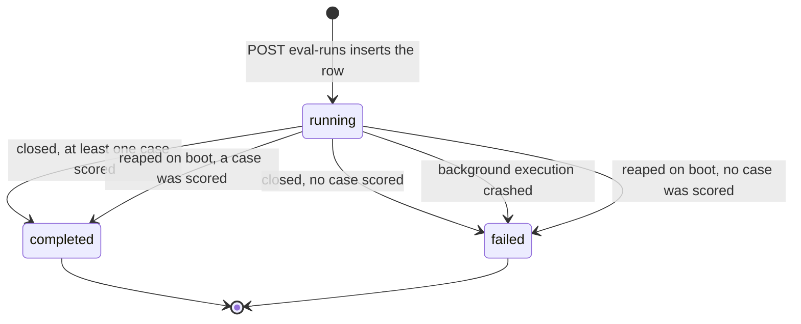

# spec — evals

An eval case freezes one decided finding (its file diff, PR title and
description, and where the finding sat). An eval run re-runs an agent's current
configuration over every one of its cases and scores each result in plain code,
with no second model call. This file is the **contract of the shipped server
behaviour**: the invariants below are what the client, the integration tests and
SPEC-05 / SPEC-06 build on, so changing one is a breaking change, not a
refactor.

It does **not** restate acceptance criteria. Requirements live in the root
specs, which stay the single source of truth:

- [`../../specs/04-eval-pipeline-2026-10-11.md`](../../specs/04-eval-pipeline-2026-10-11.md)
  (SPEC-04, cases from findings, runs, metrics).
- [`../../specs/06-case-editor-2026-10-12.md`](../../specs/06-case-editor-2026-10-12.md)
  (SPEC-06, case revisions and the case editor; only its storage shape ships).

Design history: [`../../docs/plans/2026-10-11-eval-pipeline.md`](../../docs/plans/2026-10-11-eval-pipeline.md).
Code: `src/modules/evals/` (routes → service → repository; pure helpers in
`helpers.ts`, limits in `constants.ts`), `src/domain/evals/scoring.ts` (pure
scoring), `src/db/schema/eval.ts`.

## Naming

The SPEC's "eval run" (one run over all cases of an agent) is the table
`eval_suite_runs`. The older table `eval_runs` holds that run's **per-case
results**, one row per case. The API calls the suite run an "eval run"
(`/agents/:id/eval-runs`, `/eval-runs/:id`) and `EvalRunRecord.eval_run_id`
points at `eval_suite_runs.id`.

## Endpoints

All routes are workspace-scoped (EV13). Source: `src/modules/evals/routes.ts`.

| Method | Path | Success | Notes |
|---|---|---|---|
| POST | `/findings/:id/eval-case` | 201 `{ case, created: true }`; 200 `{ case, created: false }` when the finding already has a case | 404 unknown finding; 422 with an `EvalErrorCode` (EV1) |
| GET | `/agents/:id/eval-cases` | 200 cases at their current revision, each with `latest_result` | 404 unknown agent |
| DELETE | `/eval-cases/:id` | 200 `{ ok: true }` | 404 unknown case; past results stay (EV10) |
| POST | `/agents/:id/eval-runs` | 202 `{ run_id }`; the run continues in the background | 404 unknown agent; 422 `no_eval_cases`; 409 `eval_run_in_progress`; rate-limited to 10 per minute |
| GET | `/agents/:id/eval-runs` | 200 run summaries, newest first | 404 unknown agent |
| GET | `/eval-runs/:id` | 200 one run: summary + `config` + `cases` + `results` | 404 unknown run |

The status of a refusal is decided in `service.ts:81-83`: every
`EvalErrorCode` is 422 except `eval_run_in_progress`, which is 409.

## Invariants

| # | Rule |
|---|---|
| EV1 | A case is created only from a finding that is **accepted or dismissed**, belongs to a review that has an agent, whose agent still exists, and whose file has a stored non-null patch of at most 100 000 characters, with the finding's lines inside a hunk. The lines rule is the engine's own grounding (`groundFindings`), so a whole-file kind needs only the file. Each failure is one closed code: `eval_case_undecided`, `eval_case_no_agent`, `eval_case_agent_missing`, `eval_case_no_diff`, `eval_case_diff_too_large`, `eval_case_lines_outside_diff`. Accepted gives `must_find`, dismissed gives `must_not_flag`. |
| EV2 | One case per agent and finding: `eval_cases_agent_finding_uq` over `(agent_id, source_finding_id)` plus `ON CONFLICT DO NOTHING`. A repeat returns the existing case with `created: false` (HTTP 200), never a second row. |
| EV3 | Case names are unique per set: `eval_cases_owner_name_uq` over `(workspace_id, owner_kind, owner_id, name)`. The name is the finding title as lowercase kebab-case, cut to 60 characters (`finding` when empty). A taken name gets `-2`, `-3`, … within 60 characters in total (the stem is shortened to fit). |
| EV4 | A concurrent clash on the name index is retried: the insert transaction rolls back (nothing written), the service re-reads the set's names and picks again, at most 5 attempts in total. After the fifth the request fails as a server error and no case is written. |
| EV5 | A case's content lives in append-only `eval_case_revisions`; `eval_cases` keeps identity only (owner, name, notes, source finding, provenance). A case from a finding is created with revision 1 in the same transaction as the case. No code updates or deletes a revision (only the FK cascade of a deleted case removes them). A case's current revision is its highest `revision`; `(case_id, revision)` is unique. |
| EV6 | A run records what it covered twice: `eval_suite_runs.cases`, a jsonb list of `{ case_id, revision_id, revision }` that is never nulled, and `case_revision_id` on each per-case result row. |
| EV7 | A run snapshots the agent configuration into `eval_suite_runs.config`: `agent_version`, provider, model, system prompt, strategy and **every** linked skill in `agent_skills.order` ascending, each with both enable flags. A skill `body` is stored, and sent, only when both the link and the skill are enabled; otherwise it is `null`. |
| EV8 | A run sends the engine only the frozen content: the case's stored diff, the stored PR description (capped at 4 000 characters, empty when the PR had none; omitted from the prompt when empty), and a task line built from the stored PR title. No repo-intel, intent or live PR data is passed. The diff and description reach the engine's untrusted slots; the task section is classed `untrusted` by the engine. |
| EV9 | Scoring is code-only (`domain/evals/scoring.ts`, a pure module, so `arch:check` proves it cannot reach a model). A finding matches an expectation when the normalised paths are equal and the inclusive line ranges overlap. `must_find` passes with at least one matching grounded finding; `must_not_flag` passes with none. Run metrics are **pooled** counts over scored cases, never an average of per-case values (see *Scoring*). |
| EV10 | Deleting a case keeps its past results. `eval_runs.case_id` and `case_revision_id` become `NULL` (`ON DELETE SET NULL`); each result row keeps `case_name`, `expectation_type` and `expectation`; the run's metrics are stored on the run row at close; `eval_suite_runs.cases` still names the deleted case and revision. |
| EV11 | Cost `null` means unknown, never `0`. A case's `cost_usd` is the engine's total (itself `null` when any call's cost was unknown), and `null` for an errored case. A run's `cost_usd` is the sum of the known case costs, and `null` when none is known. |
| EV12 | An agent has at most one `running` run: the partial unique index `eval_suite_runs_one_running_uq` over `(agent_id) WHERE status = 'running'`. The insert conflict is the refusal (409 `eval_run_in_progress`), so two parallel starts cannot both pass. |
| EV13 | Every route is workspace-scoped and answers 404 outside the workspace. A finding is reached only through the `reviews` join (the `findings` table has no `workspace_id`); agent, case, run and list reads filter by `workspace_id`. The boot reaper is the one unscoped read, by design. |
| EV14 | Boot reaping: on start, every run left `running` is closed by the same rule as a live close (EV15), with `finished_at` = the time of its last stored case result (its `started_at` when none) and `duration_ms` = `finished_at − started_at`. Downtime is not counted. It assumes a single API instance per database. A failure to reap is logged and never stops boot. |
| EV15 | A run closes `completed` when at least one case was scored and `failed` (`error: "no case was scored"`) when none was. An unexpected crash of the background execution closes it `failed` with the crash message (at most 200 characters). |
| EV16 | An errored case (the engine threw, a model-output error, or the 180 s per-case timeout) is stored with status `errored`, `pass = null`, `error` = the error message only (at most 200 characters, never a stack, prompt or diff text) and null metrics. Errored cases are excluded from scoring and are not counted as passed. |
| EV17 | `GET /pulls/:id/reviews` carries `eval_case_id` on every finding: the id of the case made from it, or `null`. It is resolved with one query per request, scoped by `eval_cases.workspace_id` (see [`review-flow.md`](review-flow.md)). |

## Scoring

Per case (`scoreCase`, `scoring.ts:47-65`), over the **grounded** findings the
engine kept:

| Field | Value |
|---|---|
| `findings_matching` | grounded findings matching the expectation |
| `recall` | `must_find`: 1 when at least one matches, else 0; `must_not_flag`: `null` |
| `precision` | `(grounded − noise) / grounded`, where `noise` is the matches of a `must_not_flag` case; `null` when nothing was grounded |
| `citation_accuracy` | `grounded / returned`, where `returned` = grounded + dropped by grounding; `null` when nothing was returned |

Run aggregate (`aggregateRun`, `scoring.ts:77-112`), over scored (non-errored)
cases:

- `recall` = scored `must_find` cases with a match ÷ scored `must_find` cases
  (`null` when there is none).
- `precision` = (grounded − `must_not_flag` matches) ÷ grounded, summed over all
  scored cases. `citation_accuracy` = grounded ÷ returned, summed likewise.
- `cases_passed` counts rows with status `passed`; `cases_scored` counts the
  non-errored ones.

"expected N, got M" in the UI: N is 1 for `must_find` and 0 for
`must_not_flag`; M is `findings_matching` (`repository.ts:334-335`).

## Run lifecycle

`startRun` (`service.ts:182-229`) reads the agent and its current cases, builds
the snapshot (EV7), inserts the `running` row with the case list (EV6, EV12),
answers 202 and then executes in the background. Cases run with a concurrency of
3, each bounded by a 180 s timeout; the engine call finishes before the result
is written, so no external call happens inside a repository transaction. Each
stored result increments `cases_done` in the same transaction, so `cases_done`
of `cases_total` is the run's progress.

`latest_result` on the case list is read from the latest **completed** run of
the agent (by `started_at`); failed runs never serve as the latest result
(`repository.ts:299-341`).

## Data model

Migrations are drizzle-kit generated (`pnpm db:generate`), never hand-edited.
Schema: `src/db/schema/eval.ts`.

- **`eval_cases`**: `id`, `workspace_id`, `owner_kind` (`agent` | `skill`),
  `owner_id`, `agent_id` (nullable FK → `agents`, cascade), `name`, `notes`,
  `source_finding_id` (no FK: the case outlives the finding), `provenance` jsonb,
  `created_at`. Indexes: `eval_cases_agent_finding_uq`, `eval_cases_owner_name_uq`.
- **`eval_case_revisions`**: `id`, `workspace_id`, `case_id` (FK → cases,
  cascade), `revision`, `input_diff`, `input_files` jsonb, `input_meta` jsonb
  (`pr_title`, `pr_description`), `expectation_type`, `expectation` jsonb
  (`file`, `start_line`, `end_line`), `created_at`. Unique `(case_id, revision)`.
- **`eval_suite_runs`**: `id`, `workspace_id`, `agent_id` (FK, cascade),
  `status` (`running` | `completed` | `failed`), `started_at`, `finished_at`,
  `duration_ms`, `agent_version`, `config` jsonb, `cases` jsonb, `cases_total`,
  `cases_done`, `cases_scored`, `cases_passed`, `recall`, `precision`,
  `citation_accuracy`, `cost_usd`, `error`. Partial unique index
  `eval_suite_runs_one_running_uq`.
- **`eval_runs`** (per-case results): `id`, `workspace_id`, `suite_run_id`
  (FK, cascade), `case_id` and `case_revision_id` (nullable, `SET NULL`),
  `case_name`, `status` (`passed` | `failed` | `errored`), `error`,
  `expectation_type`, `expectation`, `findings_returned`, `findings_grounded`,
  `findings_matching`, `actual_output`, `pass`, `recall`, `precision`,
  `citation_accuracy`, `duration_ms`, `cost_usd`, `ran_at`.
- **Provenance** (`EvalCaseProvenance`): finding, review, PR and repo ids, PR
  number, repo full name, the decision and its time, the producing agent's
  version (`null` when the review's run has no trace), severity, category, title.

### Contracts

The canonical contracts are in `src/vendor/shared/contracts/eval-ci.ts` (the
`AgentEval*`, `EvalRun*`, `EvalCase*`, `EvalErrorCode` section) and
`review-api.ts` (`FindingRecord.eval_case_id`). Both files exist in
`client/src/vendor/shared/contracts/` too. The eval section of `eval-ci.ts` and
all of `review-api.ts` are identical in the two copies today. Outside the eval
section, `eval-ci.ts` has already drifted (the client copy lacks `AgentManifest`
and `CiFailOn`, and its `provider` enum at the end of the file is narrower); do
not "fix" that as part of an eval change. See root `INSIGHTS.md`, 2026-09-19.

## Out of scope here

Editing a case, creating a revision on edit, "edited since last run", compare,
promote, alerts and the dashboard belong to SPEC-05 and SPEC-06. This module
ships the storage shape they need (EV5, EV6, EV10) and nothing of those
features.
