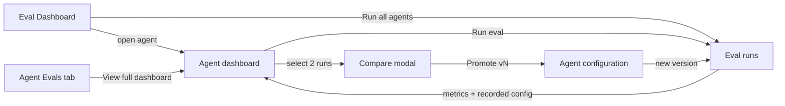

# Spec: Eval Dashboard — trends, run comparison and Promote
Spec ID: SPEC-05-eval-dashboard
Status: implemented
Supersedes: none
Packages: server, client
Depends on: SPEC-04-eval-pipeline

## Problem and user

The people hurt are **agent authors** who look after more than one review agent.
SPEC-04 gives each agent a case set, background eval runs and a run history on
its own Evals tab. That answers "did my last change help this agent?" but not
three questions the author keeps asking:

- *Which of my agents regressed?* Today that means opening every agent's Evals
  tab one by one (design `images/9.png` shows the wanted overview).
- *Is precision sliding slowly from version to version?* Two adjacent runs show
  a jump, not a drift; only a trend over many runs shows it (course brief,
  `images/16.png` › Trend charts).
- *What exactly changed between the run that scored well and the one that
  scored badly, and how do I go back to the good one?* The metrics live in one
  place and the prompt history in another; there is no way to see the prompt
  and skill diff next to the metric deltas, and no one-step way to make a
  good configuration current again (`images/11.png`).

Why it matters: an eval number is only useful if it leads to a decision. Seeing
all agents at once, seeing the trend, being warned when a run got worse, and
being able to compare and promote turns the SPEC-04 numbers into "keep v7" or
"go back to v6's prompt" without guesswork.

This spec covers the Eval Dashboard page, the per-agent dashboard page (trend
chart, alert banner, run table), Compare runs and Promote. The case editor and
the skills' Evals tab are a separate spec (proposed `SPEC-06`, see Non-goals).

## Goals / Non-goals

Goals:

- One page that lists every agent with its latest eval result and a small
  trend — because a regression in any agent must be visible without opening
  each one.
- Start eval runs for all agents in one action — because a shared change (a
  skill edit) affects several agents at once and each must be re-measured.
- A per-agent dashboard with metric cards, a trend chart over a chosen time
  range and the run table — because slow degradation is visible only as a
  trend.
- A deterministic alert when the latest run is worse than the previous one —
  because a regression that nobody looks for is a regression nobody finds; the
  alert costs nothing and needs no model.
- Compare two runs: metric deltas next to the prompt, model and skill
  differences — because the author needs the cause, not only the effect.
- Promote: make the configuration a run used the agent's current configuration,
  skill bodies included — because returning to a measured-good setup must be
  one safe step, not a hand-copy of an old prompt; a restored skill reaches
  every agent that links it, because the user wants a skill to stay one shared
  thing (user answer).

Non-goals:

- **Case editor (manual cases, editing cases, single-case run, Run on save) and
  the skills' Evals tab** — proposed `SPEC-06`, because together with this spec
  they exceed the ~25 acceptance criteria one spec may hold
  (`specs/README.md` › Lifecycle). The rule for comparing runs over different
  case sets (AC19) is written here so SPEC-06 can rely on it.
- The agent editor's Stats and CI tabs, the PreToolUse hook and mutation
  testing — out of scope by user decision (brief).
- Replaying a past configuration without making it current — an eval run always
  uses the agent's current configuration (SPEC-04 Non-goals); Promote is the way
  to run an older configuration again.
- Promoting an older run of the pair ("Promote vA") — the dialog promotes only
  the later run, as in `images/11.png` (user answer); to return to an older
  configuration the user compares that run with one started before it, so it
  becomes the later run.
- Thresholds that block anything (CI gates on eval metrics) — the alert only
  informs; the course brief says "look at the dynamics first, thresholds later"
  (`images/16.png`).
- Any model call for the alert text, the diff or the comparison.
- Re-deciding SPEC-04 semantics: metrics, noise, pooling, errored cases,
  concurrency and rate limits are used as SPEC-04 defines them.
- How pages, routes, contracts, queries or charts are built, and in what order
  — that is for the implementation planner.

## User stories

- US1: As an agent author with several agents, I want one page listing every agent's latest eval result with a small trend and the newest runs of all agents, so that I see at a glance which agent regressed.
- US2: As an agent author, I want to start eval runs for all agents in one action, so that a change shared by several agents is re-measured everywhere at once.
- US3: As an agent author, I want a per-agent dashboard with metric cards, a trend chart over a chosen time range and the run table, so that I see slow drift across versions and not only the last jump.
- US4: As an agent author, I want a deterministic warning when the latest run is worse than the previous one, so that a regression is not missed.
- US5: As an agent author, I want to compare two runs with their metric deltas and their prompt, model and skill differences side by side, so that I know which change caused the difference.
- US6: As an agent author, I want to promote the configuration a run used to be the agent's current configuration, so that I can keep or return to the best-measured setup in one safe step.

## Acceptance criteria (EARS)

- AC1 [US1]: The system shall show an "Eval Dashboard" entry in the sidebar's Skills Lab group, after Conventions, that opens the Eval Dashboard page with the breadcrumb "Skills Lab › Eval Dashboard".
- AC2 [US1]: The system shall list on the Eval Dashboard every agent of the workspace, enabled or not, each with its name, model, "Last run vN · <start date and time> · x/y pass" of its latest completed eval run, a recall sparkline over its completed runs of the last 30 days, and that run's recall, precision and citation accuracy as whole percentages.
- AC3 [US1]: IF an agent has no completed eval run, THEN the system shall show it on the Eval Dashboard with "Never run", or "No eval cases" when its set is empty, and an em dash for each metric.
- AC4 [US1]: The system shall show under "Recent eval runs · all agents" the 20 newest eval runs of the workspace by start time, each with the agent name, start time, agent version, recall, precision, citation accuracy, cases passed "x / y" and, when not completed, its status.
- AC5 [US1, US3]: WHEN the user activates an agent on the Eval Dashboard, a row of "Recent eval runs · all agents", or "View full dashboard →" on an agent's Evals tab, the system shall open that agent's dashboard page with the breadcrumb "Skills Lab › Eval Dashboard › <agent name>" and an "All agents" back link.
- AC6 [US2]: WHEN the user confirms "Run all agents" in a dialog that states how many agents will run, how many cases in total, and which agents are skipped with their reason ("no eval cases" or "eval run already in progress"), the system shall start one eval run for every agent of the workspace that has at least one case and no eval run in progress, each under SPEC-04's per-run rules (AC11–AC17 there), and report how many runs started.
- AC7 [US2]: IF no agent of the workspace has a case, or every agent with cases already has an eval run in progress, THEN the system shall show "Run all agents" disabled with that reason and start nothing.
- AC8 [US3]: The system shall show on the agent dashboard the agent's name and model, an agent switcher listing every agent of the workspace that opens the chosen agent's dashboard with the same time range, a time range selector offering 7 days, 30 days, 90 days and All with 30 days as the default, and a Run eval action that behaves as Run all evals on the Evals tab (SPEC-04 AC11, AC12, AC15).
- AC9 [US3]: The system shall keep the selected time range in the page address and apply it to the trend chart, the card sparklines and "Recent runs" only, reading an unrecognised value as the default, so that reloading or sharing the address opens the same view.
- AC10 [US3]: The system shall show on the agent dashboard one card each for recall, precision and citation accuracy with the latest completed run's value, whatever the selected range, as a whole percentage, its change in points since the previous completed run with a sign and an arrow, and a sparkline of that metric over the completed runs in the selected range.
- AC11 [US3]: The system shall show a metric trend chart with one line each for recall, precision and citation accuracy, one point per completed run started within the selected range in start-time order, where a metric with no value ("—") in a run leaves a gap in its line.
- AC12 [US3]: WHEN the user hovers or keyboard-focuses a point of the trend chart, the system shall show that run's start time, agent version, the three metrics and its cost, with an em dash when the cost is unknown.
- AC13 [US3]: The system shall list in "Recent runs" on the agent dashboard every eval run of the agent started within the selected range, ordered from the newest, with the columns of SPEC-04 AC24 and a selection checkbox on each completed run.
- AC14 [US3]: IF the selected range holds no completed eval run, THEN the system shall show in place of the chart and the table "No eval runs in the last N days" (or "No eval runs yet" for All) with an action that switches the range to All.
- AC15 [US4]: WHEN the agent's latest completed run, whatever the selected range, has recall, precision or citation accuracy at least 1 point lower (in whole percentages) than the previous completed run, the system shall show a warning banner on the agent dashboard naming the metric with the largest drop, the drop in points, the latest run's agent version, that metric's fixed cause sentence (precision: "a new false positive slipped in"; recall: "an expected finding was missed"; citation accuracy: "findings cited lines outside the diff") and whether each other metric went up, down or stayed the same.
- AC16 [US4]: IF the agent has fewer than two completed runs, or no metric with a value in both runs dropped by at least 1 point, THEN the system shall show no alert banner.
- AC17 [US5]: WHILE exactly two completed runs are selected in "Recent runs", the system shall enable Compare, and otherwise show it disabled with the hint "Select exactly 2 runs".
- AC18 [US5]: WHEN the user activates Compare, the system shall open a "Compare runs · vA → vB" dialog, A being the earlier-started run, showing recall, precision and citation accuracy as "old → new" whole percentages with the change in points, and cost as "old → new" in USD with its change, or an em dash and no change when either cost is unknown.
- AC19 [US5]: IF two runs being compared, or the two runs behind the alert banner, did not cover the same cases, THEN the system shall still show each run's own stored metrics and add to the compare dialog and the alert banner the notice "Case sets differ: N added, M removed", counted from the earlier run to the later one.
- AC20 [US5]: The system shall show in the compare dialog a line-by-line diff of the two runs' recorded system prompts, marking removed lines with "−" and added lines with "+" as well as colour, or "System prompt unchanged" when they are equal.
- AC21 [US5]: The system shall list in the compare dialog every difference between the two runs' recorded provider, model, strategy and linked skills — a skill added, removed or at a different version, with a line-by-line diff of its body between the two versions — or "No other configuration changes" when there is none.
- AC22 [US6]: WHEN the user activates "Promote vB", offered only for the later run B, and confirms a dialog that names the agent's current version being replaced, each skill whose body will change with its current and recorded version, every other agent that links such a skill, and each recorded skill that no longer exists as "deleted — left out", the system shall save a new agent version with run B's recorded provider, model, system prompt and strategy and its still-existing recorded skills linked in the recorded order, leaving the agent's name, description, output schema, CI gate, repo-intel setting and enabled state unchanged, and show "Promoted run vB as vN".
- AC23 [US6]: WHEN a promotion is confirmed, the system shall save each recorded skill whose current body differs from its recorded version's body as a new skill version carrying the recorded body and the note "Restored from vK by Promote", keeping every earlier skill version, so that every agent linking that skill uses the restored body from then on.
- AC24 [US6]: IF the agent's current configuration and the current bodies of the recorded skills already equal run B's record, THEN the system shall show "Promote vB" disabled with the hint "This is the current configuration" and create no agent or skill version.
- AC25 [US1, US2, US3, US5, US6]: IF a dashboard, compare or promote request names an agent or run outside the caller's workspace, or two runs of different agents, THEN the system shall answer "not found", change nothing and make no model request.

## Edge cases

- EC1: A workspace with no agents — the Eval Dashboard shows an empty state and "Run all agents" disabled (covered by AC2, AC7).
- EC2: A disabled agent with cases — listed on the dashboard and included in "Run all agents" (covered by AC2, AC6).
- EC3: "Run all agents" while one agent's run is in progress — that agent is skipped and named in the confirmation (covered by AC6).
- EC4: "Run all agents" pressed twice quickly — the second press finds every run in progress and starts nothing (covered by AC6, AC7).
- EC5: An agent is deleted — its runs disappear from "Recent eval runs · all agents" because SPEC-04 deletes them with the agent (covered by AC4; SPEC-04 AC10).
- EC6: The agent dashboard address names a deleted agent or an agent of another workspace — "not found" state with a link back to the Eval Dashboard (covered by AC25).
- EC7: The selected range holds runs, but all of them failed — no point on the chart, the failed runs are still in the table, and the empty message shows in place of the chart (covered by AC11, AC13, AC14).
- EC8: Only one completed run — cards show values without a change, no alert, the chart shows one point (covered by AC10, AC11, AC16).
- EC9: A set with only `must_not_flag` cases — recall is "—" in every run, its line has no points and it never triggers the alert (covered by AC11, AC16).
- EC10: Two runs with the same agent version (a skill was linked in between, which does not bump the version) — the dialog reads "v7 → v7" and the skills difference shows why (covered by AC18, AC21).
- EC11: v6 ran 18 cases and v7 ran 20 after two were added — each run's own metrics, plus "Case sets differ: 2 added, 0 removed" in the dialog and the banner (covered by AC19).
- EC12: A run is still in progress — no checkbox, no chart point, its row shows progress status (covered by AC13, AC17).
- EC13: The user selects runs in newest-then-oldest order — the dialog still reads earlier → later (covered by AC18).
- EC14: The agent's prompt was edited after run B — Promote is allowed and the confirmation names the current version that will be replaced (covered by AC22).
- EC15: Promote pressed twice — after the first, the configuration equals run B's, so the second is disabled (covered by AC24).
- EC16: A skill recorded with run B was deleted since — named "deleted — left out", the rest is promoted (covered by AC22).
- EC17: Promote while an eval run of the agent is in progress — the in-progress run keeps the configuration recorded at its start (covered by AC22; SPEC-04 AC14).
- EC18: Precision drops 2 points while recall and citation rise — banner "Precision dipped 2pts on v7 — a new false positive slipped in. Recall and citation both up." (covered by AC15).
- EC19: A metric is "—" in one of the two runs — it is left out of the alert (covered by AC16).
- EC20: A hand-edited address with `range=banana` — the default 30 days is shown (covered by AC9).
- EC21: A recorded system prompt contains HTML or markdown — it is shown as plain text in the diff (covered by AC20).
- EC22: Compare of two runs of different agents forged in a request — "not found" (covered by AC25).
- EC23: A skill restored by Promote is also linked to Performance Reviewer — the confirmation names Performance Reviewer, and its next review and eval run use the restored body (covered by AC22, AC23).
- EC24: Only a skill body differs from run B's record while the agent's own configuration is unchanged — Promote is enabled and saves the skill version and a new agent version (covered by AC22, AC23, AC24).

## Non-functional requirements

- **Model calls.** Nothing in this spec makes a model request: the alert is built from fixed sentences and the two runs' stored numbers (AC15), and comparison, diff and Promote use only stored records (AC18–AC24). Model calls happen only inside the eval runs that "Run all agents" and Run eval start, as SPEC-04 defines.
- **Concurrency and rate.** Each run started by "Run all agents" follows SPEC-04: at most one run per agent and at most 3 cases of one run at a time. All runs start at once, so N agents may make up to 3 × N model calls at a time (user answer); provider rate limits are left to the existing transport retries. A "Run all agents" request counts once against the existing limit of 10 run starts per minute (SPEC-04 › Non-functional requirements).
- **Sizes.** "Recent eval runs · all agents" shows 20 runs (AC4). The trend chart shows at most the 200 newest completed runs of the range; beyond that the oldest are left out and the chart says "Showing the newest 200 runs".
- **Latency.** The Eval Dashboard and an agent dashboard answer within 1 second for a workspace of 20 agents and 2,000 eval runs on the local stack.
- **Freshness.** While any run shown on a page is in progress, its status and the lists refresh without a page reload at least every 5 seconds, as SPEC-04 AC15 does for the Evals tab.
- **Metric display.** Percentages are whole numbers; changes are in points with a sign ("+4 pt", "−2 pt"), matching SPEC-04 AC23 and design `images/11.png`; cost goes through the existing USD formatting, where unknown is an em dash and free is "$0" (`client/specs/pages.md` › Presentation invariants 1).
- **Tenancy.** Every request is scoped to the caller's workspace; Compare and Promote additionally require both runs to belong to the named agent (AC25).
- **History.** Promote appends an agent version and, for each restored skill, a skill version; it never rewrites or deletes one, like skill restore (`server/specs/skills.md` S5). A restored skill body is in force for every agent that links the skill (AC23).
- **Atomicity.** A promotion either saves the new agent version and every restored skill version, or none of them, so an agent is never left half-promoted.
- **Contract reach.** The dashboard aggregate contract exists in both `vendor/shared` copies and is identical there today, but its trend point has no agent version and its recent runs are per-case rows; those facts change in both copies together. The run record of SPEC-04 must hold the order of the recorded skills for Promote to restore it (AC22). The client copy still lacks the agent-version contract (SPEC-04 › Non-functional requirements).
- **Accessibility.** Chart lines are told apart by the legend and the tooltip text, not by colour alone; every change shows a sign and an arrow besides colour; diff lines carry "−"/"+"; checkboxes, the range selector, the agent switcher and chart points are reachable by keyboard.
- **i18n.** Every label comes from the `eval` message namespace (`client/messages/en/eval.json`), which already holds dashboard keys, and the sidebar label from `shell.nav.eval` (`client/messages/en/shell.json:26`); English only.

## Inputs and provenance

| fact | source | date |
|---|---|---|
| Cases, background runs per agent, recorded configuration (version, provider, model, prompt, strategy, linked skills with versions, case ids), pooled metrics, errored cases excluded, cost unknown vs 0, Evals tab history and deltas in points | `specs/04-eval-pipeline-2026-10-11.md` AC11–AC24, Non-functional requirements | 2026-10-11 |
| Deleting an agent deletes its cases and eval runs | `specs/04-eval-pipeline-2026-10-11.md` AC10 | 2026-10-11 |
| Dashboard, compare/promote, trend, alert, "Run all agents" were deferred to this spec | `specs/04-eval-pipeline-2026-10-11.md` › Non-goals | 2026-10-11 |
| `EvalDashboard` and `EvalTrendPoint` exist (current, delta, trend, recent runs, alert text); a trend point has no agent version; recent runs are per-case records | `server/src/vendor/shared/contracts/eval-ci.ts:56-89` | 2026-10-11 |
| The eval section of `eval-ci.ts` is identical in both copies; the copies differ only in `AgentManifest` and a provider enum | `git diff --no-index` of the two `eval-ci.ts` files | 2026-10-11 |
| An agent config change bumps the version and snapshots provider, model, prompt, output schema, strategy, CI gate, repo-intel and linked skill ids; linking skills alone does not bump it; versions are append-only snapshots | `server/src/modules/agents/repository.ts:133-188`, `server/src/modules/agents/repository.ts:280-293` | 2026-10-11 |
| Version history is readable per agent | `server/src/modules/agents/routes.ts:126-142` | 2026-10-11 |
| Skill bodies are kept per version; restore is a normal save that appends a version | `server/src/db/schema/skills.ts:23-35`, `server/specs/skills.md` S4–S5 | 2026-10-11 |
| Run starts are limited to 10 per minute on the review route | `server/src/modules/reviews/routes.ts:30` | 2026-10-11 |
| The sidebar has no Eval Dashboard entry yet; Skills Lab holds Skills, Agents, Conventions; the label `shell.nav.eval` = "Eval Dashboard" is already in the catalogue | `client/src/vendor/ui/nav.ts:34-36`, `client/messages/en/shell.json:26`, `client/specs/pages.md` › Screens deliberately absent | 2026-10-11 |
| `nav.ts` may be edited by a plan task that owns it | root `CLAUDE.md` › Do-not-touch, `client/INSIGHTS.md` 2026-09-22 | 2026-10-11 |
| The UI kit already has `Sparkline`, `LineChart` and `MetricCard` | `client/src/vendor/ui/charts/` | 2026-10-11 |
| The `eval` namespace already holds dashboard, legend and table keys | `client/messages/en/eval.json:2-32` | 2026-10-11 |
| URL params are shareable state; an unrecognised value reads as the default | `client/specs/pages.md` › URL state contract | 2026-10-11 |
| Target: Eval Dashboard with agent rows (model, last run, sparkline, three metrics), "Run all agents", "Recent eval runs · all agents" | design `images/9.png` | 2026-10-11 |
| Target: agent dashboard with switcher, "30 days", Run eval, alert "Precision dipped 2pts on v7 — a new false positive slipped in. Recall and citation both up.", cards with sparkline and delta, metric trend, runs table with checkboxes and Compare | design `images/10.png` | 2026-10-11 |
| Target: compare dialog "v6 → v7" with old → new metrics, cost, system prompt diff, Close and Promote v7 | design `images/11.png` | 2026-10-11 |
| Target: Evals tab link "View full dashboard →" | design `images/12.png` | 2026-10-11 |
| Trend chart: recall / precision / citation over all runs; point = run; tooltip = prompt version and cost; "dynamics first, thresholds later" | design `images/16.png` (course brief) | 2026-10-11 |
| In scope: Eval Dashboard, agent dashboard with trend and alert, Compare with skills diff, Promote; case editor and skills Evals tab too, split if over ~25 AC; out of scope: Stats and CI tabs, PreToolUse hook, mutation testing | user answer (brief) | 2026-10-11 |
| Promote restores each recorded skill's body as a new skill version so every linked agent gets it; the confirmation lists the other agents affected; skills relinked in recorded order; deleted skills named and left out | user answer (OQ1 = B) | 2026-10-12 |
| Runs over different case sets keep their own metrics, with "Case sets differ: N added, M removed" in the compare dialog and the alert | user answer (OQ2 = A) | 2026-10-12 |
| "Run all agents" starts all runs at once, each with at most 3 cases in parallel | user answer (OQ3 = A) | 2026-10-12 |
| The alert fires on any drop of 1 point or more | user answer (OQ4 = A) | 2026-10-12 |
| Accepted as written: Promote only for the later run; unrecorded agent fields unchanged; range 7/30/90/All, default 30, in the address, cards and alert independent of range; all agents listed and run, enabled or not; recall sparkline over 30 days; 20 recent runs, chart capped at 200; only completed runs selectable, dialog earlier → later | user answer (OQ5–OQ11 accepted) | 2026-10-12 |

## Untrusted inputs

| input | handling | AC |
|---|---|---|
| Recorded system prompts and skill bodies (user text, possibly copied from untrusted sources) | shown only as plain text inside the diff, never rendered as HTML or markdown | AC20, AC21 |
| Agent and run ids in dashboard, compare and promote requests | must belong to the caller's workspace and, for compare and promote, to the same agent; otherwise "not found" and nothing changes | AC25 |
| Time range in the page address (hand-edited link) | only the listed values are accepted; anything else reads as the default | AC9 |
| Promote request (changes the agent's live configuration and shared skill bodies) | needs an explicit confirmation naming the version being replaced, the skills whose body changes and every other agent affected; refused when nothing would change; history is appended, never rewritten | AC22, AC23, AC24 |
| Repeated "Run all agents" requests (cost exposure) | one run per agent, agents with a run in progress skipped, counted against the run-start rate limit | AC6, AC7 |
| Agent names and model names shown on the dashboards | rendered as plain text | AC2 |

## Open questions

none
